# Motiff Lab UX Concept

Oct 31, 2026 · @Andrei

The score becomes the whole screen. Phrases, ink and notes live on the page as they do on paper; playback, the piano roll and analysis are pulled up from a selected phrase and put away with a swipe. The intent questionnaire, the permanent side panel and the always-on piano roll go away. This tab covers the interaction model and information architecture at wireframe level; the Design system tab carries colour, type, components and the same screens rendered in the new identity.

## Today: what exists and what gets in the way

The current build (main after PR #170, 32 screens, iPad 11″) already does a lot: three import routes (MIDI/MusicXML, photo/PDF via homr, audio/video via Transkun) with per-measure confidence reports, auto-detected phrases with manual adjustment, loop and tempo practice, hand and melody isolation, stylus ink, analytical facts with evidence, experiments that produce variations, a build-your-own-variation tool, sessions and saved ideas. None of that is lost in this concept; the full mapping is in “Where every current feature goes” below.

What gets in the way is how it is laid out. In the default “Both” view the score gets about 30% of the screen; two header rows, the phrase strip, the pencil row, a caption, the piano-roll header, the roll, the transport and the right panel take the rest. On a transcription one system is visible.

1. **Three overlapping mode systems.** View tabs (Score / Piano roll / Both / Focus), Listen (Original / Variation / Alternate) and Score variant (built from notes / with variation) all sit in the header, and Focus mode repeats them in its own header. The header wraps to two lines even in landscape.
2. **The phrase is the unit of work but does not live on the score.** Phrases are chips in a strip above the page; selection is made by dragging on the piano roll. The score is not the selection surface.
3. **Everything is visible at once.** View tabs, two dropdowns, phrase strip, phrase-setup link, pencil, colour-by radios, zoom, a four-tab panel and a six-control transport are all on screen before the user has done anything. The app also explains itself in prose (captions under the score, help text in the panel) instead of being self-evident.
4. **The project page is a questionnaire.** “What do you want to do?” stands between the user and the score, and sessions are exposed as objects to manage (Continue / End session).
5. **Pencil is a toolbar mode** disconnected from measures and phrases. There are no anchored text notes, no highlights, no brackets, no fingering.
6. **The piano roll is a permanent half of the screen** with its own legend and radio buttons, even when nothing is selected.
7. **Portrait breaks the panel.** It drops below the roll and its tabs need scrolling.
8. Smaller: mixed Russian and English strings, an unstyled Not Found page, a stale privacy notice.

## The concept in one picture

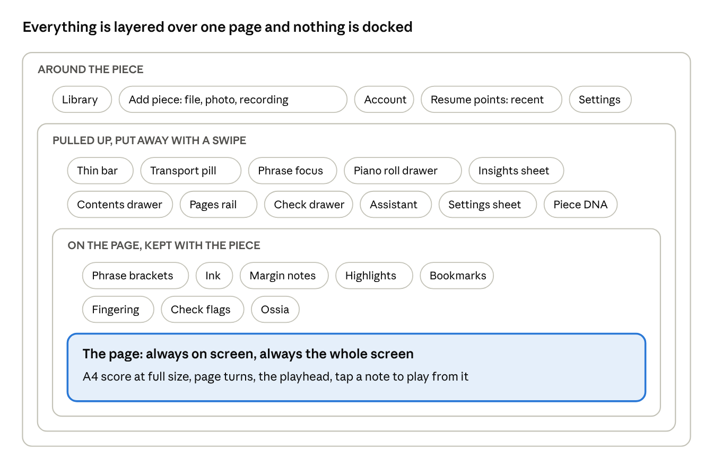

Read from the inside out: the page is the only permanent thing; marks on it are kept with the piece; everything else is pulled up from a selection or the bar and put away with a swipe; the library sits outside the piece and is visited only to switch or add one.

## Navigation model

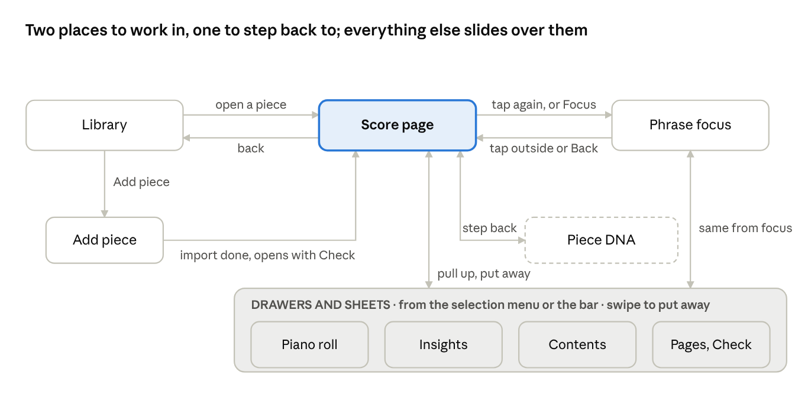

There are two places to be while working on a piece, the page and a focused phrase, and one place to step back to, Piece DNA, which sits outside the practice loop. Everything else is an overlay that slides over whichever of the two is active and leaves it exactly as it was. No overlay can open another place; the page and the phrase are always one gesture away, and Piece DNA returns to the score exactly as it was left. The current four view tabs, the project page and the “Open another piece” link all collapse into this map.

The page is not a discrete screen: the whole piece is one continuously scrolling document in which pages are laid out one after another (two per row in landscape). Moving through it is scrolling, not page jumping, so a phrase that continues on the next page is followed without a break; page steps and the Pages rail are shortcuts within the same scroll.

## The score page, default mode

A piece opens on its page, at the position of the last resume point, with nothing else on screen. This is the fundamental working mode the brief asks for, and every other state is reached from it and returns to it.

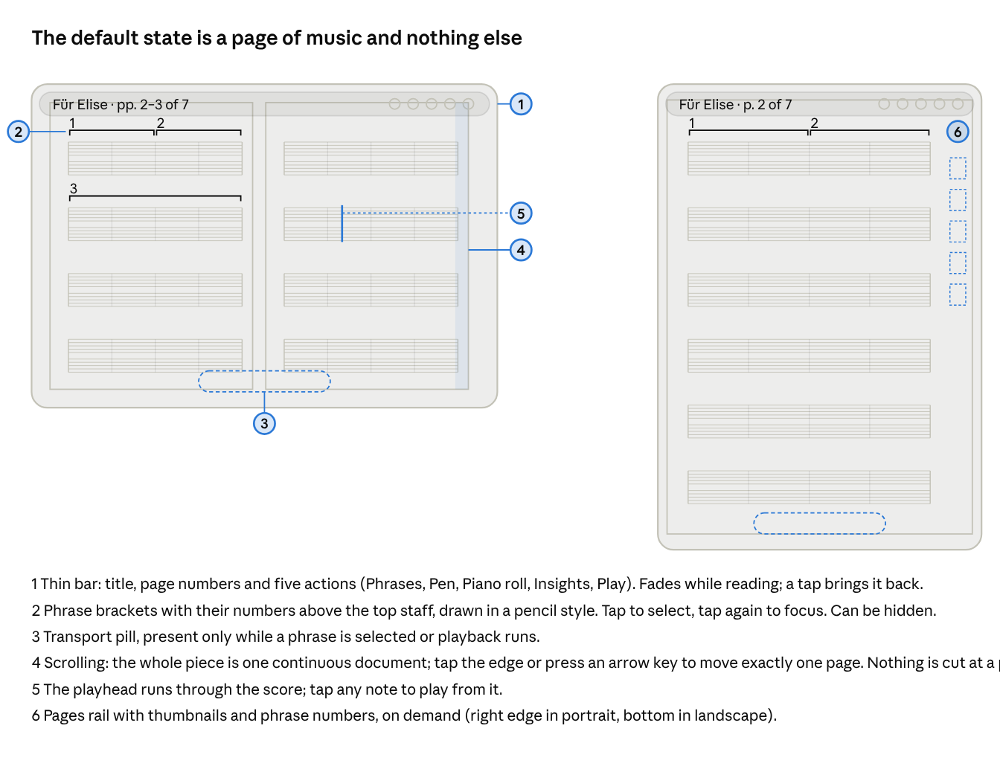

- **One scrolling document, laid out as pages.** The score is a single continuous document that scrolls vertically, like a long sheet on a stand, so a phrase that runs across a page boundary is never cut and never needs a page jump to follow. Pages remain the layout unit: A4 proportions, page numbers, the same bar-to-page map as a printed edition. Portrait shows one column of pages at about 97% of the width; landscape shows two pages per row, fitted to height, like an open book. Pinch zooms; a double tap returns to fit.
- **Navigation.** Swipe or drag to scroll freely; tap the top or bottom edge, or press the arrow keys, to move by exactly one page (a snap option aligns pages to the screen for those who prefer a stand-like turn). A long swipe up opens the Pages rail with thumbnails and phrase numbers; tapping a thumbnail scrolls there. “Go to bar” lives in the Pages rail for people who think in bar numbers. The bar shows the page under the top of the screen (“p. 2 of 4”) and updates as you scroll.
- **What is always visible.** The page and, when they are not hidden, the marks on it: phrase brackets, ink, margin-note markers, highlights, bookmarks and Check flags.
- **What appears on demand.** The bar (title, page count, five actions) fades about two seconds after the last touch and returns on any tap outside the music. The transport pill appears when a phrase is selected or playback runs.
- **Direct manipulation on the page.** Tap a note to play from it; tap a bracket to select its phrase; drag across bars to select freely; long-press a bar for the contextual menu; draw with the stylus, or with a finger when Pen is on, to ink.

## Selecting phrases

The score is the selection surface. Detected phrases are drawn on it as pencil brackets above the top staff, numbered at their left end, and a free selection is made by dragging across bars, the way a teacher boxes a passage in pencil. The phrase strip and roll-based selection of the current build go away.

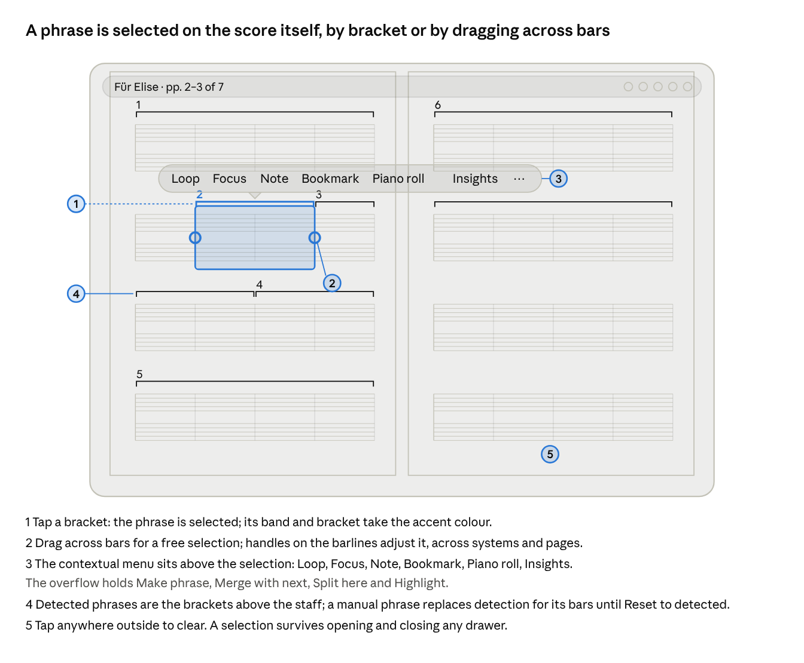

- **Detection stays automatic.** Phrases are detected once, as a hierarchy (motifs inside phrases inside sentences), and shown at once at the granularity the user has chosen; there is no review step and no list of phrases to read through. The user can adjust a bracket by dragging its handles, merge two, split one, or make a selection into a phrase; manual edits stick to the piece at that level until Reset to detected.
- **Granularity is the user’s choice.** The Phrases action in the bar offers three levels: *Short* (motifs and half-phrases of 1–4 bars, easy to loop and practise, for beginners), *Phrases* (4–8 bars, the default) and *Sentences* (whole musical sentences and periods of 8–16 or more bars, for advanced players who think in larger spans). Changing the level redraws and renumbers the brackets in place; the current selection maps to the enclosing or the contained span, so position is never lost. A piece is never shown as dozens of equal brackets: at Sentences Für Elise has four or five, at Phrases about sixteen, at Short around forty. The level is remembered per piece, and the Pages rail shows the count for the current level.
- **One menu for everything contextual.** The menu appears above whatever is selected and holds the six actions a musician takes on a passage. It never shows items that do not apply (no Insights for a single note, no Split for a one-bar selection).
- **Selection is sticky.** Opening the piano roll, the Insights sheet or the Contents drawer leaves the selection in place; so does scrolling away, so a phrase can be compared with another part of the piece and returned to.

## Phrase focus

Focus is a reading lamp on one phrase, not a different screen. The phrase is enlarged to the full width; the page it came from stays visible and dimmed behind it, so the musician always knows where they are in the piece.

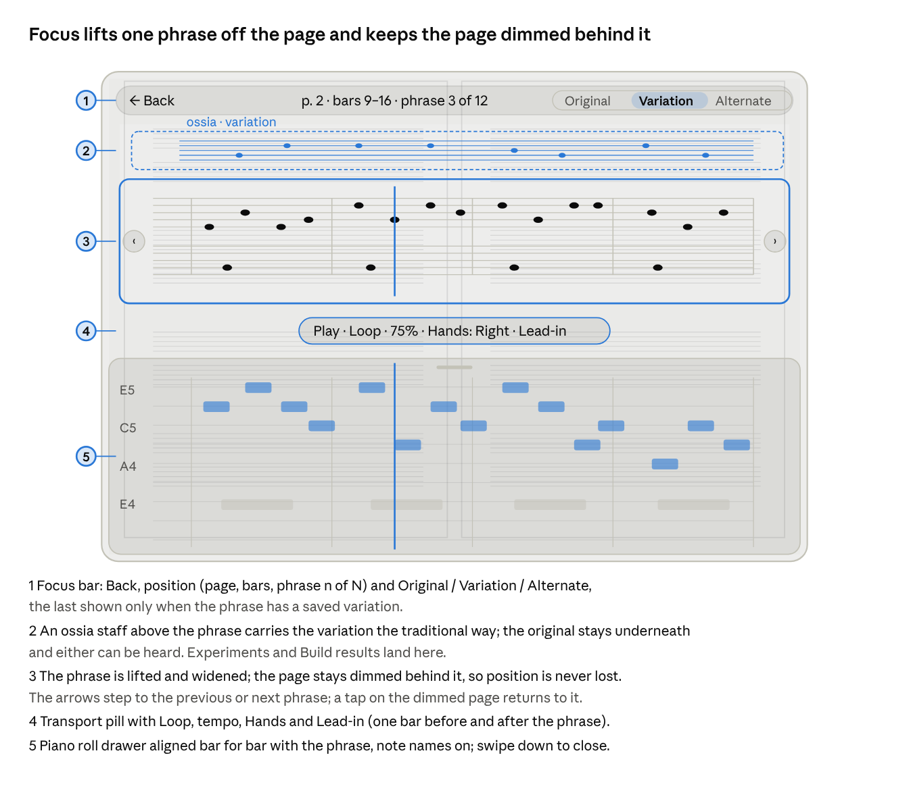

- **Entering and leaving.** Second tap on a selected bracket, Focus in the contextual menu, or a pinch-out on a selection. Leave with Back, a tap on the dimmed page, or a pinch-in. The transition animates the phrase from its place on the page and back, which is what makes it feel reversible.
- **Walking the piece.** Previous / next step phrase by phrase; the breadcrumb updates and the dimmed document scrolls behind the card when the next phrase is further down.
- **Variations.** When a phrase has a variation, it appears as an ossia above the original, the notation musicians already know for “alternatively, play this”. A phrase can hold any number of saved variations: a row of chips above the ossia names them (“Dotted”, “More air”, “My version 2”) and picks the one shown; a long-press on a chip renames or deletes it; dragging a second chip onto the ossia shows two staves for side-by-side comparison. The segmented control chooses what is heard; Alternate plays the original and then the chosen variation, as today. The plum dot on the bracket carries the count.
- **Transcriptions: Reading and As played, side by side.** A piece imported from a recording opens in Reading notation (quantised, clean), which is what one learns from. The nuances of the performance are never far: in focus a *Reading | As played* control sits beside Original / Variation, and switching redraws the phrase card in place, with timing to the thirty-second, dynamics, accents, rit. and accel., slurs and pedal as the current build already engraves them. Better still, *As played* can be shown as the ossia above the Reading staff, so the clean version and the performed version are read together, bar for bar, and heard with Alternate. The piano roll follows the same switch, showing attacks against the grid. The last choice is remembered for the session and the piece default (Reading) is in the Notation item of the overflow.
- **Tools in context.** The piano roll drawer and the Insights sheet open from the focus bar or the pill and sit under or beside the card; the card never shrinks below readable size. In portrait a long phrase wraps to two systems inside the card.

## Bookmarks: a personal table of contents

A bookmark is a passage the musician has named and filed: “Opening theme”, “The leap, bars 23–24”, “Coda — memorise”. Together the bookmarks are the piece’s Contents: a table of contents written by the player rather than by the engine. Detected phrases say how the music is built; bookmarks say what matters to this musician. They live on the score as marks and in a drawer as a list, and once a piece is known they are the fastest way to move around it.

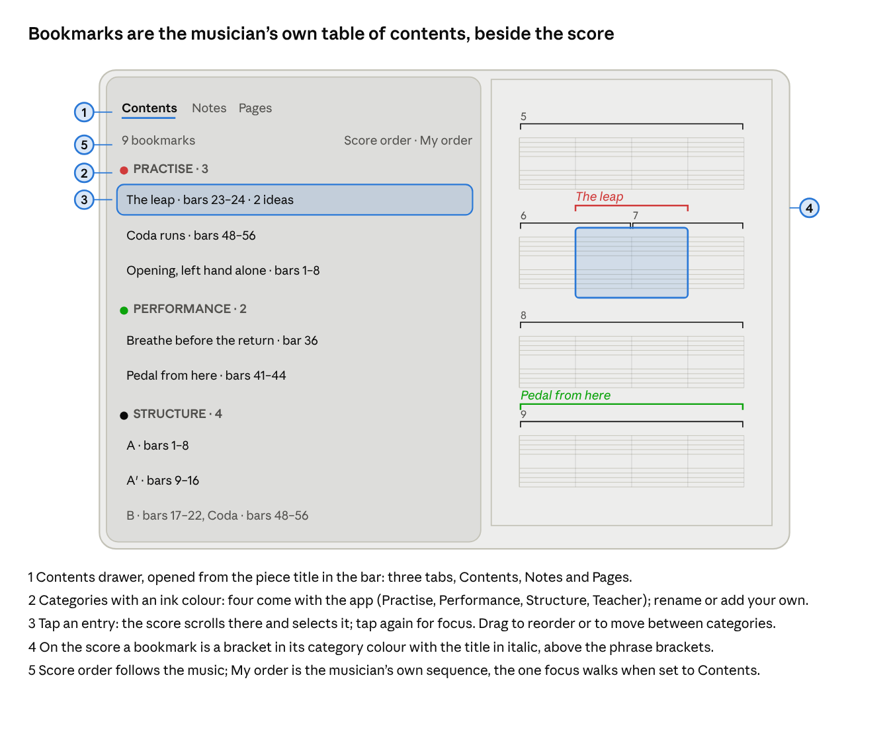

- **Making one.** Select a phrase or any run of bars and choose Bookmark in the contextual menu (or press B). A small card appears above the selection with a title field, pre-filled with the bar range (and the phrase number when the selection is a detected phrase), a row of category chips and Done. Two taps make a bookmark; typing a title is optional and can be done later from the drawer. Bookmarks may overlap and may span any number of bars. A bookmark made from a detected phrase follows that phrase if it is later merged or split. This replaces the Tag mark of the annotation set: a tag was a word over a bracket, and a bookmark is that word with a category and a place in the contents.
- **Categories.** Four come with the app: Practise (carmine), Performance (forest), Structure (graphite) and Teacher (ochre). The musician can rename them, add their own and give each one of the four ink colours. A category is also a filter in the drawer and a layer on the score.
- **On the score.** A bookmark is a bracket in its category colour drawn above the phrase brackets, with its title in italic at the left end. Overlapping bookmarks stack. The Bookmarks layer can be hidden from the Pen menu for a clean page.
- **The Contents drawer.** Opens from the piece title in the bar (the way a reader opens a book at its contents), from the overflow, or with a swipe in from the left edge. It has three tabs: Contents (bookmarks), Notes (ink, margin notes, highlights) and Pages (thumbnails with phrase numbers and bookmark ticks). Contents lists bookmarks grouped by category, each with its title, bar range and the number of ideas saved for it. A switch in the header sorts by score order or by the musician’s own order; entries drag to reorder or to move between categories; a long-press folds a category. Tapping an entry scrolls the score there and selects it; tapping again enters focus. Search covers titles and categories.
- **Walking the contents.** In phrase focus the previous / next arrows walk detected phrases; a Contents toggle in the focus bar makes them walk bookmarks instead, in the drawer’s order, so a practice session can run as a playlist: the Practise category, slow, one entry after another, with Loop on. The breadcrumb then reads “The leap · 2 of 3 in Practise”.
- **Structure for free.** The detected form of the piece (A, A′, B, Coda, from the structure analysis the current build already has) can be added as Structure bookmarks with one tap in the drawer’s empty state; the musician keeps, renames or deletes them like any other.
- **Kept with the piece.** Bookmarks belong to the piece, not to a session: every resume point sees the same contents, they travel in the exported project file, and they survive a re-import of the score. The card in the library shows their count.

## Annotations

Marks are made on the page, never in a separate note-taking screen. Any iPad is supported. With a stylus, the stylus always draws and the finger never does, so there is no mode to enter or leave. Without one, the Pen action in the bar turns drawing on: one finger draws, two fingers scroll and pinch, and a tap on Pen (or on the page with two fingers) turns it off again; the bar shows the pen as active so it is never a mystery why the page is not scrolling. Every mark is anchored to a bar or a phrase, so it survives zoom, reflow and page turns and can be found again in the Notes tab of the Contents drawer.

| Mark | On paper | How you make it | How it shows | Found again in |
| --- | --- | --- | --- | --- |
| Ink | Pencil scribbles, circled notes | Draw with the stylus, or turn on Pen in the bar and draw with a finger. A small palette (3 colours, highlighter, eraser) appears when the stylus first touches the page or when Pen is turned on. Two-finger tap undoes; with Pen on, two fingers scroll. | Vector strokes anchored to the bars under them | Contents drawer, Notes tab, as “ink, bars 9–12” |
| Margin note | A remark written in the margin | Long-press a bar or a phrase bracket, choose Note, type or dictate | A small numbered marker in the margin with the first words; tap opens the note as a popover beside the bar | Contents drawer, Notes tab, searchable |
| Highlight | Highlighter over a passage | Select bars, choose Highlight and a colour; or the highlighter in the stylus palette | A translucent band behind the staves | Contents drawer, Notes tab, filter by colour |
| Bookmark | A titled section in a personal table of contents, with a word over a bracket: “difficult”, “coda” | Select bars, choose Bookmark, give it a title and a category (Practise, Performance, Structure, Teacher, or your own) | A bracket in the category’s ink colour above the phrase brackets, with the title in italic at its left end | Contents drawer, grouped by category (see Bookmarks) |
| Fingering | Digits over noteheads | Tap a notehead with the stylus, or with a finger while Pen is on; a 1–5 pad appears under the finger. Handwritten digits are recognised too. | Small digits above the noteheads in the ink colour | Part of the score, not listed |

The Pen menu also holds layers: Ink, Notes, Bookmarks, Analysis, Check and, for transcriptions, Performance (the performed dynamics, pedal and timing shown as light marks over the Reading notation, so nuances are visible without switching) can each be hidden, and “Hide all marks” gives a clean page for reading. Marks belong to the piece, not to a session, so they are there whichever session is resumed.

## Piano roll as a drawer

The piano roll is a drawer that slides up from the bottom when asked for and never a view of its own. The “Piano roll only” and “Both” views are dropped.

- **Opens** from the contextual menu on a selection, from the Piano roll action in the bar, or from the focus bar. It takes about 40% of the height in landscape and 30% in portrait; the score shifts so the selected phrase stays in view above it.
- **Shows** the selected phrase, or the system under the playhead when nothing is selected, with bars aligned to the score above at the same horizontal scale. Note names are on by default; colour is by hand (right / left). Colour by voice or track and the zoom controls move into the drawer’s own small overflow menu.
- **Synchronised both ways**: tap a note to hear it; drag across notes to select them and the same bars are selected in the score; the playhead runs through both.
- **Leaves** with a swipe down or a tap on its handle. Selection, position and focus state are untouched. The drawer remembers its height and can be dragged up to about 70% for close inspection, never to full screen.
- For transcriptions the inferred hands keep the dashed outline and the “L? / R?” labels of the current build, and a tap on a label reassigns the hand.

## Insights: one stream from hearing to trying

The four panel tabs of the current build become one continuous stream in one sheet, asked for from a phrase and never present otherwise. There are no modes: understanding, trying and keeping are three verbs on the same fact, in the same place, while the loop keeps playing. A fact about the phrase carries the experiments that change exactly what it describes; one tap on an experiment sounds the variation as the ossia; Keep files it as an idea; Adjust opens the keep / change / operation controls inline. The content of the current Understand, Explore and Build tabs is all still there, but it is one list, read top to bottom, and it points back at the score instead of describing it.

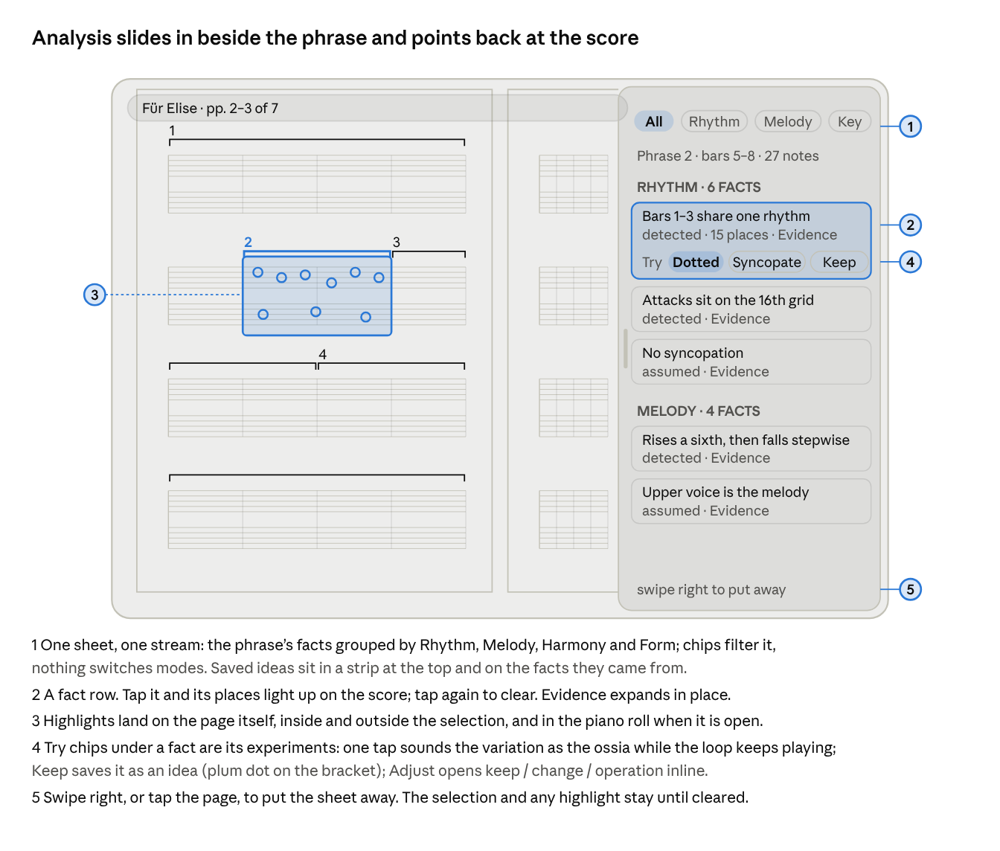

- **The stream.** For the selected phrase, one scrolling list of facts, written as short claims and grouped by Rhythm, Melody, Harmony and Form; filter chips at the top narrow it, nothing switches it. Each fact row has: the claim; its places (tap to ring them on the score); Evidence (folds open in place); a row of *Try* chips; and, once something was kept, the idea chips that came from it. Saved ideas are also gathered in a strip at the very top and as plum dots on the brackets.
- **Try chips are the experiments.** They are derived from the fact, so they always make sense: a rhythm fact offers Dotted, Syncopate, Half-time; a contour fact offers Invert, More air, Ornament; a harmony fact offers Reharmonise, Pedal bass. Tapping one sounds the variation at once as the ossia above the phrase and puts the Original / Variation / Alternate control in the focus bar; the loop does not stop, so hearing, comparing and deciding happen in the same breath. *Keep* saves it with the fact that produced it. *Adjust* opens the current Build flow (keep / change / operation) inline, pre-filled with that experiment, for people who want to steer it; closing it keeps the result in place. Surprise me is a shuffle button in the sheet header; I have a question is the input at the bottom of the stream, and its answer is added to the stream as a new fact.
- **Continuity.** The stream re-targets as the selection moves or as playback enters a new phrase (a pin keeps it where it is); selection, loop, tempo and hands never change because the sheet opened; the sheet can stay open across phrases, and tapping the page puts it away without stopping sound.
- **Insights strip in focus.** Below the lifted phrase a single line shows the three strongest facts as chips, so the most useful knowledge is present during practice without any sheet; tapping a chip opens the stream at that fact with its Try chips ready.
- **Opens** from Insights in the contextual menu, from the bar, or from the focus bar, scrolled to the fact that was last active for this phrase.
- **Check** is not part of the stream; it is a drawer of its own, since it concerns the import rather than a phrase.

## AI Assistant: a companion that knows what you are doing

The assistant is not a chatbot beside the app; it is the last voice in the Insights stream. It is asked from a phrase or from the whole piece, it sees what the musician has been doing, and it answers with things the app can do. It lives in the same sheet as the facts and the tries, so understanding, trying and asking are one movement.

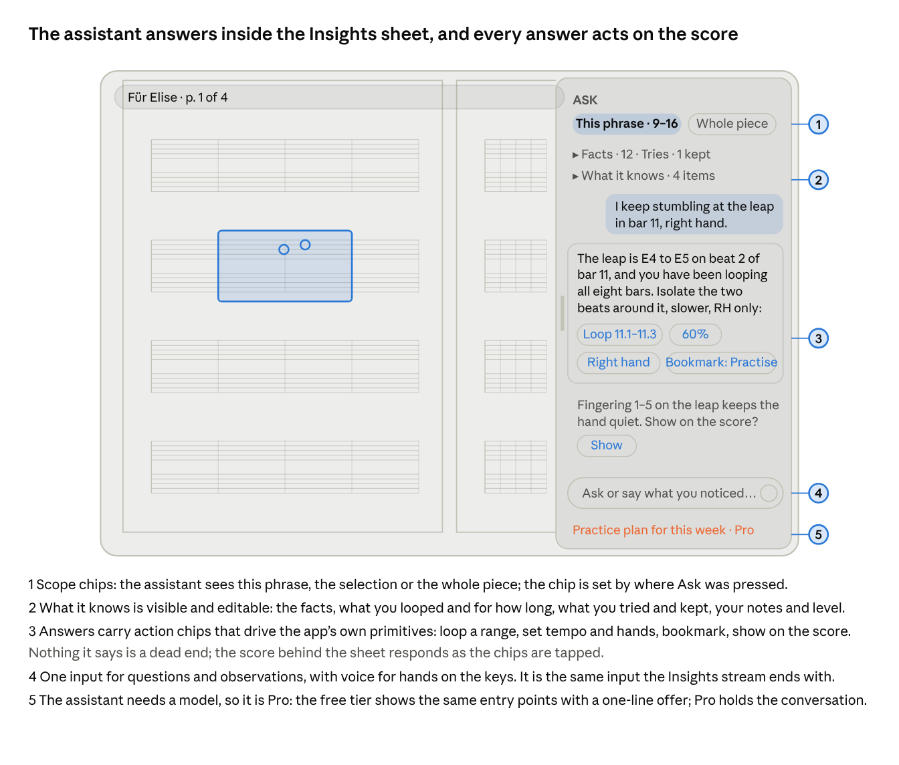

- **Where it is asked.** *Ask* in the contextual menu (scope: this phrase or selection), in the focus bar (this phrase), in the bar’s overflow (whole piece), and the input that closes the Insights stream (whatever is selected). Keyboard: ?. A press on the mic in the input lets the musician speak with hands on the keys. Nothing pops up on its own; at most a quiet “Ask?” hint appears in the Insights strip when something notable has happened (the same four bars looped twenty times, a tempo that has not moved in a week), and only at the guidance level that allows hints.
- **What it knows, shown openly.** A fold at the top of the conversation lists the context it is given: the piece and its facts; the current phrase, selection or bookmark; recent activity (what was looped, at what tempo, for how long; what was tried and kept; notes and bookmarks written; Check flags left open); the musician’s level and settings; and the observation just typed. Any item can be removed before asking. The fold is the honesty of the feature: the musician can see why an answer is specific.
- **Answers that act.** Every answer can carry action chips bound to the app’s own primitives: Loop 11.1–11.3, 60%, Right hand, Show on the score (rings), Bookmark as Practise, Add note, Try: Half-time, Set lead-in. Tapping a chip changes the score and the transport behind the sheet at once; the conversation stays. An answer about structure draws on the page (brackets, rings); an answer about practice sets the pill; an answer about interpretation can be kept as a margin note.
- **Scope.** The scope chip at the top of the conversation says what the assistant is looking at: this phrase, this selection, this bookmark, or the whole piece. Switching scope keeps the thread; the assistant says what changed.
- **Memory.** The conversation is kept with the piece and listed in the Contents drawer under Notes, so an observation from last week is still there; the assistant can be asked “what did we decide about the coda?”. Across pieces it keeps only what the musician saved in Settings (level, goals).
- **Pro.** The rule for the product is simple: what runs on the device is free, what needs the cloud or an AI model is Pro. The assistant needs a model, so it is a Pro feature in full. In the free tier its entry points are present (Ask in the menu, the input at the foot of the stream) and open a one-line offer in plum where the conversation would be; nothing is sent anywhere. In Pro the same places hold the conversation, with the longer-range work (a practice plan for the week, progress across pieces, listening to a recording of the musician’s own playing) inside it, never on a separate screen.

## Piece DNA: the composition as a whole

Piece DNA is the third place in the app, and the only one that is not the score: a full-screen map of the composition’s identity, for the moments when a musician steps back from practising to understand what the piece is made of. Where the Insights stream investigates the phrase in hand, Piece DNA shows which ideas define the whole piece, where they return, how they change, and how the sections relate. It is reached from the library card, from the piece title menu and from the score’s overflow; it is deliberately not in the bar’s five actions, because it is not part of the hands-on loop.

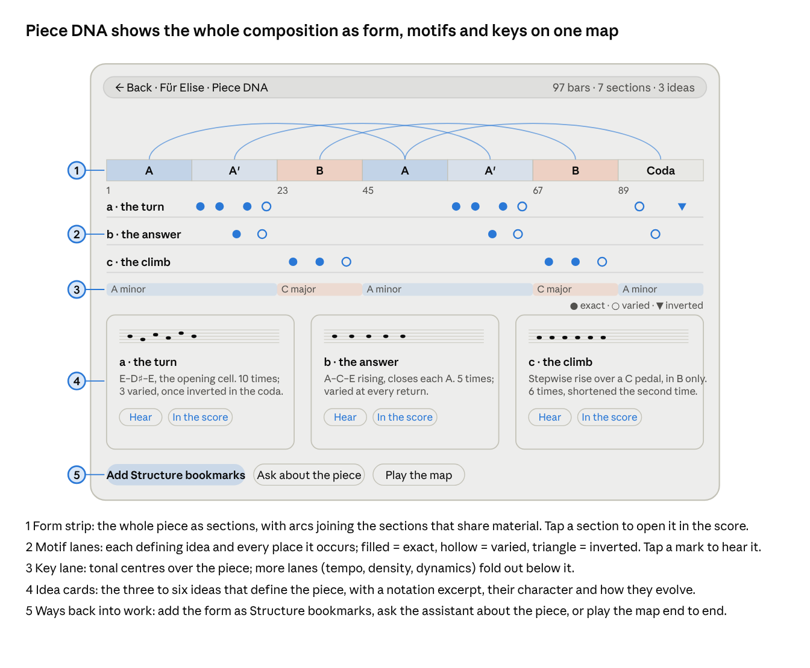

- **One map, read top to bottom.** The form strip across the top shows the sections (from the structure analysis the current build already has) on a bar axis, with arcs joining sections that share material. Under it, one lane per defining idea with a mark at every occurrence: filled for exact repeats, hollow for varied, a triangle for inverted, so repetition and evolution are visible at a glance. Then the key lane (and, folded, tempo, density and dynamics). Then the idea cards: the three to six motifs that make the piece, each with a notation excerpt, a one-line character, a count and a sentence on how it evolves.
- **Everything plays and everything points back.** Tap a section, a mark or a card and the excerpt sounds; a second tap opens the score at that bar and leaves Piece DNA, which remembers its scroll for the return. *Play the map* plays the piece from the start with the map following, as a listening session rather than a practice one.
- **Hover-free, tablet-first.** Occurrence marks are 24 px touch targets; the map scrolls horizontally when the piece is long, with the form strip pinned.
- **Ways back into work.** *Add Structure bookmarks* writes the sections into the Contents drawer’s Structure category, which is how the map becomes navigation. *Ask about the piece* opens the assistant with whole-piece scope and the map as context. A motif can be sent to the Insights stream (“where does this idea come from?”) and the Explore tries can be run on any of its occurrences from the score.
- **Grows with the analysis.** The page is defined by its lanes and cards, not by a fixed layout: new analyses (harmonic rhythm, hand independence, difficulty by bar) appear as further lanes under a *More lanes* control, and a lane can be hidden. Piece DNA for a transcription shows the inferred form with the same “assumed” label used by facts.
- **Not a mode.** It never interrupts practice: nothing in the score links to it except the overflow and the title menu, and leaving it restores the score exactly as it was, selection included.

## Playback

The transport is a floating pill at the bottom centre of the page, not a bar. It holds Play / Pause, Loop, Tempo (tap for 50 / 75 / 100%, drag for anything else), Metronome, Count-in and Hands (All / Right / Left / Melody / Accompaniment). Position is not a slider: the playhead runs through the score itself, and tapping any note plays from it, as today.

- **Appears** when a phrase is selected, when playback starts, or when Play is tapped in the bar. While playing it fades after about three seconds so it does not sit on the music; a tap anywhere brings it back.
- **Loop** follows the context: a selection loops the selection, focus loops the phrase, nothing selected loops the page.
- **The score follows playback** by scrolling smoothly, keeping the playing system in the upper third of the screen, so the next system is always visible below it and nothing is cut at a page edge. A manual scroll during playback wins; auto-follow resumes on the next Play or with a tap on the playhead.
- **Original / Variation / Alternate** is shown in the focus bar only when the focused phrase has a saved variation; it never appears in the page view.
- **Hear the transition** (the current “play the transition with the previous or next phrase”) becomes a lead-in toggle in focus: play starts one bar early and ends one bar late.

## Library, sessions and import

The library is the screen outside the piece, and it exists to get out of the way: one tap on a card opens the piece where it was left. The home page, the project page and the session list of the current build collapse into it.

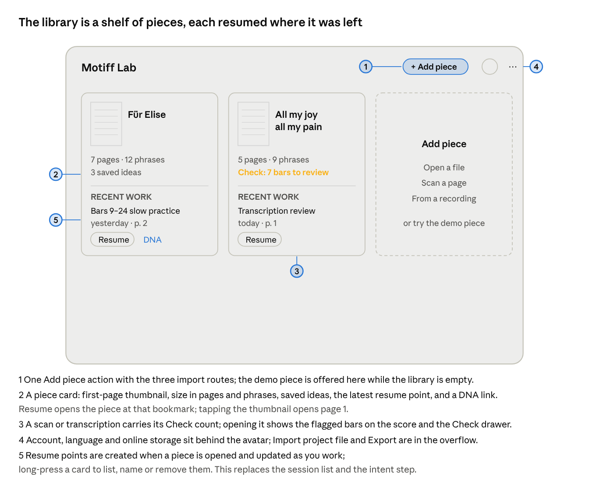

- **Sessions become resume points.** Opening a piece creates one; it records the page, the selection or focused phrase, open drawers and the tempo, and is updated as the musician works. A resume point can be named (“slow practice, bars 9–24”) from the card or from the bar’s title menu; several per piece are allowed. The free-text goal of the current project page survives as the resume point’s name. Resume opens the latest; long-press lists them.
- **Import is one flow.** Add piece offers the three routes in one sheet; opening a file runs on the device and is free, while scanning a page and transcribing a recording run on the server and are Pro, marked with the plum Pro tag on their rows. The explanatory text about what leaves the device and the consent checkbox stay, but as one short line and one switch above the file field rather than a page of prose. The report that follows import is shown once, then becomes the Check layer.
- **The Check layer.** Uncertain bars from a scan or transcription are flagged on the score with a small marker and a reason; the Check drawer lists them with Show, Fix notes and Correct. For transcriptions the drawer’s header holds the bar and tempo corrections (tempo ×2 ÷2, bars earlier or later) that live on today’s report page. When every flag is resolved the layer disappears.
- **Account** keeps sign-in by email code, keep projects in sync (free with a quota, `docs/decisions/0025-two-studios.md` section 8), delete online data, privacy and terms in a sheet behind the avatar; language and every adjustable element live in Settings.
- **Nothing asks what you want to do.** Play, Understand and Explore are things the musician does from a phrase, not a choice made before seeing the music.

## Settings: shaping the app to the musician

The same app has to serve a beginner who wants guidance and a professional who wants a clean page with ink and bookmarks. Settings live at two levels: one global Settings sheet with everything, and small contextual settings on each element, reached in place with a long-press. Both edit the same switches; the contextual one is just the nearest door.

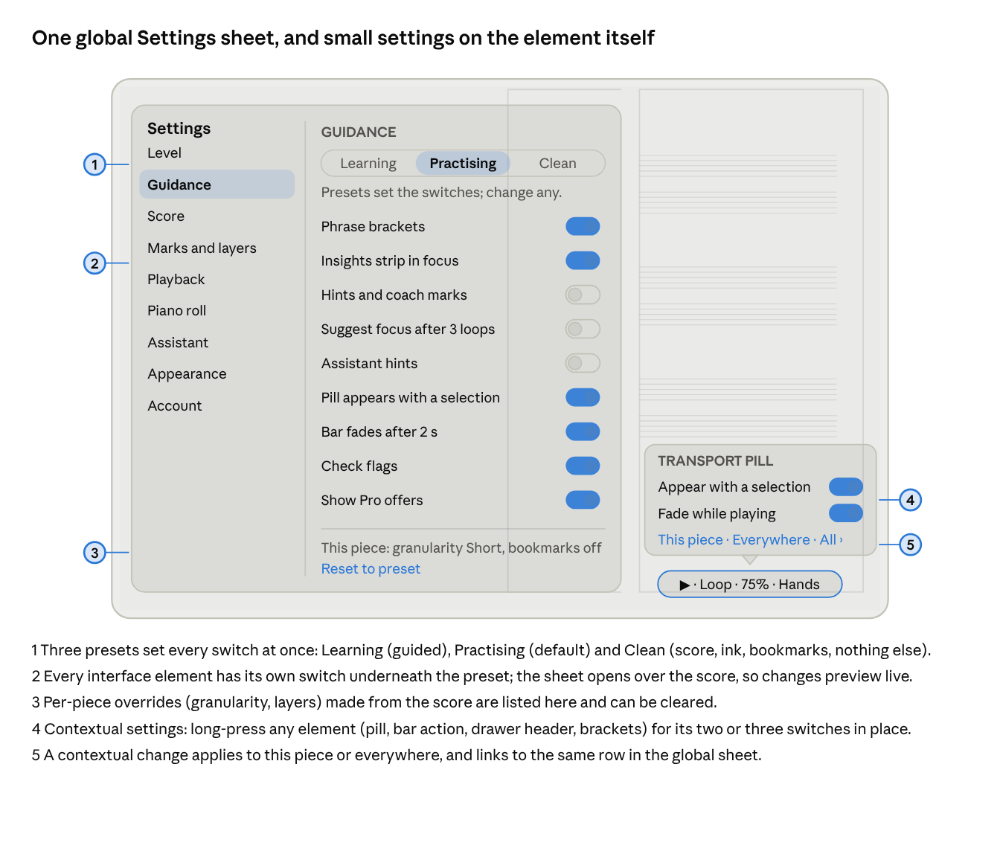

- **Global Settings.** Opened from the gear next to the avatar in the library and from the bar’s overflow in the score. In the score it opens as a sheet over the page, not a separate screen, so every change is previewed live on the music behind it. Sections: Level, Guidance, Score, Marks and layers, Playback, Piano roll, Assistant, Appearance, Account.
- **Three presets, then every switch.** *Learning*: brackets, Insights strip, hints and coach marks, focus suggestions, assistant hints, Check flags all on; Short granularity. *Practising* (default): brackets and Insights strip on, hints off, Phrases granularity. *Clean*: the score, ink and bookmarks only; no brackets, no strip, no hints, the pill only while playing, the bar fades in one second, assistant on request only. A preset is a starting point: every element has its own switch beneath it, and changing one turns the preset label into “Custom”. On the first run, before the library, one screen asks once: three cards, each with its name and a one-line description, and a Continue button; the choice is changed any time in Settings and never asked again. The descriptions, as shown on the cards and next to the presets in Settings: \*Learning\* — “For getting to know a piece: phrases marked, hints and facts in view, the assistant ready to help.” \*Practising\* — “For daily work: phrases and the Insights strip, no hints; tools appear when you select something.” \*Clean\* — “Just the music: the score, your ink and bookmarks; everything else waits until you ask.”
- **What can be switched.** Phrase brackets and their default granularity; Insights strip in focus; hints and coach marks; focus suggestions after repeated loops; assistant hints and verbosity; transport pill behaviour (appear with a selection, fade while playing); bar fade delay; auto-follow during playback; page step snapping; layers shown by default (ink, notes, bookmarks, analysis, check); whether Pen stays on after a stroke or turns off; ink palette; piano roll note names and colour scheme; theme (Daylight, Night stand, Auto) and the Slate page; score scale; language; online sync; export and import.
- **Contextual settings.** A long-press on an element opens a small popover with its two or three switches: the transport pill (appear with selection, fade), a bar action (for Phrases: granularity, show brackets; for Pen: stay on after a stroke, palette), a drawer header (piano roll: note names, colour), the Insights strip (show, how many facts), a bracket (show brackets). The popover ends with a scope control, *This piece · Everywhere*, and a link to the same row in the global sheet, so nothing is hidden in only one place.
- **Per piece and everywhere.** Global settings are the defaults. Granularity, layers and a few score settings can be overridden for a piece from the score; the global sheet lists those overrides and clears them in one tap.
- **Clean page in one tap.** The bar’s overflow has *Clean page*, a temporary switch to the Clean preset for this sitting, for the moment a musician wants to just play; it reverts when the piece is closed, unless they choose to keep it.

## Portrait and landscape

The same model works in both orientations; only the geometry of the overlays changes. Nothing is ever docked, so the score keeps the full screen in both.

| Element | Landscape 1180×820 | Portrait 820×1180 |
| --- | --- | --- |
| Score | Continuous vertical scroll, two pages per row, page height fits the screen | Continuous vertical scroll, one column of pages, A4 at full width |
| Bar | Thin, over the top margin, fades while reading | Same |
| Transport pill | Bottom centre | Bottom centre, a little wider |
| Phrase focus | Phrase across the full width, ossia above, drawer below | Same; a long phrase wraps to two systems |
| Piano roll drawer | Bottom 40%, draggable to 70% | Bottom 30%, draggable to 60% |
| Insights sheet | Right third (about 380 px) over the page | Bottom sheet at half height, draggable to full |
| Contents drawer (Contents, Notes, Pages) | Left, about 320 px over the page | Bottom sheet |
| Pages rail | Thumbnails along the bottom | Thumbnails along the right edge |
| Library | Three cards across | Two cards across |
| Settings sheet | Dialog over the page, sections on the left | Full-height bottom sheet, sections as a top row |
| Piece DNA | Full screen; the map scrolls horizontally, form strip pinned | Full screen; lanes stack, idea cards one per row |

## Where every current feature goes

Every capability in the current build has a home in the new model. Three things are removed as UI, not as capability: the intent questionnaire, the “Piano roll only” view and the explanatory captions.

| Today | New home |
| --- | --- |
| Home: four ways to start | Library: one Add piece action with the three routes; the Für Elise demo lives in the empty state |
| Import project .json | Library overflow menu |
| Account, EN / RU, keep-online toggle, privacy, terms | Avatar in the Library header opens the account sheet (sign-in, online storage, privacy, terms); language moves to Settings |
| Scan report, transcription report (uncertain bars, tracks, warnings) | Check layer on the score: flagged bars with a reason; a Check drawer lists them with Show / Fix / Correct |
| Tempo ×2 ÷2, bars earlier / later | Head of the Check drawer for transcriptions |
| Project page: “What do you want to do?” | Removed; Open goes straight to the score |
| Sessions: Continue / End | Resume points: created on open, named by the user if they wish, listed as Recent work on the piece card; a resume point keeps page, selection, open drawers and tempo |
| Saved ideas | Ideas strip at the top of the Insights stream and chips on the facts they came from; count shown on the piece card |
| Views: Score / Piano roll / Both / Focus | Page view (default) and Phrase focus; piano roll is a drawer; “Piano roll only” dropped |
| Score variants: built from notes / for reading / as played | Reading \| As played control in the focus bar and the contextual menu, in place and per phrase, with As played also available as the ossia; the piece default in the Notation item of the overflow; the Performance layer shows the nuances over Reading notation. Transcriptions only |
| Listen: All / RH / LH / Melody / Accompaniment | Hands control in the transport pill |
| Original / Variation / Alternate | Segmented control in the focus bar, present only when the phrase has a variation; the variation is drawn as an ossia staff |
| Phrase strip, previous / next | Brackets above the staff with their numbers; previous / next in the focus bar; phrase numbers under the page thumbnails |
| Phrase setup: make selection a phrase, merge, reset, hear transitions | Contextual menu on a selection: Make phrase, Merge with next, Split here; granularity (Short / Phrases / Sentences), Show brackets and Reset to detected in the Phrases menu; lead-in toggle in focus |
| Pencil: 3 colours, marker, eraser, undo, clear | A stylus draws directly; without one, Pen in the bar turns finger drawing on; palette on first touch; two-finger tap undoes; Clear ink on this page in the Pen menu |
| Loop / Clear selection | Loop in the pill; tap outside the selection clears it |
| Transport: play, stop, position, tempo, metronome, count-in | The pill; position is the playhead on the score |
| Play tab: from start, repeat, play to end, whole piece, 50 / 75 / 100% | Pill and focus bar; play to end and whole piece are Play with Loop off |
| Understand: facts by group, detected / assumed, Evidence, Show places | A fact row in the Insights stream; it highlights its places on the score; Evidence expands in place |
| Explore: experiments, Surprise me, I have a question, experiment card, saved note | Try chips on the fact rows of the Insights stream (Surprise me is the shuffle button, I have a question the input at the bottom); the result sounds at once and appears as the ossia while the loop runs |
| Tools: build a variation (keep / change / operation) | Adjust on a Try chip opens keep / change / operation inline in the Insights stream, pre-filled |
| Tools: scan check per bar | Check drawer |
| Colour by track / voice / hand, zoom + − | Piano roll drawer overflow; pinch to zoom |
| Captions under the score | Removed; “About this notation” row in the Notation item |
| Open another piece | Back to Library |
| Not Found page | Styled, with a link to the Library |
| No equivalent today: navigating a known piece | Bookmarks: titled, categorised passages that form a personal table of contents in the Contents drawer; focus can walk them in the musician’s own order |
| No equivalent today: asking for help in context | AI Assistant: Ask from a phrase, the focus bar or the bar overflow; answers in the Insights sheet with action chips that drive loop, tempo, hands, bookmarks and marks; Pro offers inside the same conversation |
| Account page: language, keep projects online | Settings sheet (gear in the library, overflow in the score) with Learning / Practising / Clean presets and a switch per element; the same switches in place by long-press on any element, scoped to this piece or everywhere |
| Musical structure insights (Understand, piece level) | Piece DNA: a full-screen map of form, motif occurrences, keys and the defining ideas, reached from the library card, the title menu and the overflow; every element plays and opens the score at its bar |

## Checked against the musician’s workflow

| Question from the brief | How the design answers it |
| --- | --- |
| Can a musician work with the score comfortably for a long time? | The page fills the screen at A4 proportions, the bar fades, the pill fades while playing. Nothing is docked. The document scrolls continuously, so a phrase that crosses a page edge is read without a break; two pages per row in landscape match a stand. |
| Can they quickly find and focus on a phrase? | Brackets are on the page above the staff; one tap on a bracket selects, a second tap (or Focus in the menu) lifts it. Previous / next in the focus bar walks the piece phrase by phrase. Phrase numbers under page thumbnails jump anywhere. |
| Can they annotate without interrupting their workflow? | A stylus draws at once with no mode; a finger draws after one tap on Pen. Notes, bookmarks and highlights are two taps from the bar they concern. Nothing opens a separate screen. |
| Can they reach extra information without losing focus? | The Insights stream covers a third of the screen and the phrase stays visible beside it; facts highlight on the page; trying a variation never stops the loop; a swipe puts the sheet away with the selection intact. |
| Does the piano roll add value without stealing attention? | It is absent until asked for, aligned bar for bar under the phrase when present, and gone with a swipe. |
| Is the plain A4 experience immediately there? | It is the state the piece opens in. The resume point restores the page, and nothing else is shown until the user acts. |
| Does it feel natural to someone used to printed music? | Pages, brackets, pencil, margin notes, highlighter, fingering and ossia are all borrowed from paper practice; the digital additions (loop, tempo, hands, roll, analysis) are reached from the music, not from menus. |

## Open questions before visual design

- [x] Pages are layout units inside one continuously scrolling document (decided in the Navigation model thread). Verovio paginates to fixed A4 pages with a stable bar-to-page map, as the Design system screens show; confirm the current build uses fixed page sizes rather than a flowing layout.
- [x] Decided: any iPad is a target, with or without a stylus. Ink therefore has a Pen mode for the finger (the Pen action in the bar); with a stylus the mode is unnecessary because the stylus always draws. See Annotations.
- [x] Phrases belong to the piece and are shared by all its sessions, as does the chosen granularity. Confirm, and confirm that detection can produce the three levels (Short / Phrases / Sentences) from one analysis rather than three runs, and that a manual edit overrides detection at its level until Reset.
- [x] Decided: a phrase can hold any number of saved variations. The ossia shows one at a time; a row of chips above it picks which, and two can be compared side by side. See Phrase focus.
- [x] Is “for reading” vs “as played” per view? Decided: Reading is the default for a transcription and As played is one tap away wherever the musician is, per phrase and in place, never a buried per-piece setting. See Phrase focus and Annotations (Performance layer).
- [x] Keyboard support for desktop now or later? Page keys, space to play and L to loop are cheap to specify. Related idea: a connected MIDI keyboard as an input (Web MIDI over USB or Bluetooth), so the app hears what is actually played: the playhead follows the player, the piano roll shows played notes against the score, wrong or missed notes and timing drift are marked per bar, and loop, tempo and the Check flags gain real evidence. This becomes the richest context for the assistant and for personalised advice (what was practised, how accurately, which bars slip), and the natural basis for Pro features such as progress over time. Decide the scope for a first version: listening only (no recording kept), or a kept take per resume point.
- [x] Decided: the sheet is called Insights. Understand / Explore / Build are no longer tabs; they survive only as the verbs of one stream (facts, Try chips, Adjust).
- [x] Language of the visual design pass: Russian strings, English, or both? Decided: both, for the interface and for all generated content: facts and Evidence, Try chip names, assistant answers, Piece DNA idea cards, category names, Check reasons and import warnings, which are the places the current build still mixes English into Russian. The language is chosen in Settings (and once at first run), applies to everything at once, and every control is laid out for the longer Russian labels (Правая рука, Фортепианный ролл, Оригинал | Вариация | Поочерёдно); the visual pass renders both.
- [x] Decided, as a rule for the whole product: everything that runs on the device is free; anything that needs cloud infrastructure or an AI model is Pro. So the assistant is Pro in full (the free tier shows its entry point and a one-line offer, nothing more), and so are scan and transcription imports, which run on the server. Sync between the workspaces is the exception: free with a quota (2026-11-08, `docs/decisions/0025-two-studios.md` section 8). Facts, Try chips, variations, Piece DNA, bookmarks, ink and playback run on the device and stay free.
- [x] Follows from the rule: the assistant is online-only, so activity context leaves the device only when a Pro user asks; the free tier sends nothing anywhere unless the player signs in and turns sync on. The What-it-knows fold stays as the place where that is visible.
- [x] Settings: is Practising the right default preset for a new account, or should the first run ask once? Decided: the first run asks once, showing the three presets as cards with a one-line description each (see Settings); the choice can be changed any time in Settings and is never asked again.

Colour, type, components and the rendered screens: Design system
