# Motiff Lab Visual Design System

2026-10-31 · @Andrei

The identity is cream paper, graphite ink and one blue pencil. The score is engraved black on paper; every interface element is a quiet, warm neutral; the single cobalt accent marks what the system is pointing at (selection, focus, playhead, the active control), plum marks what the system has made (variations, ideas), amber marks what the user has marked (highlighter, notes, flags). Light and dark themes share the same tokens; dark keeps the paper cream by default and offers a slate page for low light. Everything below is built on the UX concept tab: the same layers, the same screens, now with colour, type and components.

## Visual direction

**Blue pencil on cream paper.** Editors and conductors have always marked printed music with a blue pencil: it is visible on the page, it never competes with the engraving, and it washes out when the music is photographed. Motiff Lab borrows that convention. The score is black engraving on cream paper; everything the app itself points at is cobalt; everything the musician writes is pencil-coloured ink; everything the app has composed (a variation, an idea) is plum. The interface around the page is the desk: warm, matte, slightly darker than the paper, so the page is always the brightest thing on screen.

**Personality in five words:** quiet, warm, precise, editorial, unhurried. The current build is a dark dashboard with a neon-lime accent; it reads as software. The new identity reads as a music stand with a good lamp.

**Rules that follow from it**

- One accent. Cobalt is the only colour that means “interactive” or “selected”. It is never used decoratively.

- Paper is the brightest surface. No white panels sit on top of the page except the small contextual menu and dialogs.

- Matte over glossy. Sheets and pills are translucent surfaces with a blur, not glass; shadows are soft and warm, never black.

- Type does the branding. A serif for titles and piece names (as on a printed edition), a humanist sans for controls; no gradients, no illustration.

- Marks look hand-made. Phrase brackets, bookmarks and fingering use pencil weights and an italic serif, so the musician’s own marks and the app’s analysis sit on the page the way pencil does.

**Logo treatment.** The wordmark is “Motiff Lab” set in Source Serif 4 Medium, ink on paper, with the tagline *Hear. Understand. Transform.* in the same serif, italic, at caption size. No symbol is needed inside the app; for the app icon, a cream rounded square with a single cobalt phrase bracket (the “⎡ ⎤” shape used on the score) is proposed, to be drawn in the visual pass.

## Colour system

Two themes, one set of token names. **Daylight** is the default; **Night stand** is the dark theme, which keeps the page a dimmed cream so notation stays black-on-paper, with a **Slate** page option (light notation on dark) for playing in a dark room. Contrast ratios are against the surface the colour is normally used on (WCAG 2.x; 4.5:1 for text, 3:1 for large text and graphics).

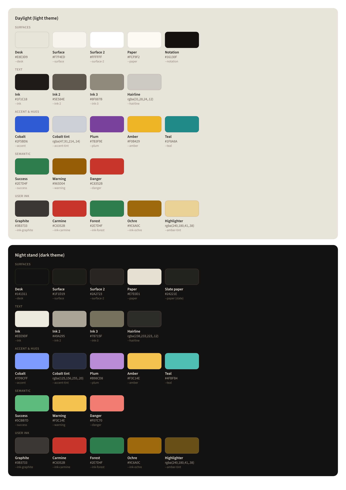

| Token            | Role                                                       | Daylight            | Night stand                | Contrast                         |
|------------------|------------------------------------------------------------|---------------------|----------------------------|----------------------------------|
| `--desk`         | App background behind the page                             | \#E8E3D9            | \#141311                   | —                                |
| `--surface`      | Sheets, drawers, pill, bar, cards                          | \#F7F4ED            | \#1F1D19                   | —                                |
| `--surface-2`    | Menus, dialogs, fields                                     | \#FFFFFF            | \#2A2723                   | —                                |
| `--paper`        | The score page                                             | \#FCF9F2            | \#E7E0D1 (Slate: \#24221E) | —                                |
| `--notation`     | Engraving ink on paper                                     | \#16130F            | \#16130F (Slate: \#EDE6D7) | 17.6 : 1 (dark 14.1, slate 12.8) |
| `--ink`          | Primary text                                               | \#1F1C18            | \#EEE9DF                   | 15.4 : 1 (dark 13.9)             |
| `--ink-2`        | Secondary text, captions                                   | \#5E584E            | \#A9A295                   | 6.4 : 1 (dark 6.6)               |
| `--ink-3`        | Tertiary, placeholders, overlines                          | \#8F887B            | \#78715F                   | 3.2 : 1, large or non-text only  |
| `--hairline`     | Borders, grid lines                                        | rgba(31,28,24,.12)  | rgba(238,233,223,.12)      | —                                |
| `--accent`       | Cobalt: selection, focus, playhead, active controls, links | \#2F5BD6            | \#7D9CFF                   | 5.3 : 1 (dark 6.5)               |
| `--accent-tint`  | Selection band, active chip and tab backgrounds            | rgba(47,91,214,.14) | rgba(125,156,255,.20)      | —                                |
| `--on-accent`    | Text on a cobalt fill                                      | \#FFFFFF            | \#10131F                   | 5.9 : 1 (dark 7.1)               |
| `--plum`         | What the app composed: ossia, variations, saved ideas      | \#7B3F9E            | \#B98CD8                   | 6.3 : 1 (dark 6.3)               |
| `--amber`        | What the user marked: highlighter, note markers, flags     | \#F0B429            | \#F3C14E                   | fill only                        |
| `--teal`         | Left-hand notes in the piano roll                          | \#1F8A8A            | \#4FBFB4                   | 3.8 : 1 graphic (dark 7.6)       |
| `--fn-t`         | Tonic function (rest), Piece DNA harmony and its circle only | \#3E7F5A          | \#6FB58C                   | graphic, always with the letter T |
| `--fn-s`         | Subdominant function (motion), same places only            | \#B4882B            | \#D9AE55                   | graphic, always with the letter S |
| `--fn-d`         | Dominant function (tension), same places only              | \#B5502F            | \#E07A55                   | graphic, always with the letter D |
| `--success`      | Done, resolved                                             | \#2E7D4F            | \#5CBB7D                   | 4.9 : 1                          |
| `--warning`      | Check flags text, attention                                | \#965D04            | \#F3C14E                   | 4.95 : 1 (dark 10.1)             |
| `--danger`       | Delete, errors                                             | \#C8352B            | \#F07C70                   | 4.8 : 1 (dark 6.3)               |
| `--ink-graphite` | User ink, pencil                                           | \#3B3733            | same                       | on paper                         |
| `--ink-carmine`  | User ink, red pencil                                       | \#C8352B            | same                       | on paper                         |
| `--ink-forest`   | User ink, green pencil                                     | \#2E7D4F            | same                       | on paper                         |
| `--ink-ochre`    | User ink, ochre pencil (Teacher category by default)       | \#9C6A0C            | same                       | on paper 4.5 : 1                 |
| `--dim`          | Veil over the page in phrase focus                         | rgba(31,28,24,.42)  | rgba(20,19,17,.55)         | —                                |

User ink colours do not change with the theme: they are pigments on the paper, and the paper is cream in both themes. On the Slate page the four inks get a 1 px paper-coloured halo so they stay legible on dark. The four inks are also the four category colours for bookmarks: Practise carmine, Performance forest, Structure graphite, Teacher ochre.

## Score surface

The page is an A4 sheet drawn at its real proportions (1 : 1.414), with 2 px corners, a soft paper shadow and a page number in the lower outer corner in `--ink-3`. Engraving uses **Leland** (the MuseScore SMuFL font, OFL), which Verovio ships; it is rounder and more even than the default Leipzig and reads better at tablet size. Staff lines are hairline weight, not thinner than 1 physical pixel. Verovio’s own title and part-name header is hidden (it still reserves the top margin the bar sits in); the title block is set by the app in Source Serif 4 on the first page so it matches the interface.

Everything that sits on the music is one of these marks, and each has one colour and one weight so they never need a legend:

| Mark               | Who made it                                         | Colour                                                                                                                                          | Form                                                                                                                                                        |
|--------------------|-----------------------------------------------------|-------------------------------------------------------------------------------------------------------------------------------------------------|-------------------------------------------------------------------------------------------------------------------------------------------------------------|
| Selection band     | The app, from a tap or drag                         | `--accent-tint` fill, 1.5 px `--accent` border, 3 px radius                                                                                     | Covers the selected bars across both staves, 8 px outside the staves; round 14 px handles on the first and last barline                                     |
| Focused phrase     | The app, in phrase focus                            | 2 px `--accent` border, 6 px `--accent-tint` glow, no fill                                                                                      | The lifted card; the page behind it under `--dim`                                                                                                           |
| Phrase bracket     | The app (detected) or the user (manual)             | `--ink-graphite` at 75% opacity, 1.25 px; the selected one `--accent` 1.5 px                                                                    | A horizontal bracket 14 px above the top staff, number at its left end in 11 px semibold; a 6 px plum dot at the right end when the phrase has a saved idea |
| Playhead           | The app, during playback                            | 2 px `--accent` with a 1 px paper halo                                                                                                          | Vertical line through both staves, 10 px beyond them                                                                                                        |
| Fact highlight     | The app, from a fact in the Insights stream         | 1.5 px `--accent` ring                                                                                                                          | A ring 8 px larger than the notehead; cleared with a second tap                                                                                             |
| Ossia              | The app, a variation                                | 1.5 px dashed `--plum` frame, overline label                                                                                                    | A single staff above the focused phrase on a paper-coloured panel                                                                                           |
| Highlighter        | The user                                            | `--amber-tint` fill, multiply blend                                                                                                             | A band over one staff of the chosen bars                                                                                                                    |
| Margin note marker | The user                                            | `--amber` teardrop 20 px with a number                                                                                                          | In the margin above the bar; opens a `--surface-2` popover                                                                                                  |
| Bookmark bracket   | The user                                            | 1.25 px bracket in the category’s ink colour (`--ink-carmine`, `--ink-forest`, `--ink-graphite` or `--ink-ochre`) and the title in italic serif | 30 px above the top staff, so it clears phrase brackets; overlapping bookmarks stack 14 px apart                                                            |
| Fingering          | The user                                            | 11 px `--ink-graphite` digits                                                                                                                   | Centred above the notehead                                                                                                                                  |
| Ink                | The user, with a stylus or a finger while Pen is on | Graphite, carmine, forest or ochre; 2.2 px round-capped stroke                                                                                  | Vector strokes anchored to the bar under their start point                                                                                                  |
| Check flag         | The import report                                   | 18 px `--warning-fill` square, 4 px radius, “?”                                                                                                 | Above the top-right of the uncertain bar; gone when resolved                                                                                                |

## Typography

Two families, both open (OFL) and available on Google Fonts and as self-hosted woff2: **Source Serif 4** for titles, piece names and anything that imitates print; **Source Sans 3** for every control and body text. They are drawn by the same designer, so their x-heights and weights match. Numerals are tabular everywhere (`font-variant-numeric: tabular-nums`) so bar numbers, tempo and times do not jitter. Notation is **Leland** via Verovio.

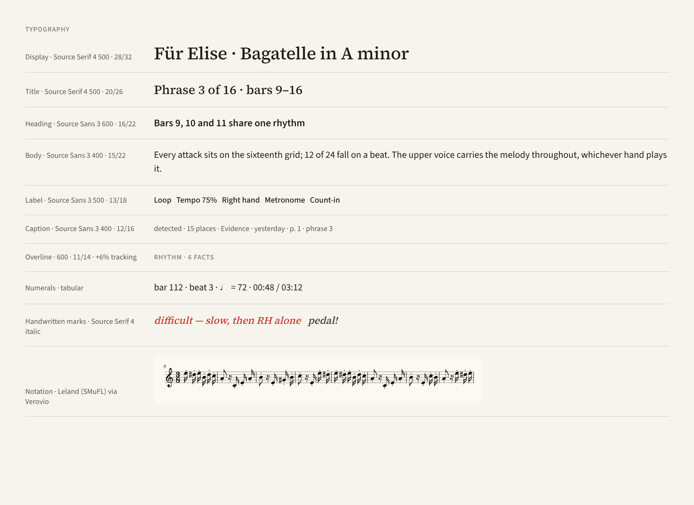

| Style       | Family, weight                | Size / line (px, iPad)  | Used for                                                        |
|-------------|-------------------------------|-------------------------|-----------------------------------------------------------------|
| Display     | Source Serif 4, 500           | 28 / 32, −1% tracking   | Library wordmark, title block on page 1                         |
| Title       | Source Serif 4, 500           | 20 / 26                 | Piece names on cards, sheet and dialog titles; 17 px in the bar |
| Heading     | Source Sans 3, 600            | 16 / 22                 | Section heads inside sheets                                     |
| Body        | Source Sans 3, 400            | 15 / 22                 | Facts, notes, descriptions                                      |
| Body strong | Source Sans 3, 600            | 15 / 22                 | Emphasis inside body                                            |
| Label       | Source Sans 3, 500            | 13 / 18 (15 in buttons) | Controls, chips, pill items, menu items, drawer tabs            |
| Caption     | Source Sans 3, 400            | 12 / 16                 | Meta lines, dates, hints                                        |
| Overline    | Source Sans 3, 600, uppercase | 11 / 14, +6% tracking   | Group labels (“Rhythm · 6 facts”, “Recent work”)                |
| Handwritten | Source Serif 4, italic 500    | 12–16                   | Bookmark titles and ink labels on the score, in the ink colour  |
| Notation    | Leland (SMuFL)                | Verovio scale 50 at A4  | The score, the phrase card, the ossia                           |

Readability rules: body never below 15 px on the tablet; nothing interactive below 13 px; line length in sheets 45–65 characters (the 380 px sheet gives about 48); no text is placed over the music except marks in the table above; captions in `--ink-2`, never `--ink-3`, when they carry information.

## Iconography

Icons are line icons on a 20 px grid with a 1.5 px stroke, round caps and joins, no fills except the three dots of “more” and the play glyph when it is the main action. They are monochrome and take the colour of their text (`currentColor`), so an icon on a selected control is cobalt and an icon on a quiet control is `--ink-2`. The style matches the Lucide set, which can be used for anything generic; the music-specific icons (phrases, piano roll, metronome, lead-in, hands, tempo dial) are drawn on the same grid.

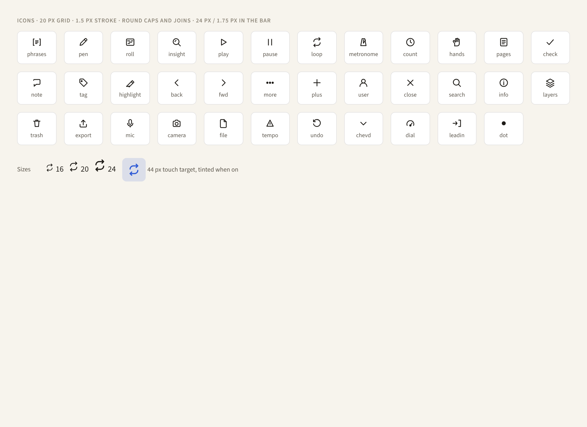

- **Sizes**: 16 px inside captions and chips, 20 px in buttons, menus and the pill, 24 px with a 1.75 px stroke in the bar. Every icon-only control is at least 44 × 44 px.

- **States**: default `--ink`; quiet `--ink-2`; on (toggled or active) `--accent` on an `--accent-tint` 8 px rounded square; disabled 38% opacity; destructive `--danger`.

- **Pairing**: an icon never stands alone in the pill or menus except the five universally known ones (play, pause, more, back, close); everything else carries its word.

- **Named set** (code names, as in icons.js): phrases, pen, roll, insight (the Insights action), play, pause, loop, metronome, count, hands, pages, check, note, bookmark, tag, highlight, back, fwd, more, plus, user, close, search, info, layers, trash, export, mic, camera, file, undo, chevd, dial, leadin, dot, and since version 0.5 folder (a folder to import), recheck (look through a folder again), move, select and editnote (the modes), scroll (Navigate: a page with arrows, replacing move in the iPad bar) and keysig (the Circle: a circle with a sharp; Andrei approved both on 2026-11-13, #479 item 21), and since version 0.5.4 expand (two arrows to the corners, maximize-2: Expand into focus, from the selection menu and the roll's head, so it is not taken for Insights' magnifier, #511 section 9), and since version 0.5.5 collapse (the same two arrows turned inwards, minimize-2: Collapse, the way back from Expand opened on the roll, #521 17).

## Design tokens

All values live as CSS custom properties on `:root`, with the dark theme as `[data-theme="dark"]` overrides and the slate page as `[data-page="slate"]`. Components reference tokens only; no component has a literal colour or size. The colour tokens are in the table above; the rest:

| Group  | Token                | Value                                           | Notes                                                                                         |
|--------|----------------------|-------------------------------------------------|-----------------------------------------------------------------------------------------------|
| Space  | `--s-1` … `--s-12`   | 4, 8, 12, 16, 20, 24, 32, 40, 48 px             | 4-pt grid; component padding uses 12/16, section gaps 24/32                                   |
| Radius | `--r-xs`             | 4 px                                            | Tags, flags                                                                                   |
|        | `--r-s`              | 8 px                                            | Buttons, fields, fact rows, bar actions                                                       |
|        | `--r-m`              | 12 px                                           | Cards, menus                                                                                  |
|        | `--r-l`              | 16 px                                           | Sheets, drawers, dialogs                                                                      |
|        | `--r-pill`           | 999 px                                          | Bar, transport pill, contextual menu, chips, segmented                                        |
| Size   | `--h-compact`        | 32 px                                           | Chips, segmented controls, compact buttons                                                    |
|        | `--h-control`        | 40 px                                           | Buttons, fields, bar actions                                                                  |
|        | `--h-touch`          | 44 px                                           | Minimum hit area for anything tappable                                                        |
|        | `--icon-s / -m / -l` | 16 / 20 / 24 px                                 | See Iconography                                                                               |
| Border | `--hairline`         | 1 px, 12% ink                                   | Dividers, card borders, roll grid                                                             |
|        | `--hairline-strong`  | 1 px, 24% ink                                   | Field borders, handles, drawer grab                                                           |
| Shadow | `--shadow-paper`     | 0 1 2 / 10% + 0 12 32 / 10%                     | The page on the desk                                                                          |
|        | `--shadow-sheet`     | 0 1 2 / 8% + 0 12 40 / 20%                      | Sheets, drawers, dialogs, the focus card                                                      |
|        | `--shadow-pill`      | 0 6 20 / 18%                                    | Transport pill, toast                                                                         |
|        | `--shadow-menu`      | 0 4 16 / 16%                                    | Bar, contextual menu, hovered cards                                                           |
| Focus  | `--focus-ring`       | 2 px surface + 4 px accent                      | Keyboard focus only (`:focus-visible`)                                                        |
| Blur   | surfaces             | `backdrop-filter: blur(12px)` at 86–92% opacity | Bar and pill over the page                                                                    |
| Motion | `--t-fast`           | 120 ms                                          | Hover, press, toggle                                                                          |
|        | `--t-base`           | 200 ms                                          | Menus, pill appearing, chip and tab change                                                    |
|        | `--t-slow`           | 320 ms                                          | Sheets and drawers sliding, the phrase lifting into focus                                     |
|        | page step            | 400 ms                                          | Scroll by exactly one page when an edge is tapped; free scrolling has no animation of its own |
|        | `--ease`             | cubic-bezier(.2, .8, .2, 1)                     | Everything; `prefers-reduced-motion` drops slides to fades                                    |

Shadows in the dark theme use black at 30–45% instead of warm ink; the values are in `tokens.css`, which is the source of truth for this table and is delivered with this document.

## Components

Every component is built from the tokens above and rendered below in both themes from the same CSS. The specimen is a live rendering of `ds.css`, not a drawing.

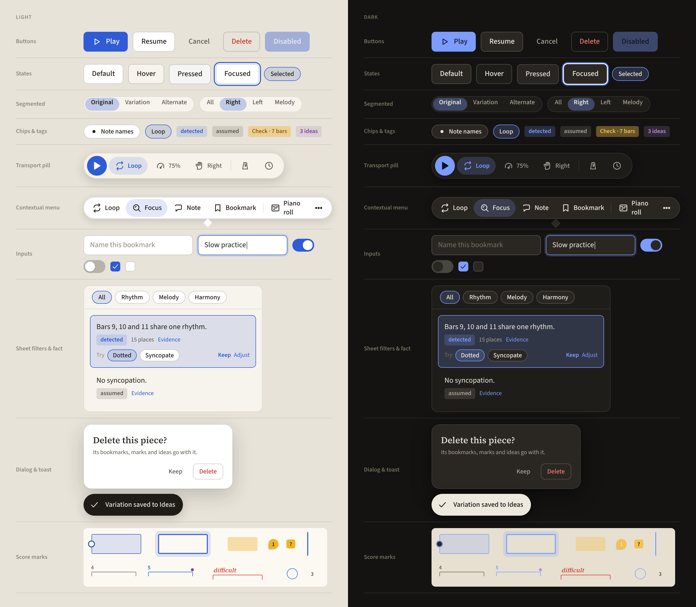

| Component                           | Styling                                                                                                                                                                                                                                                                                                                                                                                                                                                                                                                                                                                                                                                                                                                                                                                                                                                                                               |
|-------------------------------------|-------------------------------------------------------------------------------------------------------------------------------------------------------------------------------------------------------------------------------------------------------------------------------------------------------------------------------------------------------------------------------------------------------------------------------------------------------------------------------------------------------------------------------------------------------------------------------------------------------------------------------------------------------------------------------------------------------------------------------------------------------------------------------------------------------------------------------------------------------------------------------------------------------|
| Bar                                 | Floating pill, 44 px high, 16 px from the edges; `--surface` at 86% with 12 px blur, hairline border, menu shadow. Title in Title 17 px, page count in Label `--ink-2`, five 40 px actions on the right; the active one tinted. The Phrases action opens a small popover with a segmented control for granularity (Short / Phrases / Sentences), a Show brackets switch and Reset to detected; it never lists the phrases. Active state on `--accent-tint`. Fades to 0 after 2 s of reading; any tap restores it.                                                                                                                                                                                                                                                                                                                                                                                     |
| Transport pill                      | 52 px pill, bottom centre, `--surface` 92% with blur. A 40 px round cobalt Play button, then 36 px pill items (Loop, tempo, Hands, Lead-in in focus) with a hairline divider before Metronome and Count-in. An item that is on shows `--accent-tint` with cobalt text.                                                                                                                                                                                                                                                                                                                                                                                                                                                                                                                                                                                                                                |
| Contextual menu                     | 44 px pill in `--surface-2` with a hairline and a 12 px pointer, placed 14 px above the selection and clear of bracket numbers. Items are icon + word, 36 px, hover on `--accent-tint` (Loop, Focus, Note, Bookmark, then Piano roll, Insights); hairline dividers group them; the overflow holds the rarer actions.                                                                                                                                                                                                                                                                                                                                                                                                                                                                                                                                                                                  |
| Buttons                             | 40 px, 8 px radius, 15 px Label. Primary: cobalt fill, white text, one per view. Secondary: `--surface-2` with a strong hairline. Quiet: text only, `--ink-2`. Danger: `--danger` text with a hairline. Compact: 32 px, 13 px.                                                                                                                                                                                                                                                                                                                                                                                                                                                                                                                                                                                                                                                                        |
| Segmented control                   | 32 px pill on `--surface` with a hairline; the chosen segment on `--accent-tint-strong`, semibold. Used for Original / Variation / Alternate and Hands.                                                                                                                                                                                                                                                                                                                                                                                                                                                                                                                                                                                                                                                                                                                                               |
| Chips and tags                      | Chips: 28 px pill, strong hairline, `--surface-2`; on = `--accent-tint` with a cobalt border. Tags: 22 px, 4 px radius, 12 px semibold, tinted by meaning: detected (cobalt), assumed (hairline grey), check (amber with `--warning` text), saved ideas (plum).                                                                                                                                                                                                                                                                                                                                                                                                                                                                                                                                                                                                                                       |
| Sheet                               | 380 px wide over the right third, 12 px inset, 16 px radius, `--surface`, sheet shadow, a 4 px grab bar on its left edge. Overline header, a row of filter chips (All, Rhythm, Melody, Harmony, Form) under a hairline, body padding 16/24, a hairline footer with the hint. No tabs: the sheet is one stream. Portrait: bottom sheet at 50% height.                                                                                                                                                                                                                                                                                                                                                                                                                                                                                                                                                  |
| Drawer                              | Full width, 12 px inset, top corners 16 px, `--surface`, a 36 × 4 px grab handle, an overline header row with chips on the right.                                                                                                                                                                                                                                                                                                                                                                                                                                                                                                                                                                                                                                                                                                                                                                     |
| Fact row                            | Body text, then a caption line with a tag, places and an Evidence link, then a Try row of 24 px chips (the active one tinted) with Keep and Adjust links on the right; 12 px padding, 8 px radius, hairline when hovered, `--accent-tint` with a cobalt border when selected.                                                                                                                                                                                                                                                                                                                                                                                                                                                                                                                                                                                                                         |
| Card                                | `--surface`, hairline, 12 px radius, 16 px padding; the thumbnail is a real first page at 84 × 118 on `--paper` with a 1 px shadow; Title 19 px; a hairline rule before Recent work. The Add card is dashed.                                                                                                                                                                                                                                                                                                                                                                                                                                                                                                                                                                                                                                                                                          |
| Fields                              | 40 px, 8 px radius, `--surface-2`, strong hairline; focus turns the border cobalt with a 3 px `--accent-tint` ring.                                                                                                                                                                                                                                                                                                                                                                                                                                                                                                                                                                                                                                                                                                                                                                                   |
| Switch and checkbox                 | 44 × 26 switch, 20 px checkbox with 5 px radius; cobalt when on.                                                                                                                                                                                                                                                                                                                                                                                                                                                                                                                                                                                                                                                                                                                                                                                                                                      |
| Dialog                              | 420 px, 16 px radius, `--surface-2`, 24 px padding, Title then Caption, actions right-aligned; destructive actions in `--danger`.                                                                                                                                                                                                                                                                                                                                                                                                                                                                                                                                                                                                                                                                                                                                                                     |
| Toast                               | 44 px pill, `--ink` background with `--desk` text (inverted), icon + sentence, bottom centre above the pill.                                                                                                                                                                                                                                                                                                                                                                                                                                                                                                                                                                                                                                                                                                                                                                                          |
| Pages rail                          | A row (or column) of 44 × 62 page thumbnails on a translucent `--surface` strip; the current page outlined in cobalt; phrase numbers under the thumbnails in 9 px `--ink-3`.                                                                                                                                                                                                                                                                                                                                                                                                                                                                                                                                                                                                                                                                                                                          |
| Ossia panel                         | Paper-coloured panel over the dim veil with a 1.5 px dashed plum frame; a row of 24 px plum-tinted chips above the staff names the saved variations and picks the one shown (two selected = two staves for comparison).                                                                                                                                                                                                                                                                                                                                                                                                                                                                                                                                                                                                                                                                               |
| Assistant conversation              | Lives at the end of the Insights stream. Scope chips (28 px, the active one tinted) under an ASK overline; a folded “What it knows” row in caption style; the musician’s messages right-aligned on --accent-tint with 8 px radius; the assistant’s messages left-aligned on --surface-2 with a hairline, body text 15 px; action chips inside an answer are 24 px chips in cobalt text with a cobalt hairline, tinted while their action is active; Pro offers are the same chip in plum. The input is a 44 px pill field with a mic button, always at the bottom of the sheet.                                                                                                                                                                                                                                                                                                                       |
| Settings sheet and settings popover | The global sheet is a 760 px dialog over the page (portrait: full-height bottom sheet) with a 150 px section list on the left (selected row on --accent-tint) and rows on the right: Label 15 px, a caption under it when needed, a 44 × 26 switch or a segmented control on the right, 52 px row height, hairline between rows. The preset segmented control sits at the top of Guidance. The contextual popover is a 260 px --surface-2 card with a 12 px pointer, an overline naming the element, two or three switch rows at 40 px, and a footer with the scope segmented control (This piece / Everywhere) and an “All ›” link in cobalt.                                                                                                                                                                                                                                                        |
| Piece DNA map                       | A full-screen page on --desk with its own 44 px bar (Back, title, counts). Form strip: 24 px section blocks on a bar axis, A-type sections on --accent-tint, contrasting sections on --plum-tint, coda on --hairline, section letters in Heading 16; arcs above in --accent at 60%, 1 px. Motif lanes: 28 px rows with a hairline, the idea name in Label 13 semibold at the left; marks are 10 px (24 px hit area): filled --accent for exact, hollow 1.5 px for varied, a triangle for inverted; the playing mark pulses. Key lane: 14 px tinted blocks with 11 px labels. Idea cards: --surface, hairline, 12 px radius, a real notation excerpt on --paper at the top, Title 17, two caption lines, Hear and In the score as compact chips. Actions at the foot as a primary chip and two secondary chips. Dark theme: the same tints at their dark values; the excerpts follow the Slate choice. |

## Component states

States are expressed with the same three devices everywhere: a tint for hover and selection, a cobalt border or underline for the active thing, and opacity for disabled. Hover exists only on pointer devices (`@media (hover: hover)`); on the iPad the pressed state does its job. Focus rings appear only for keyboard focus (`:focus-visible`).

| State              | Buttons and bar actions                                                         | Chips, tabs, pill items                                       | Rows (facts, cards, list items)           | Score marks                                    |
|--------------------|---------------------------------------------------------------------------------|---------------------------------------------------------------|-------------------------------------------|------------------------------------------------|
| Default            | As specified per variant                                                        | Hairline border, `--ink` or `--ink-2` text                    | No border                                 | Graphite bracket, no band                      |
| Hover              | Background `--accent-tint` (quiet) or 4% darker (filled), 120 ms                | `--accent-tint` background                                    | `--surface-2` with a hairline             | Bracket darkens to 100% opacity                |
| Pressed            | 96% brightness, 0.5 px down                                                     | Same as hover, 96% brightness                                 | Same as hover                             | Band appears under the finger                  |
| Selected / on      | Primary stays cobalt; toggles move to `--accent-tint` with cobalt text and icon | `--accent-tint` (chips, pill) or 2 px cobalt underline (tabs) | `--accent-tint` with a 1 px cobalt border | Cobalt band and bracket; handles shown         |
| Focused (keyboard) | `--focus-ring`: 2 px surface, 4 px cobalt                                       | Same                                                          | Same                                      | Dotted cobalt outline on the bar               |
| Disabled           | 38% opacity, no pointer                                                         | 38% opacity                                                   | Text `--ink-3`, no hover                  | Not applicable                                 |
| Loading            | Label replaced by a 16 px ring spinner in the same colour                       | —                                                             | A hairline shimmer at 40%                 | A hairline shimmer over the bar being analysed |
| Destructive        | `--danger` text; filled only inside a confirmation dialog                       | —                                                             | —                                         | —                                              |

## Piano roll styling

The roll lives in the drawer and uses the drawer’s `--surface` as its background so it never looks like a second page. Pitch rows are 9–10 px on the tablet with a `--hairline` rule between them; the rows of black keys are tinted 4% ink so octaves read without labels. Barlines are `--hairline-strong`, beats `--hairline`, aligned with the barlines of the phrase card above at the same horizontal scale.

- **Notes** are 3 px-radius bars, `--accent` for the right hand and `--teal` for the left (the hand colours of the current build, made consistent with the system), at 90% opacity so overlaps show. A note under the cursor or belonging to a highlighted fact gets a 1.5 px `--surface-2` gap and a 3 px cobalt ring.

- **Note names** are set inside right-hand notes in 8–9 px semibold `--on-accent` when the note is at least 20 px wide; shorter notes show the name on a tap. The left margin names every C, E and A in `--ink-2` (C in `--ink`, semibold).

- **Hands inferred from a transcription** keep a dashed 1 px outline and an “L?” / “R?” label; a tap on the label reassigns.

- **Playhead** is the same 2 px cobalt line as on the score, continuous through the card and the roll.

- **Zoom** is pinch, 50–300% of the phrase width; the header chips (Note names, Colour: hands / voices / tracks) and the overflow hold the rest.

## Responsive styling

The tokens do not change between devices; what changes is page scale, overlay width and whether hover exists. Breakpoints are by width: tablet up to 1180 (iPad 11″ landscape and 13″ portrait), laptop 1181–1679, desktop 1680 and up.

| Element           | Tablet (iPad)                                                                                                                   | Laptop                                                                   | Desktop                                                              |
|-------------------|---------------------------------------------------------------------------------------------------------------------------------|--------------------------------------------------------------------------|----------------------------------------------------------------------|
| Page              | One continuously scrolling document. Portrait: one column of pages at 97% width. Landscape: two pages per row, fitted to height | Two pages per row fitted to height, 24 px desk margin, continuous scroll | Pages capped at 1.4× A4; extra width becomes desk; continuous scroll |
| Bar               | 44 px, fades after 2 s                                                                                                          | 44 px, fades; reappears on mouse move                                    | Same; keyboard shortcuts shown on hover                              |
| Transport pill    | 52 px, bottom centre                                                                                                            | Same                                                                     | Same, with shortcut hints                                            |
| Insights sheet    | Right 380 px (portrait: bottom 50%)                                                                                             | Right 400 px                                                             | Right 440 px                                                         |
| Piano roll drawer | Bottom 40% (portrait 30%)                                                                                                       | Bottom 40%                                                               | Bottom 36%, rows 12 px                                               |
| Contents drawer   | Left 320 px (portrait: bottom)                                                                                                  | Left 340 px                                                              | Left 360 px                                                          |
| Library           | 3 cards across (portrait 2)                                                                                                     | 3–4                                                                      | 4–5, max 1600 px content width                                       |
| Hover             | None; pressed state only                                                                                                        | Hover tints on                                                           | Hover tints on                                                       |
| Focus ring        | Only with a hardware keyboard                                                                                                   | Keyboard                                                                 | Keyboard                                                             |
| Drawing           | A stylus draws directly; a finger draws with Pen on, two fingers scroll                                                         | Pen tablets draw; the mouse draws with Pen on                            | Same as laptop                                                       |
| Type scale        | As specified                                                                                                                    | Same                                                                     | Same; the page may be zoomed, type is not                            |
| Settings sheet    | 760 px dialog over the page (portrait: full-height bottom sheet)                                                                | 760 px dialog                                                            | 800 px dialog                                                        |
| Piece DNA         | Full screen; map scrolls horizontally (portrait: lanes stack, one idea card per row)                                            | Full screen, map fits the width up to 1600 px                            | Same, idea cards four across                                         |

The current build’s header that wraps to two lines cannot happen here: the bar carries a title, a page count and six icons, which fit at 820 px.

## The screens in the new identity

These are the UX concept’s screens rendered with the tokens and components above, at iPad 11″ size (1180 × 820 and 820 × 1180). The notation is real: Für Elise engraved by Verovio in Leland and paginated to A4, with the phrase brackets, bands and marks drawn from the measure positions, so what you see is what the engine can produce.

**Library.** The wordmark in serif, one cobalt Add piece, pieces as cards with a real first-page thumbnail, the saved-ideas tag in plum and the Check tag in amber.

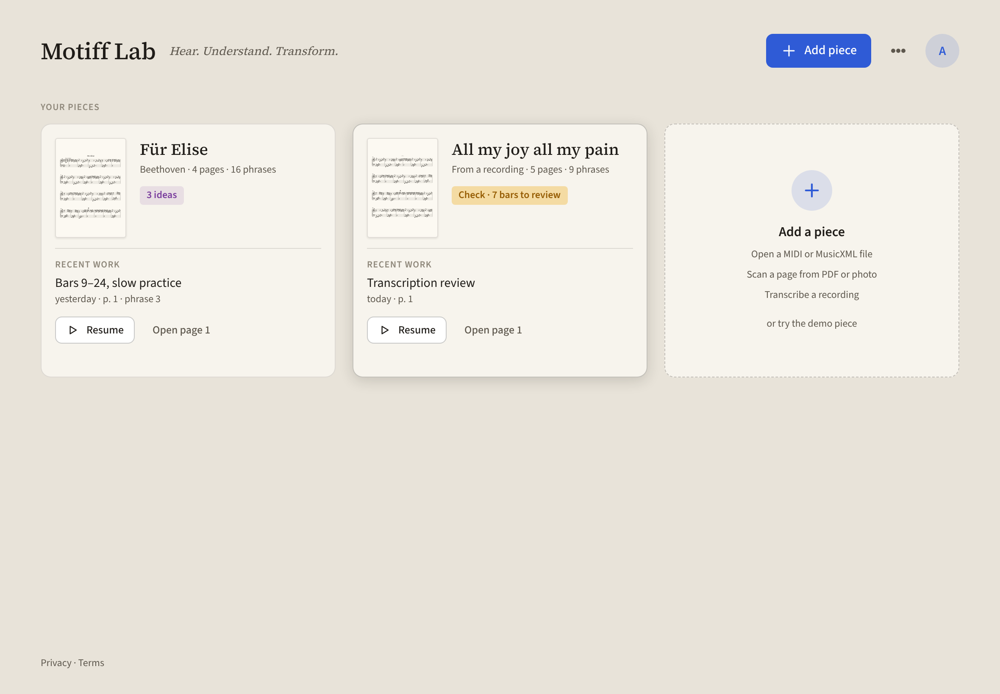

**Score page, default.** The first two pages of the continuously scrolling document on the desk, the bar floating over the top margin, detected phrases as graphite brackets above the staff with their numbers, a plum dot on phrase 3 because it has a saved idea. Nothing else.

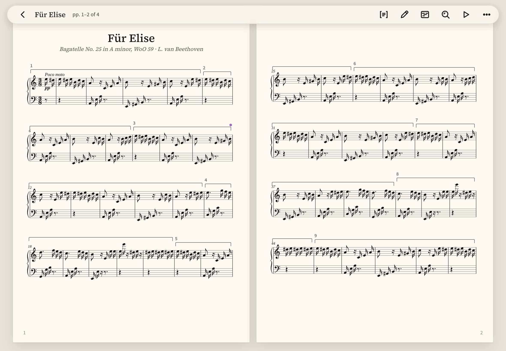

**Selection.** Phrase 3 tapped: the cobalt band covers bars 9–16 across two systems with handles at each end, the bracket turns cobalt, the contextual menu sits above the first segment, the playhead is in bar 10, and the transport pill has appeared with Loop on.

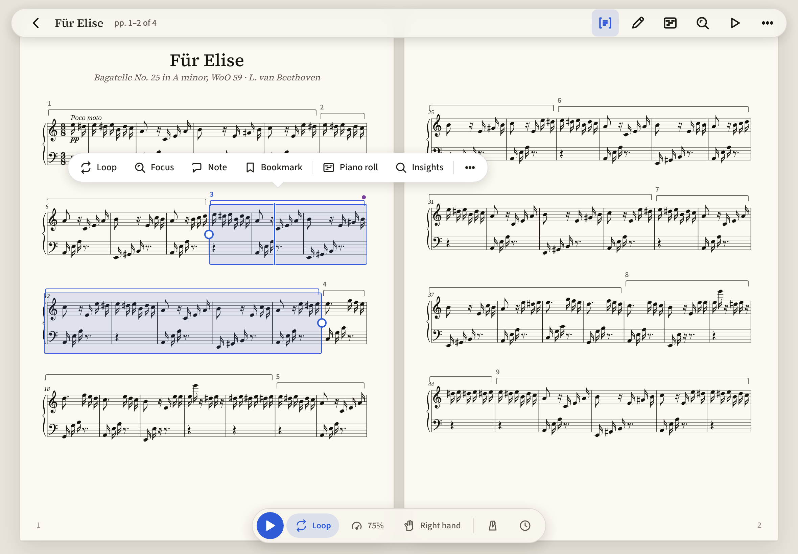

**Phrase focus, Daylight.** The page dims, the phrase lifts into a card at full width with previous / next on its edges, the ossia with the variation sits above in a plum frame, the focus bar carries Back, the position and Original / Variation / Alternate, and the piano roll drawer is open below with note names and hand colours.

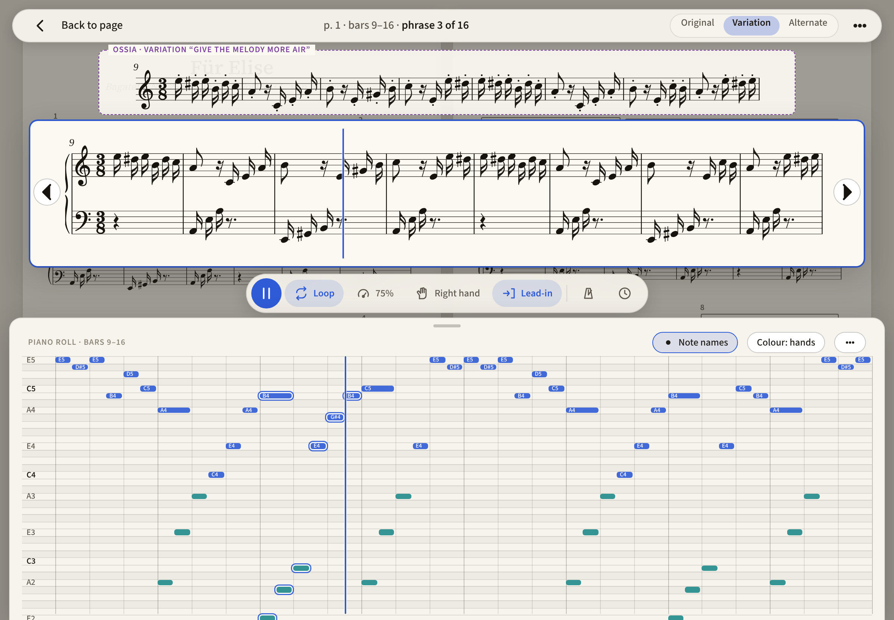

**Phrase focus, Night stand with the Slate page.** Same state, dark theme, slate notation: the cobalt and teal lighten, the paper becomes slate, every token does its job without a redesign.

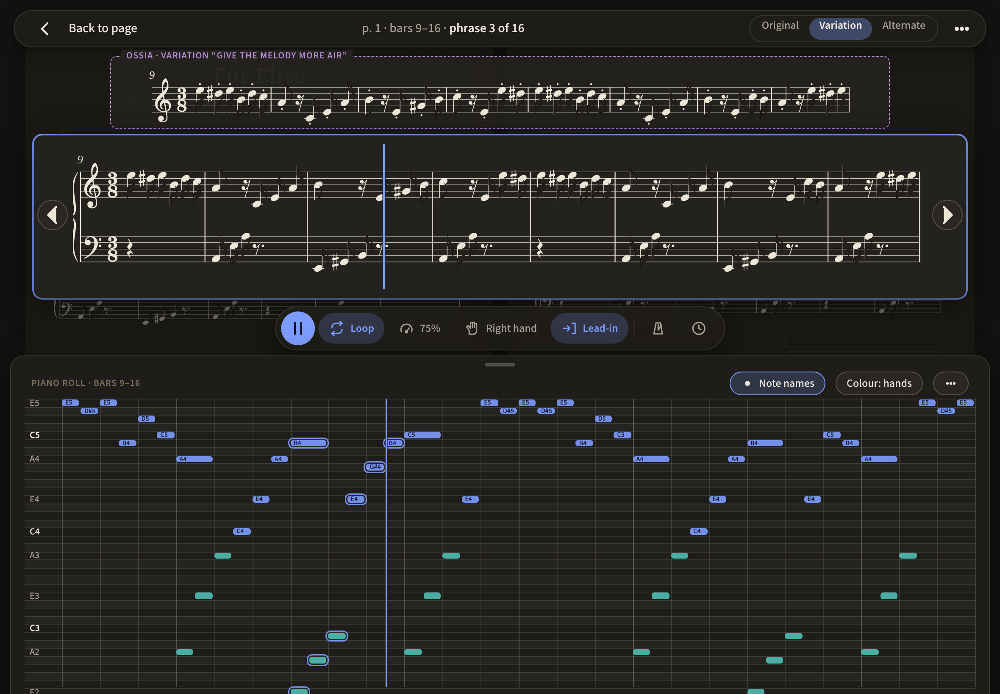

**Insights sheet.** The Insights stream open beside the selected phrase: filter chips instead of tabs, the first fact selected with its fifteen places ringed on the score and its Try chips (Dotted active, Keep, Adjust) ready; the bar has shortened to make room.

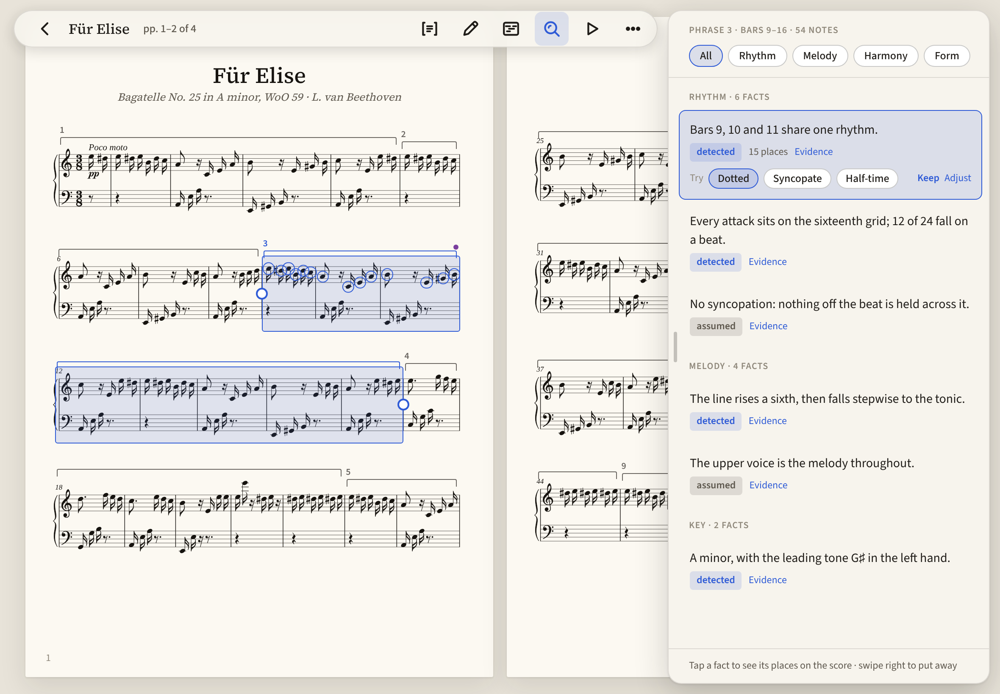

**Annotations, portrait.** The stylus palette under the Pen action; on the page: an amber margin-note marker with its popover, an amber highlighter band, a carmine bookmark bracket “difficult — slow, then RH alone” (category Practise), graphite fingering digits, a hand-drawn carmine circle with “pedal!”, and a Check flag on bar 50.

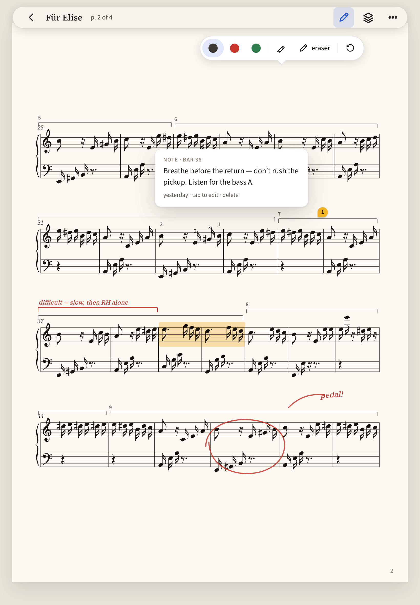

**Bookmarks.** The Contents drawer over the left of the page: Contents / Notes / Pages tabs, Score order or My order, categories with their ink colour (Practise carmine, Performance forest, Structure graphite), “Pedal from here” selected and banded on the score; bookmark brackets with their titles sit above the phrase brackets, stacking where two share bars (Opening over A).

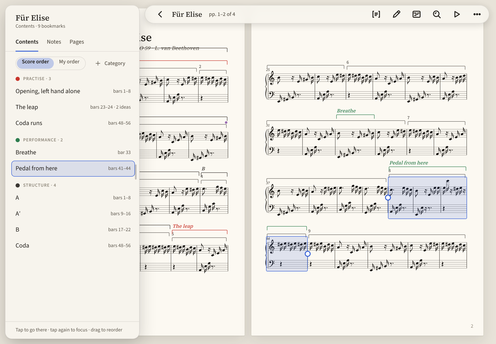

**AI Assistant.** The Insights sheet in Ask mode: scope chips, the folded Facts and What-it-knows rows, the musician’s message on the accent tint, the assistant’s answers with action chips (Loop 11.1–11.3 active, 60%, Right hand, Bookmark · Practise; Show, Add as note), a plum Pro offer, and the single input with a mic; the leap in bar 11 is ringed on the score.

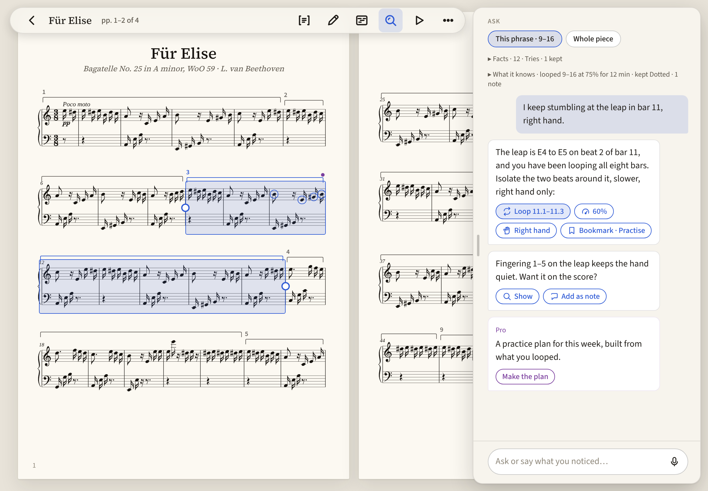

**Settings, global and contextual.** The Settings dialog over the dimmed score with its section list and the Guidance page (presets, switches with captions, this piece’s overrides, Reset to preset), and at the same time the contextual popover under the Phrases action: granularity, Show brackets, Reset to detected, This piece / Everywhere, All settings.

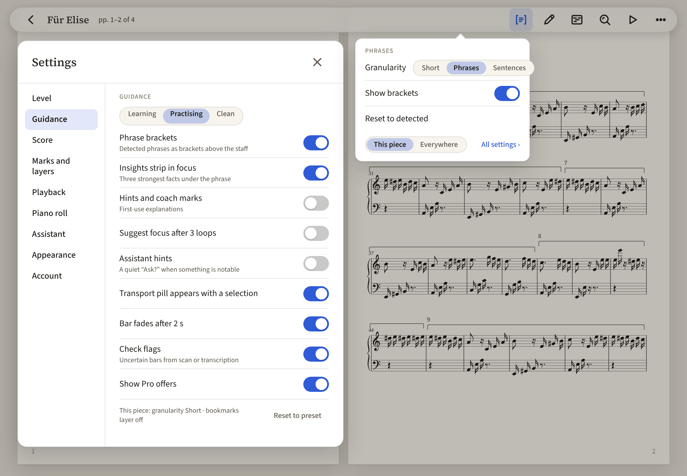

**Piece DNA.** The full-screen map: form strip with arcs between the sections that share material, bar numbers, three idea lanes with exact / varied / inverted marks, the key lane, idea cards with real engraved excerpts, Hear and In the score, and the ways back into work.

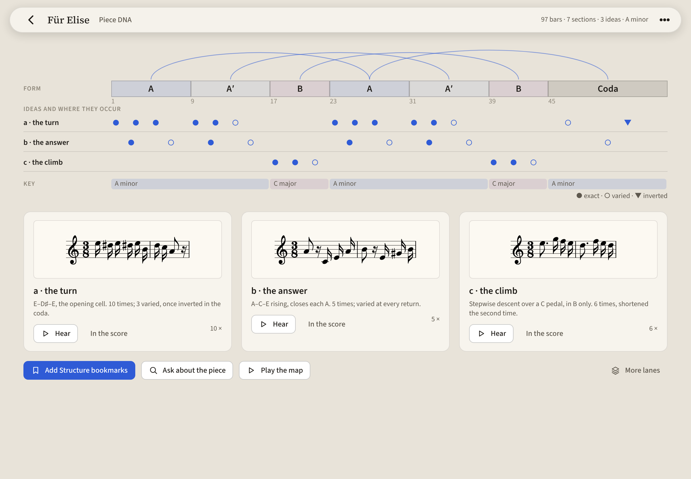

## Applying it to the existing app

The current build is a Blazor web app with Verovio notation, so the system lands as two stylesheets and a handful of engine options rather than a rewrite. The files that produced every picture in this tab are delivered alongside it: `tokens.css` (all tokens, both themes, the slate page), `ds.css` (every component and score mark), `icons.js` (the icon set as inline SVG) and the Verovio options used for the pages.

1.  **Tokens first.** Add `tokens.css` to the app shell, set `data-theme` on `<html>` from the system setting with a manual override in Settings (Appearance), and `data-page="slate"` from a Night-stand option. Replace every literal colour, radius and shadow in the existing styles with a token; the lime accent and the dark dashboard surfaces disappear in this step.

2.  **Fonts.** Self-host Source Sans 3 (400/500/600) and Source Serif 4 (400/500/600) as woff2; set `--font-ui` and `--font-display`; turn on tabular numerals globally.

3.  **Verovio.** `font: "Leland"`, `header: "auto"` with the engraved header hidden by CSS (it reserves the top margin the bar sits in), `pageHeight 2970`, `pageWidth 2100`, `scale 50`, `pageMarginTop 500`, side margins 150, `spacingSystem 20`, `svgViewBox true`. Set `color` on the SVG container and `fill: currentColor` on `use` elements so notation follows `--notation` and the Slate page works. Measure and system positions come from the rendered `g.measure` and `g.staff` bounding boxes, which is how the brackets, bands and rings here are placed.

4.  **Components.** Rebuild the chrome from `ds.css` in this order, matching the UX tab’s priorities: bar, transport pill, contextual menu, selection band and brackets, phrase focus card and ossia, drawers and the sheet, library cards, dialogs and toasts.

5.  **Marks.** Ink, notes, highlights, bookmarks and fingering are stored per bar and drawn from the measure boxes; the styles in the Score surface table are the only ones used.

6.  **Check.** Verify the contrast table against the shipped build (the values above are computed from the tokens), test the Slate page with the four ink colours, and run both orientations on an iPad 11″ and 13″.

What this tab does not decide: the final wordmark and app icon (proposed above, to be drawn once the direction is approved), the exact fade timing of the bar after use testing, and the rendering of the Russian set (both languages ship, for the interface and all generated content), which affects button widths in the pill and menu and is checked with the longest labels (“Правая рука”, “Фортепианный ролл”).
