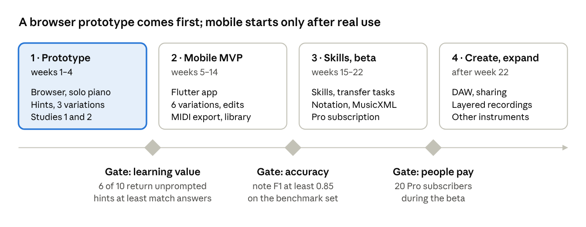

<!-- Exported from the Motiff Lab specification doc (https://claude.ai/artifact/8uR7nDk6Z7ar8vLjbsCMz3) on 2026-10-22. Edit here or in the doc; keep them in sync. -->

# Motiff Lab — Product Concept & Specification

Oct 22, 2026 · @Andrei

## Summary

> **Brand:** Motiff Lab · Hear. Understand. Transform. (Brand Identity). **First milestone:** Stage 1, notation-based motif exploration with MIDI and MusicXML (MVP · Stage 1). The audio-based vision below stays the long-term goal; earlier tabs use the working title "Motif Lab" for the same product.

Motif Lab helps pianists learn music they love by ear, understand how it works, and make their own variations of it. The user imports a recording, picks a short passage, and reconstructs it with progressive hints; the app then explains the structure and offers controlled transformations of the motif.

> Do not simply tell musicians what to play. Help them understand what they hear, reconstruct it themselves, and discover what else they can do with it.

Transcription and generation are supporting capabilities, not the product. The first release targets short passages from solo piano recordings and tests one loop end to end: select, listen, reconstruct, understand, transform, perform. Layered recordings and other instruments come after that loop is validated.

This Overview holds the vision, development stages, scope, business model, roadmap and risks. MVP · Stage 1 specifies the first release and Brand Identity the name, voice and look. Four more tabs specify the reconstruction and audio stages: PRD (requirements), MVP UX (screens and flows), Domain & Architecture (domain model and system design) and Validation Plan (experiments and metrics). "Motif Lab" in those tabs is the earlier working title.

## Problem

A pianist hears a motif in a favourite recording and wants to play it, understand why it works, and improvise around it. Today that takes trial and error plus a mix of transcription software, MIDI tools, notation editors and separate practice apps. None of them guides the learning itself.

Existing tools sit at two extremes:

- **Full answers.** Transcription apps (Piano2Notes, Songscription, AnthemScore) and chord apps (Chordify) produce notes, chords or a score. That solves the immediate problem but removes the listening work the player wanted to do.
- **Drills and generators.** Ear-training apps quiz intervals on synthetic sounds, disconnected from real music. AI generators produce new material without teaching how or why it works.

The core question is not "how do I convert audio into notes?" but "how can I use music I love to learn to hear, reconstruct, understand and transform musical ideas?" The product should reduce the friction of that process without removing the effort that makes it learning.

Competitor features are from memory and need a check before this doc is shared.

## Vision and principles

The promise to users: take a musical idea you love, figure out how it works, and make it your own.

- **Vision.** Make musical understanding and creative independence accessible by turning familiar music into a space for listening, reconstruction, experiment and practice.
- **Mission.** Help musicians move from copying music to understanding and transforming it.
- **Positioning.** An AI-assisted learning and creative workspace, between transcription, ear training, practice, harmony and improvisation. It is not an audio-to-MIDI converter, a chord app, a sheet-music generator, a generic AI composer or a drill app.

Eight principles guide every requirement in the PRD:

| Principle | What it means in the product |
| --- | --- |
| Learning over transcription | Optimise for what the player can do afterwards, not for notes detected |
| Progressive disclosure | Show only what is needed to make progress; more on request |
| Active listening | Listen, predict, attempt, compare and correct before looking |
| Understanding over isolated facts | Explain relationships: shared notes between chords, how the bass supports harmony, how voices move |
| Controlled creativity | Transform the user's motif on purpose, one property at a time; no unrelated generation |
| Transferable skills | Practise applying a concept to new passages |
| User agency | The AI proposes and explains; the musician decides |
| Technical honesty | Mark detected, inferred, user-confirmed and uncertain information, and allow corrections |

## Users and use cases

The primary user is a self-directed pianist, late beginner to intermediate, who can play but struggles to work music out alone. Piano comes first because a keyboard shows melody, bass and harmony in one clear picture. Every other audience waits until the core loop works for this person.

| Audience | Need | Phase |
| --- | --- | --- |
| Self-directed pianist (primary) | Reconstruct passages by ear, understand them, make variations | 1–2 (MVP) |
| Piano teacher | Assign passages; see hints used and skills shown | 3 |
| Songwriter or composer | Study and develop motifs from music they admire | 3 |
| Producer | Reconstruct motifs from layered tracks; export MIDI | 4 |
| Guitarist, bassist, other instrumentalist | The same loop on their instrument | 4 |
| Novice DJ | Key, tempo and harmony of a track | 4 |

Typical traits of the primary user:

- Plays some pieces; knows basic notes, chords, scales and rhythm.
- Prefers learning from music they enjoy over abstract exercises.
- Wants to rely less on sheet music and video tutorials.
- Wants to start improvising and arranging.
- Is curious about how music works but has little formal theory.

## Core journey and modules

The product is built around one journey on one short passage: Discover → Select → Listen → Reconstruct → Understand → Transform → Perform → Retain. Each step maps to one of six modules.

| Step | What happens | Module |
| --- | --- | --- |
| 1. Discover | Import a recording or pick a library piece; the app proposes sections and repeated motifs | A |
| 2. Select | Choose a passage of about 2–8 bars; it becomes its own workspace | B |
| 3. Listen | Loop, slow down, hear each hand separately, hear the passage in context | B |
| 4. Reconstruct | Play or enter notes, get feedback, reveal hints when stuck | C |
| 5. Understand | Explore melody, bass, harmony and rhythm, with short explanations | D |
| 6. Transform | Change one property of the motif and compare with the original | E |
| 7. Perform | Play the original or a variation without visual help | C, F |
| 8. Retain | Hints used, skills shown and saved variations build a personal library of discoveries | F |

| Module | Purpose | Depth in the MVP |
| --- | --- | --- |
| A. Audio import and analysis | Turn a recording into an editable, approximate musical representation | Solo piano: notes, pedal, beats, key, chords, sections, confidence |
| B. Motif and phrase workspace | Make a short passage the central object of work | Full |
| C. Guided reconstruction | Help the player work out a passage with feedback and hints | Full, with MIDI and on-screen keyboard |
| D. Structure explorer | Explain how melody, bass, harmony and rhythm relate | Basic: chords, bass line, intervals, contour, rhythm grid |
| E. Variation engine | Transform a motif on purpose and learn from the result | Six operations, one property at a time |
| F. Practice and skills | Consolidate discoveries, track separate skills, test transfer | Progress and hint history; skill profile and transfer tasks in phase 3 |

## Development stages

Motiff Lab is built in four stages, each validated before the next is committed. Stage 1 is the first implementation milestone; it starts from notation so the core idea can be tested without first solving audio transcription.

| Stage | Goal | Input | Status |
| --- | --- | --- | --- |
| 1. Notation-based motif exploration | Validate the value of exploring motifs and making meaningful variations, with rhythm restoration of played MIDI and optional AI explanations | MIDI, MusicXML | First milestone, about 12 weeks; specified in MVP · Stage 1 |
| 2. Guided reconstruction and ear training | Attempts, progressive hints, feedback, independent reproduction | Notation, MIDI keyboard | Specified in the PRD, MVP UX and Validation Plan tabs |
| 3. Audio-based reconstruction | Start from a recording, through the same workspace | Solo piano recordings, later layered music | Specified in the PRD, MVP UX and Domain & Architecture tabs |
| 4. Advanced creative exploration | Reharmonisation, motif development, DAW, more instruments, sharing where licensed | All inputs | Ideas backlog and could-have items below |

Whatever the input, the player reaches the same workspace, event model and journey, so each stage adds capability without changing the product's purpose.

## Product scope

The MVP validates the whole journey on one passage of solo piano, not complete music understanding. Must-haves ship in the browser prototype (phase 1) or the mobile MVP (phase 2); could-haves wait for validation results. Requirement IDs for each line are in the PRD.

*Stage note: this table describes the audio-based release (Stages 2–3). The first release is the Stage 1 notation MVP, whose scope is in its own tab.*

| Feature | Priority | Phase |
| --- | --- | --- |
| Import a solo piano recording the user owns (MP3, WAV, M4A) | Must | 1 |
| Analysis: notes, pedal, beats, key, chords, sections, with confidence | Must | 1 |
| Select a passage; suggested phrases and repeated motifs | Must | 1 |
| Loop, slow down, transpose, hands-separate playback | Must | 1 |
| Piano roll and keyboard views of the estimated notes | Must | 1 |
| Attempts via MIDI keyboard or on-screen keyboard | Must | 1 |
| Progressive hints in four tiers, and a full-reveal view | Must | 1 |
| Compare attempt with reference; feedback by error type | Must | 1 |
| Variation operations, one property at a time (3 in phase 1, 6 in phase 2) | Must | 1–2 |
| A/B playback of original, attempt and variation | Must | 1 |
| Save passages, attempts and variations | Must | 1 on device, 2 in account |
| Edit notes and timing (corrections) | Should | 2 |
| Explanations of chords, motifs and variation operations | Should | 2 |
| MIDI export of attempts and variations | Should | 2 |
| Starter library of public-domain pieces | Should | 2 |
| Progress and hint history | Should | 2 |
| Skill profile and transfer tasks | Could | 3 |
| Staff notation and MusicXML export | Could | 3 |
| Microphone input for acoustic pianos | Could | 3 |
| Voice-leading analysis, reharmonisation, ornaments | Could | 3 |
| AI tutor for open questions about a passage | Could | 3 |
| Layered recordings with part isolation; other instruments | Could | 4 |
| DAW integration; sharing where rights allow; DJ view | Could | 4 |

**Non-goals**

- Reliable transcription of any instrument in any recording, or of whole orchestral or densely produced tracks.
- A full DAW or notation editor.
- A general-purpose AI composition platform.
- Social features and public sharing in the MVP.
- Guaranteed copyright clearance for uploaded recordings or derived arrangements.

## Ideas backlog

Ideas from brainstorming that are not yet in scope. Earlier ideas such as the mistake view, rhythm-first hints and simplified arrangements are now part of the PRD.

| Idea | Why it helps | Earliest phase |
| --- | --- | --- |
| Predict the next note: the passage pauses and the player plays or sings what comes next | Trains active listening and prediction | 2 |
| Duet mode: the app plays the accompaniment of a variation while the player plays the melody | Makes variations feel like real music | 2 |
| Pedal hints: show where the sustain pedal changes | Pedal shapes the solo piano sound and is hard to hear | 2 |
| Concept cards: save a discovered concept (for example an anticipation) and link it across pieces | Builds a personal library of musical ideas | 3 |
| Motif map across the whole piece | Learning one motif solves many bars | 3 |
| Fingering suggestions for a solved passage | Avoids awkward habits once the notes are known | 3 |
| Daily motif: a 5-minute passage picked from the user's own library | Habit without new imports | 3 |
| Teacher packs: chosen passages and a hint limit per student | Teachers as a sales channel | 4 |

## Copyright, privacy and legal

The app works only on audio the user already has, never hosts or shares it, and deletes uploads after analysis. This is the main design rule that keeps the product on safe ground; it needs a lawyer's review before launch.

**Copyright**

- No import from streaming services or video sites. Their terms forbid downloading, and it would make the app a ripping tool.
- Uploaded audio is deleted within 24 hours of a finished analysis. Isolated parts, when added in phase 4, are made for that user only and also expire.
- Notes, MIDI and notation of a copyrighted piece are personal study copies. They are shown and exported only to the user who uploaded that file, never shared or published in the app, and the terms say exports are for personal practice.
- The starter library uses public-domain compositions with recordings whose licence allows commercial use. Each recording's licence is checked and stored.
- Variations of copyrighted motifs (phase 4) stay private; sharing them needs its own review.

**Privacy (GDPR, as the service starts in the EU)**

- Collect the minimum: email, practice data, file hashes. No audio kept.
- Microphone audio, when added, is processed on the phone and never uploaded.
- Account deletion removes all personal data; processors (hosting, auth, payments) sign data processing agreements.
- A plain-language privacy policy before the first public beta.
- AI assistance (from Stage 1) is off until the player turns it on, sends only a digest of engine facts about the current motif to Azure AI Foundry in an EU region, and stores no prompts on Motiff Lab servers (decision record 0003).

This section is product thinking, not legal advice.

## Business model and costs

Proposal: freemium, with a small free monthly allowance of imported pieces and a low-priced Pro subscription. The main cost grows with the number of pieces analysed, so the free tier is capped by imports, not by practice time.

| Plan | Includes | Proposed price |
| --- | --- | --- |
| Free | 3 imported pieces a month, the starter library, the full journey with hints, 3 variation operations | €0 |
| Pro | Unlimited imports, all variation operations, explanations, corrections, MIDI export, progress history; later skill profile, notation and AI tutor | about €5 a month or €40 a year |
| Teacher (later) | Pro for the teacher, student seats, teacher packs, student progress | to be decided |

Prices are placeholders to test, not market research.

**Cost drivers**

- Analysis compute per new piece, mostly the piano transcription model. Part isolation in phase 4 adds more. Shared results by audio hash cut this for popular pieces.
- Storage is small: audio is deleted, and results are a few hundred kilobytes of JSON per piece.
- AI tutor calls, metered per Pro user.
- App store fees on subscriptions, plus hosting, auth and email at low fixed cost.

Cost per analysed piece is the number that decides the free allowance. Measure it in the prototype before fixing prices (NFR-15).

*Stage note: Stage 1 is free while it is validated; these plans apply from Stage 2, when accounts and analysis costs arrive.*

## Roadmap

Four phases over about 22 weeks of part-time work, each started only when the previous gate is passed. The browser prototype is cheap to build and answers the two biggest questions: does guided reconstruction help players learn, and is the analysis accurate enough?

*Figure: roadmap · 4 phases, 3 gates*

Week counts assume one person working evenings and weekends. Gate thresholds and the continue, change or stop rules are defined in the Validation Plan, so the decision to continue is made on data, not enthusiasm.

*Stage note: this roadmap covers the audio-based product (Stages 2–3). It begins after the Stage 1 exit gate, about 12 weeks from the start; Stage 1 milestones are in the MVP · Stage 1 tab.*

## Risks and open questions

The biggest risk is note accuracy on real-world piano recordings: heavy pedal, reverb and old recordings blur notes, and a wrong hint teaches the wrong thing. The prototype exists mainly to measure this on pieces players actually want to learn.

| Risk | Impact | Mitigation |
| --- | --- | --- |
| Analysis accuracy: pedal blur, reverb or poor recordings cause wrong notes | Players lose trust | Solo piano first, quality score on import, confidence shading, corrections |
| Learning friction: players want instant answers and leave | Low retention | Player sets the assistance level; the full reveal is always one tap away; measured in Study 2 |
| Novelty without skill: variations are fun but players do not become more independent | The product fails its promise | Hint-free performance, transfer tasks, skill metrics (Validation Plan) |
| Variations sound mechanical | Players stop creating | Rule-based operations with musical constraints, user edits, ratings in Study 1 |
| Hand split is wrong where hands cross or overlap | Hands-separate practice breaks | Players can reassign notes; train a model on corrections later |
| Excessive scope | MVP never ships | One motif-level journey first; phase gates |
| Weak differentiation: others copy the visible features | Low pricing power | Quality of the reconstruction flow, the transformation model and proven learning outcomes |
| Model and library licences block commercial use | Rewrite or paid licence | Check every licence in the prototype; prefer permissive ones |
| Exports and variations seen as copying | Legal or app-store trouble | Personal-use exports only, no sharing in the MVP, legal review before launch |
| Layered music is much less accurate than solo piano | Phase 4 slips | Treat it as a separate bet; start with piano-led arrangements |
| One-person team | Slow progress | Browser prototype first; managed services for auth, payments, hosting |

**Open questions**

- [ ] Which hint tiers help most, and in what order? (Study 1)
- [ ] Does progressive disclosure beat the full answer on transfer, or only on engagement? (Study 2)
- [ ] Which piano transcription model gives the best accuracy for its licence and cost?
- [ ] What note accuracy is good enough for the learning loop?
- [ ] Which six variation operations matter most to players?
- [ ] Should the full-reveal view be free, to build trust, or part of Pro?
- [x] Flutter or React Native, given the native audio work? Decided: .NET MAUI (decision record 0001).
- [x] music-core in Rust (one library everywhere) or TypeScript (faster start for the prototype)? Decided: C# (decision record 0001).
- [ ] Which recordings can the starter library and the study passages legally use?
- [ ] Clear the brand name Motiff Lab (checklist in Brand Identity).
