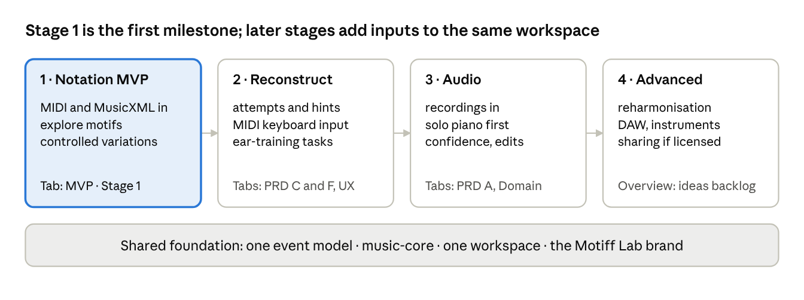
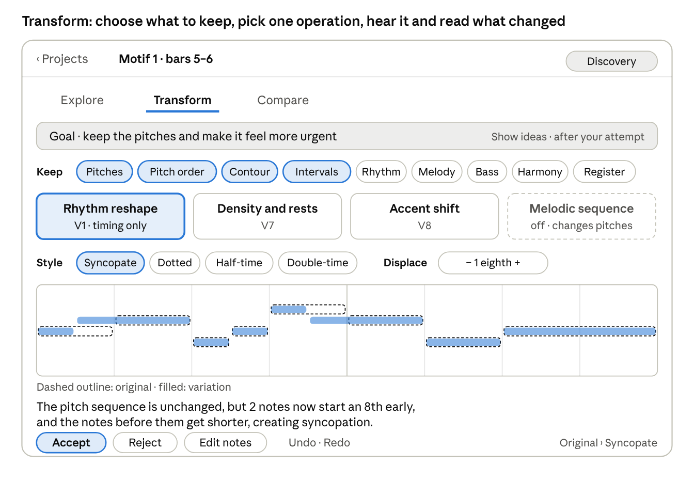
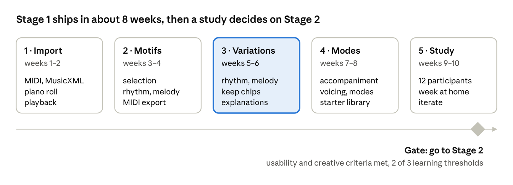

<!-- Exported from the Motiff Lab specification doc (https://claude.ai/artifact/8uR7nDk6Z7ar8vLjbsCMz3) on 2026-10-22, then refined in this repository on 2026-10-22 (AI assistance, rhythm restoration, acceptance criteria). This file is now the current Stage 1 specification. -->

# MVP · Stage 1: Notation-Based Motif Exploration

## Stage 1 at a glance

The first release of Motiff Lab works on structured music, not audio. Players import a MIDI or MusicXML file, explore the piece and its motifs, restore the rhythm of a played performance, and transform a motif through controlled, explained variations. A deterministic music engine computes every note, timing, analysis and transformation. Optional AI assistance, hosted on Azure AI Foundry, explains those results in plain words and suggests what to try next. Stage 1 is the first implementation milestone of the full vision, not a replacement for it.

| Item | Stage 1 decision |
| --- | --- |
| Goal | Validate that musicians find value in understanding a motif's structure and making meaningful variations of it, with or without AI help |
| Primary user | The self-directed pianist from the Overview, plus songwriters who already work with MIDI |
| Input | MIDI (.mid) and MusicXML (.musicxml, .mxl) files |
| Core journey | Import and explore → Understand → Restore rhythm (when needed) → Transform → Compare and learn |
| Central feature | The variation engine, with explicit Keep choices and an explanation built from the actual change |
| AI role | Interprets engine results, asks questions, gives hints and suggests goals and parameters. It never produces the notes, the timing or the analysis |
| Learning | Discovery, Guided and Analysis modes; the player tries first and help comes on request |
| Platform | Desktop and tablet browser (Blazor WebAssembly PWA). The core journey works offline and without AI |
| Cloud | Static hosting, an anonymous analytics endpoint and a thin AI gateway (Azure Functions). Imported files never leave the device |
| Output | Saved variations in the project; MIDI export |
| Not in Stage 1 | Audio import or transcription, audio-based rhythm restoration, MIDI keyboard input or MIDI output to instruments, sync with other devices or apps, reconstruction attempts with hints, PDF or image scores, reharmonisation |
| Exit gate | Usability, creative-engagement, learning-potential and AI-trust criteria in the validation study below |

The guiding principle for this stage: help musicians move from reproducing existing music to understanding it, transforming it, and eventually creating independently.

## Where Stage 1 sits

Motiff Lab is built in four stages, each validated before the next is committed. Stage 1 starts with notation; Stages 2 and 3 are specified in the PRD, MVP UX, Domain & Architecture and Validation Plan documents, which stay the long-term specification.



*Figure: development stages · 4 stages on one foundation*

| Stage | Goal | Input | Specified in |
| --- | --- | --- | --- |
| 1. Notation-based motif exploration | Validate the value of exploring motifs and making meaningful variations | MIDI, MusicXML | This document |
| 2. Guided reconstruction and ear training | Turn exploration into explicit learning: attempts, progressive hints, feedback, independent reproduction | Notation, MIDI keyboard | PRD modules C and F, MVP UX flows 2, 3 and 6, Validation Plan studies 1–3 |
| 3. Audio-based reconstruction | Start from a recording instead of a score, through the same workspace | Solo piano recordings, later layered music | PRD module A, MVP UX flow 1, Domain & Architecture analysis pipeline, accuracy benchmark |
| 4. Advanced creative exploration | Reharmonisation, motif development, counter-melodies, personalised paths, DAW, more instruments, sharing where licensing permits | All of the above | Overview ideas backlog and could-have items |

The "phase 1–4" labels inside the PRD and other documents describe the release plan for the audio-based product (Stages 2–3). They are kept as written; their phase 1 now starts after the Stage 1 exit gate.

## Why start with notation

Structured files remove the riskiest technical problem, polyphonic audio transcription, so the first months test the product's core idea: does exploring and transforming a motif help musicians understand and create? Notes arrive exact, so every explanation and variation can be trusted, and AI can be checked against known facts.

| Question | Notation-first answer |
| --- | --- |
| What risk is removed? | Transcription accuracy (Overview risk 1), GPU cost, audio licensing of models, and the backend needed to run them |
| What is still validated? | Motif selection, structure exploration, rhythm restoration of played MIDI, the variation engine, Keep constraints, explanations, AI assistance, comparison, and early learning signals |
| What is not validated yet? | Learning by ear from recordings, which Stages 2 and 3 test with the PRD, UX and Validation Plan |
| What carries forward? | The event model, music-core, variation operations, playback, the AI gateway and its grounding rules, the workspace layout and the brand |
| What is the trade-off? | Fewer players own MIDI or MusicXML files of the music they love; Stage 1 must make getting files easy (see Content sources) |

Because audio-derived and file-derived notes share one representation, Stage 3 adds a new input to the same workspace instead of building a second product.

## Core journey

Every Stage 1 screen serves one of five steps. Steps 1, 2, 4 and 5 are the core loop; step 3 appears only when the imported file is a played performance.

| Step | The player | The engine (deterministic) | AI assistance (optional) | Screens |
| --- | --- | --- | --- | --- |
| 1. Import and explore | Loads a file, looks over the piece, picks a motif | Parses, builds measures, finds repeats and phrase boundaries, plays back | Points out a few places worth exploring, for example a motif that returns transposed | N1–N3 |
| 2. Understand | Studies the motif's melody, rhythm, harmony, repetition and phrasing | Computes intervals, contour, rhythm grid, chords, repeats, phrase spans and character facts | Explains in plain words what the facts mean and how motifs relate; answers "why does this sound like that?" | N4 |
| 3. Restore rhythm | Aligns a played MIDI performance to a grid and compares before and after | Detects unquantised timing, aligns to the chosen grid and strength, keeps the original | Recommends a grid and strength from the measured timing, and says why | N2b |
| 4. Transform | Says what to keep, sets a goal, applies one operation at a time or edits notes by hand | Runs the operation, checks Keep constraints, builds the diff and the factual explanation | Suggests goals, operations and parameters that fit the Keep choices; in Discovery, only after the player's own attempt | N5 |
| 5. Compare and learn | Listens to versions, answers what changed, saves or exports | Plays A/B and layered, overlays differences, records learning data, exports MIDI | Asks a listening question, gives feedback on the player's answer, connects the change to a musical idea | N6, N7 |

The player can complete every step without AI. AI never replaces an engine result; it interprets one.

## Scope

Stage 1 must deliver one complete journey on one motif; everything else is labelled with the stage where it arrives. Requirement IDs (S1-…) are defined in the next sections.

| Capability | Priority | Requirement IDs |
| --- | --- | --- |
| Import MIDI and MusicXML; keep tempo, meter, key, tracks, voices | Must | S1-I1 to S1-I5, S1-I8 |
| Correct or remove imported events; edit single notes | Must | S1-I7, S1-E7 |
| Workspace with piano roll, keyboard, playback, loop and tempo | Must | S1-W1 to S1-W6 |
| Manual motif selection by bars, track, voice or individual notes | Must | S1-M1 to S1-M5 |
| Rhythm and melody views (onsets, durations, rests, intervals, contour) | Must | S1-A1, S1-A2 |
| Repetition and phrase structure, character facts | Must | S1-A4, S1-A5 |
| Rhythm restoration of performance MIDI with before/after comparison | Must | S1-R1 to S1-R7 |
| Variation engine with Keep constraints and factual explanations | Must | S1-E1 to S1-E10 |
| Undo, redo, A/B compare, multiple named variations | Must | S1-E5, S1-E6, S1-E8 |
| MIDI export of motifs and variations | Must | S1-X1 |
| Discovery, Guided and Analysis modes | Must | S1-L1 to S1-L3 |
| Projects saved on the device | Must | S1-P1 |
| AI consent, data disclosure and a working app with AI off | Must | S1-AI0 |
| AI explanations of structure and changes | Must | S1-AI1 |
| AI variation goals and parameter suggestions | Must | S1-AI2 |
| Harmony view where chords exist (bass, chord labels, voicings) | Should | S1-A3 |
| Automatic motif suggestions (repeats) | Should | S1-M6 |
| Listening comparison tasks ("what changed?") | Should | S1-L4 |
| AI creative opportunities and motif relationships | Should | S1-AI3 |
| AI rhythm-restoration recommendations | Should | S1-AI4 |
| AI questions, hints and feedback in the three modes | Should | S1-AI5 |
| Starter library of public-domain files | Should | S1-C1 |
| Score view: the piece, motif and variation as notation, following playback | Must | S1-W7 |
| The score on A4 pages and as a PDF | Must | S1-W9 |
| Free-form questions to the AI about a passage | Could | S1-AI6 |
| Playback to a connected MIDI instrument; MIDI keyboard input | Later | Stage 2 |
| Reconstruction attempts, progressive hints and feedback on played attempts | Later | Stage 2 (PRD module C) |
| Accounts, sync, mobile apps | Later | Stage 2 |
| Rhythm restoration of free-tempo performances (no usable tempo map) | Later | Stage 2 or 3, with beat tracking |
| Audio import, transcription and audio-based rhythm restoration | Later | Stage 3 (PRD module A) |
| Sync with DAWs, other devices or apps | Later | Stage 4 |
| PDF or photographed scores (optical music recognition) | Started | Pulled forward 2026-10-25: homr on a scan server the player runs on their own computer, with a Check the scan step (decision record 0011). MusicXML exported by any OMR tool still imports like any other MusicXML |
| Harmonic colour, reharmonisation, counter-melodies | Later | Stage 4 |

**Out of scope for Stage 1**

- General-purpose audio-to-MIDI transcription, or transcription of full polyphonic recordings.
- External MIDI device setup, MIDI hardware connectivity, and synchronisation with external devices and applications.
- PDF or image-based score recognition.
- Advanced reharmonisation and AI-generated music: AI does not write notes in Stage 1.
- Full DAW functionality, or support for every instrument.
- Social features and public distribution of copyrighted arrangements.

**Changes from the exported specification:** S1-I6 now hands off to the new rhythm-restoration section (S1-R); S1-W8 (MIDI output) moved to Stage 2; the score view S1-W7 moved from Should to Could, and then on 2026-10-22 up to Must, because seeing notation while listening matters to the players this stage is for; S1-A4, S1-A5 and the S1-AI requirements are new.

## Functional requirements

These requirements cover everything in Stage 1 except rhythm restoration, the variation engine, learning modes and AI assistance, which follow in their own sections. Where a Stage 1 requirement matches one in the PRD, it is noted so later stages reuse it. Musical time follows decision record 0002 (`docs/decisions/0002-canonical-time.md`).

### Import

| ID | Requirement | Priority |
| --- | --- | --- |
| S1-I1 | Accept .mid (Standard MIDI File type 0 and 1, timed in ticks per quarter note) and .musicxml or .mxl (MusicXML) files up to 50 MB | Must |
| S1-I2 | Parse notes (pitch, onset, duration, velocity), rests, chords, ties (merged into one note), tuplets and grace notes (flagged); exclude MIDI drum channel 10 with a notice | Must |
| S1-I3 | Keep the tempo map, time signatures, key signatures and pickup bars; MIDI without a time signature is read as 4/4 with a notice | Must |
| S1-I4 | Keep track, part and instrument names; split a piano grand staff into right and left hand by staff; for a single-track piano MIDI, infer hands by pitch and continuity, marked as inferred | Must |
| S1-I5 | Build measures; mark phrase boundaries only when the source supports them (slurs or phrase marks, rests of a beat or more, repeat signs) | Must |
| S1-I6 | Detect unquantised performance MIDI and offer Restore rhythm (see S1-R1) | Must |
| S1-I7 | Let the player correct or remove imported events; changes go to the edit log as user-edited | Must |
| S1-I8 | Show an import report: tracks, notes, measures, timing that had to be rounded, and any warnings | Must |

### Workspace and playback

| ID | Requirement | Priority |
| --- | --- | --- |
| S1-W1 | A project holds one source file, its motifs and their variations; it opens on an overview of the whole piece with one lane per track | Must |
| S1-W2 | Piano roll with measure and beat grid, zoom, colour and pattern by track or voice, selectable notes | Must |
| S1-W3 | Keyboard view lights the sounding notes during playback | Must |
| S1-W4 | Playback in the browser: play, pause, loop the motif, tempo 25–150%, metronome, count-in, solo and mute per track | Must |
| S1-W5 | Sources: original motif, variation, both layered, and A/B switching at the same position (as PRD FR-E6) | Must |
| S1-W6 | Switching between Explore, Restore, Transform and Compare keeps the selection and playback position (as PRD FR-B8) | Must |
| S1-W7 | Score view of the piece, the motif and its variation: a MusicXML source as written, or notation generated from the notes (MIDI imports, variations) and labelled as generated; the notes being heard are highlighted and the view follows playback (decision record 0008) | Must |
| S1-W9 | The score on A4 pages, headed by the piece's title and numbered, and downloaded as an A4 PDF with the notation as vectors, in the browser and the iPad app (decision record 0017) | Must |

### Motif selection

| ID | Requirement | Priority |
| --- | --- | --- |
| S1-M1 | Select a range by dragging across measures; edges snap to beats; 1–8 bars | Must |
| S1-M2 | Limit the motif to one track, part, hand or voice, for example the melody only | Must |
| S1-M3 | Select individual notes to form a motif (2–32 notes) | Must |
| S1-M4 | A motif keeps a link to its source position; "Show in piece" jumps there | Must |
| S1-M5 | Repeat-play a motif and duplicate it into a new variation | Must |
| S1-M6 | Suggest motifs from exact and transposed repeats in the melody | Should |

A motif is the set of note IDs the player selected, across one or more voices, plus the harmonic context of the bars it spans. Melodic views and operations use its melody voice; accompaniment and voicing operations use its other voices. This replaces the one-voice, 3–16-note definition in Domain & Architecture for Stage 1; the domain document's derived views still apply to the melody voice.

### Structure analysis

| ID | Requirement | Priority |
| --- | --- | --- |
| S1-A1 | Rhythm: onsets on the grid, durations, rests, subdivision and grouping, syncopations, accents where marked, repeated rhythmic patterns | Must |
| S1-A2 | Melody: pitch sequence, intervals (semitones and names), contour, repeated notes, scale degrees, phrase boundaries (from the source or set by the player) | Must |
| S1-A3 | Harmony, where two or more notes sound together: bass line, chord labels with inversion and alternatives (marked inferred), voicing spread, shared notes between neighbouring chords, harmonic rhythm | Should |
| S1-A4 | Repetition and phrasing: where the motif recurs (exact, transposed), phrase spans and their lengths, and which bars are new material | Must |
| S1-A5 | Character facts, each measured: tempo and its changes, note density per beat, register and range, velocity range, articulation (sounding length relative to the note value), syncopation share | Must |

S1-A5 gives the engine's measurable side of "musical character". Words such as "urgent" or "calm" come only from AI interpretation (S1-AI1) or from the player, and are labelled as interpretation.

### Export, storage and content

| ID | Requirement | Priority |
| --- | --- | --- |
| S1-X1 | Export a motif, variation or restored performance as MIDI (type 1, one track per part or hand, with tempo map), named after the project, motif and variation | Must |
| S1-P1 | Projects autosave in the browser; a project can be exported and re-imported as one file for backup | Must |
| S1-C1 | Starter library of at least 15 public-domain pieces as MusicXML | Should |

**Non-functional targets for Stage 1:** a 5,000-note file imports in under 3 s; variation and rhythm-restoration previews play within 300 ms (as PRD NFR-5); loop restarts with no audible gap; AI answers start within 5 s or show a clear fallback; the core journey works offline after the app has loaded; works in current Chrome, Edge, Safari and Firefox on desktop and tablet; WCAG 2.2 AA for app screens.

## Rhythm restoration

Many MIDI files are recorded performances: the notes are right, but onsets drift around the beat, so the piano roll looks ragged and rhythm analysis is unreliable. Restore rhythm aligns a performance to a rhythmic grid the player chooses, keeps the original, and lets the player hear and see both.

Stage 1 handles performances recorded against a tempo map, for example played to a click in a DAW, so bar and beat positions in the file are meaningful. Free-tempo performances, where the beat itself has to be found, need beat tracking and are deferred to a later stage; the app detects them and says so.

| ID | Requirement | Priority |
| --- | --- | --- |
| S1-R1 | Detect performance timing on import: the share of onsets off the 16th and triplet-8th grids, and the spread of their offsets. If it passes a threshold, offer Restore rhythm with the measured figures | Must |
| S1-R2 | Detect when the tempo map does not fit the playing (onsets do not cluster around beats at any common grid) and explain that Stage 1 cannot restore free-tempo performances | Must |
| S1-R3 | Grid choice: 8th, 16th, 32nd, triplet 8th, triplet 16th, or mixed (16th and triplet 8th, nearest wins per note); default from the detected figures | Must |
| S1-R4 | Strength 0–100% moves each onset that share of the way to the grid; durations follow the onset, and ends can optionally snap too | Must |
| S1-R5 | Scope: the whole piece, a track or hand, or the selected bars; notes the player excludes keep their played timing | Must |
| S1-R6 | The original timing is never overwritten. Restored timing is a separate layer marked as derived, with the grid and strength recorded; the player can turn it off at any time | Must |
| S1-R7 | Before and after: A/B and layered playback at the same position, and a piano-roll overlay that shows how far each note moved; a summary such as "212 notes moved, median 18 ticks, largest 61 ticks in bar 14" | Must |

Restored timing feeds rhythm analysis, motif selection and variations; the original performance stays available for playback and export. A note that moves by more than half a grid step is flagged for the player to check, since it may have been placed on the wrong beat.

## Variation engine

The variation engine is the central Stage 1 feature. The player first says what must stay the same, then applies one understandable operation, hears it at once, and reads exactly what changed. Operation IDs continue the catalogue in the PRD (V1–V6), so later stages share one engine.

### Operations in Stage 1

| ID | Category | Operation | Keeps | Changes | Parameters |
| --- | --- | --- | --- | --- | --- |
| V1 | Rhythm | Rhythm reshape | Pitches and their order | Onsets and durations | Syncopate, dotted, half-time, double-time, displace by 1–3 eighths |
| V13 | Rhythm | Articulation | Pitches, onsets | How long each note sounds | Short, detached or connected: a quarter, half or all of the time to the next onset |
| V7 | Rhythm | Density and rests | Pitch order | Note count and rests | Repeat notes in 8ths or 16ths, merge repeats, more air (a rest of one unit before each note that follows straight on), fill rests |
| V8 | Rhythm | Accent shift | Pitches and timing | Which notes are accented | Accent pattern: on-beat, off-beat, every 3rd note, first beat of the bar, custom onsets |
| V4 | Melody | Melodic sequence | Rhythm, interval shape | Pitch level, repeats | Steps −4 to +4 scale degrees, repeats 1–3, diatonic or exact |
| V9 | Melody | Interval reshape | Rhythm, contour | Interval sizes | Widen or narrow selected intervals by 1–2 scale steps |
| V10 | Melody | Change direction | Rhythm, interval sizes in scale steps | Direction of movement | Mirror the whole motif, or flip selected intervals |
| V11 | Melody | Passing and neighbour notes | Main notes and overall length | Added notes between them, in the second half of each main note | Passing (needs a key; a third to a fifth), upper neighbour, lower neighbour; where: all gaps or selected |
| V2 | Accompaniment | Accompaniment pattern | Melody, harmony | How chords are played | Broken chord, arpeggio up, up-down, Alberti, repeated chord tones; 8ths, triplets, 16ths |
| V12 | Accompaniment | Bass pattern | Melody, harmony | Bass line | Roots only, root and fifth, octaves, walk, pedal |
| V3 | Voicing | Voicing and register | Melody pitch classes, rhythm | Inversion, spacing, register, hand distribution | Root, 1st or 2nd inversion; close or open; octave shift; move a chord tone to the other hand |
| V6 | Difficulty | Simplify | Melody contour, harmony | Fewer, easier notes | Levels 1–3 as in the PRD |
| V14 | Melody | Ornament | Bass, harmony | Quick neighbour notes on long melody notes | Mordent, lower mordent, turn, trill, grace note from above or below, in 32nds on notes a quarter or longer |
| V15 | Harmony | Reharmonise | Melody, its rhythm | The chords under it | Relative or parallel chord for each major or minor chord |

V6 is a Should for Stage 1. V5 (harmonic colour) waits for Stage 4. Accompaniment and voicing operations need chord detection (S1-A3), so they ship with it; on a single melody line they are disabled with a reason. V1 and V3 extend the PRD parameters with displacement and hand distribution; the PRD catalogue should be updated to match.

V2 is built ahead of chord detection for the Explore experiments (2026-10-25): it replays the pitches each bar's accompaniment already has (held chord, repeated chord, arpeggio up or down, up-down, Alberti; 8ths, triplets, 16ths), so the harmony is the source's own and no chord has to be detected.

Chord detection (S1-A3, #46) shipped on 2026-11-01 with redesign package 3 ([0018](decisions/0018-redesign.md)), with V7, V12 and two operations the redesign adds, V14 Ornament and V15 Reharmonise. The harmony finder reads one window per beat (a dotted quarter in compound meters), scores every root and quality in whole numbers, and joins a beat to the chord before it when it fits; a stretch where only the melody sounds holds no chord. Every chord carries its inversion, a confidence and the near readings, and the harmony facts are inferred, or uncertain when a chord has a near rival. V15 is a simple, explainable reharmonisation (relative and parallel chords); V5 harmonic colour still waits for Stage 4. V8 Accent shift (velocities only, around the passage's median) and V11 Passing and neighbour notes followed on 2026-11-01, with grace notes in V14. V3 Voicing and register (inversions, close or open spacing, octave shifts, a chord tone to the right hand) and V6 Simplify (level 1 keeps melody and bass, level 2 plays chord roots in the bass, level 3 also rounds the rhythm to eighths and folds melody leaps wider than an octave) completed the catalogue on 2026-11-01, so every Try chip now opens a built operation.

V13, V2, V4, V9 and V10 are in the playback lab's Selection tab, and V13, V2, V9 and V10 also run from the Explore card. V13 Articulation was added on 2026-10-25 for the Explore experiments. It changes only lengths, so Keep rhythm (onsets and lengths) rules it out even though every onset stays. V1 and V13 can be limited to the melody, the accompaniment or the bass of the selection, as read by the shared texture; operations that pick their own notes (V4, V9, V10, hand edits) always use the whole selection.

### Keep constraints

Before choosing an operation, the player picks what to keep from nine properties: pitches, pitch order, contour, intervals, rhythm, melody, bass, harmony and register. Only operations compatible with those choices stay enabled, which turns each variation into a deliberate experiment.

| Keep → | Pitches | Pitch order | Contour | Intervals | Rhythm | Melody | Bass | Harmony | Register |
| --- | --- | --- | --- | --- | --- | --- | --- | --- | --- |
| V1 Rhythm reshape | ✓ | ✓ | ✓ | ✓ | – | ✓¹ | ✓ | ✓ | ✓ |
| V13 Articulation | ✓ | ✓ | ✓ | ✓ | – | ✓ | ✓ | ✓ | ✓ |
| V7 Density and rests | – | ✓ | ✓ | – | – | – | ✓ | ✓ | ✓ |
| V8 Accent shift | ✓ | ✓ | ✓ | ✓ | ✓ | ✓ | ✓ | ✓ | ✓ |
| V4 Melodic sequence | – | – | ✓ | ✓² | ✓ | – | – | – | – |
| V9 Interval reshape | – | – | ✓ | – | ✓ | – | ✓ | – | – |
| V10 Change direction | – | – | – | – | ✓ | – | ✓ | – | – |
| V11 Passing and neighbour notes | – | – | – | – | – | – | ✓ | ✓ | ✓ |
| V2 Accompaniment pattern | – | – | – | – | – | ✓ | – | ✓ | – |
| V12 Bass pattern | – | – | – | – | – | ✓ | – | ✓ | – |
| V14 Ornament | – | – | – | – | – | – | ✓ | ✓ | – |
| V15 Reharmonise | – | – | ✓ | ✓ | ✓ | ✓ | – | – | – |
| V3 Voicing and register | – | – | – | – | ✓ | ✓³ | ✓⁴ | ✓ | – |
| V6 Simplify | – | – | ✓ | – | – | – | – | ✓ | – |

✓ = the operation can run with this property kept. ¹ Melody pitches stay; its rhythm changes, so Keep melody and Keep rhythm cannot both be on with V1. ² Diatonic sequences keep interval sizes in scale steps, not semitones. ³ Melody pitch classes stay; its octave may change. ⁴ Only spacing, register of upper voices and hand distribution; inversions are disabled while Keep bass is on. The table is the first proposal; the engine enforces it, and the musicality check in milestone 3 may adjust it.

Common starting points are offered as one-tap presets:

- Keep the pitch order, change the rhythm (V1, V7, V8).
- Keep rhythm, change intervals (V9, V10, V4).
- Keep the melody, change the accompaniment (V2, V12, V3).
- Keep the bass, change the upper voices (V3).
- Keep the contour, change interval sizes (V9).

### Requirements

| ID | Requirement | Priority |
| --- | --- | --- |
| S1-E1 | Offer the operations above, each changing one musical dimension by default | Must |
| S1-E2 | Keep choices come before the operation; incompatible operations are disabled with a reason, following the Keep table | Must |
| S1-E3 | Each operation has 1–3 parameters with defaults; the result plays within 300 ms of a change | Must |
| S1-E4 | Every variation gets an explanation built from its actual difference to the source, for example "The pitch sequence is unchanged, but 3 notes now start an 8th early, creating a syncopated accent on beat 2." | Must |
| S1-E5 | Variations are chains of steps over the original; the original is never overwritten; undo and redo up to 50 steps | Must |
| S1-E6 | Compare: A/B, both layered, piano-roll overlay of differences, side-by-side score when the score view is on | Must |
| S1-E7 | Edit single notes in a variation; a variation can also be made entirely by hand, and is treated as a first-class result | Must |
| S1-E8 | Accept or reject each step; save, rename, duplicate and delete variations, up to 30 per motif | Must |
| S1-E9 | After every step, check the kept properties; if a manual edit breaks one, its chip shows "no longer kept" without blocking | Must |
| S1-E10 | On request, generate up to 3 alternatives with different parameters; in Discovery mode only after the player's own attempt | Must |

Operation rules from the PRD still apply: results stay on the grid and in range, hand spans over a 10th are flagged, voices do not cross, and the same input always gives the same output.

## Learning modes

Stage 1 is an editing tool designed for learning: three modes decide how much the app, including its AI, suggests before the player acts. The player can switch mode at any time; the choice is stored per motif. The modes prepare for the hint ladder of Stage 2: the player tries first, and help comes on request.

| ID | Mode | The player gets | The player does | The app reveals | Priority |
| --- | --- | --- | --- | --- | --- |
| S1-L1 | Discovery | A musical constraint and a short goal, for example "Keep the pitches; make it feel more urgent"; an optional suggested operation and example | Makes their own variation by hand or with operations | Generated alternatives and AI suggestions, only after the player saves an attempt | Must |
| S1-L2 | Guided | A short sequence of prompts | Follows each step and answers one listening question | The next prompt, an explanation, and AI feedback on the answer when AI is on | Must |
| S1-L3 | Analysis | Source and variation side by side with the rhythm, melody and harmony views | Inspects, edits, compares | Everything: diff list, explanation, structure views, AI explanations on request | Must |
| S1-L4 | Comparison task | Two versions played without labels | Says what changed and what was kept | The answer and the explanation | Should |

**Example guided sequence: "Rhythm changes character"**

1. Keep the original notes.
2. Change only the rhythm (V1, syncopate).
3. Listen to both versions.
4. Which feels more stable, energetic or anticipatory? (The answer is recorded, not marked; with AI on, the player can ask what in the rhythm supports their answer.)
5. Try another rhythmic change (V7 or V8) and compare all three.

The first release ships five guided sequences, authored as JSON content and checked by a pianist: rhythm and character, contour and intervals, sequence a motif, melody over a new accompaniment, and voicing and colour. Guided sequences do not depend on AI; AI adds follow-up questions and feedback.

**What Stage 1 records for learning**

For each motif: mode used, operations tried, kept properties, whether alternatives or AI suggestions were opened before or after the player's own attempt, which AI suggestions were applied, answers to listening questions and comparison tasks, and saved variations. These records stay on the device. They feed the Stage 1 validation study through an export the participant chooses to share, and later the skill profile (PRD FR-F4). Applying a learned operation to a different motif (transfer) is tested in the study, and becomes an in-app feature in Stage 2.

## AI assistance

AI in Stage 1 is an interpreter and a coach, not a composer. The engine computes facts; the AI turns them into explanations, questions and suggestions. Every AI output is checked against the engine before the player sees it, and is labelled as AI interpretation.

### Principles

1. **The engine owns musical truth.** Notes, timing, analysis, transformations and Keep checks come only from music-core. The AI receives facts and returns words and proposals.
2. **Grounded or not shown.** Every AI statement about the music cites the engine facts it relies on. Proposals name an operation and parameters from the catalogue, never notes. The gateway rejects outputs that cite unknown facts or propose values outside the allowed ranges.
3. **Proposals are executed, then explained by the engine.** When the player applies an AI suggestion, the engine runs it, checks Keep constraints and writes the factual explanation from the diff (S1-E4). AI commentary can add context next to it, never replace it.
4. **The player decides.** AI suggests; nothing is applied without a tap. In Discovery mode, suggestions unlock only after the player's own attempt.
5. **Useful without AI.** Every step works with AI off, offline or unavailable. Templates built from engine facts take the place of AI text.
6. **Send little, send only with consent.** Only a compact digest of facts about the current motif leaves the device, and only after the player agrees (S1-AI0).

### Features

| ID | Feature | Input digest | Output | Without AI | Priority |
| --- | --- | --- | --- | --- | --- |
| S1-AI0 | Consent, disclosure and fallback | — | AI is off until the player turns it on; a panel shows exactly what is sent; AI can be turned off at any time; every feature has a non-AI path | — | Must |
| S1-AI1 | Explain structure and changes | Facts from S1-A1 to S1-A5 for the motif and its context; the diff of the current variation | 2–4 plain sentences on what the facts mean, each citing fact IDs; optional "why it works" for a variation | Template explanation from the same facts | Must |
| S1-AI2 | Suggest variation goals and parameters | Motif facts, Keep choices, mode, operations already tried | Up to 3 goals, each with an operation, parameters and a one-line reason | Presets and default parameters | Must |
| S1-AI3 | Creative opportunities and motif relationships | Repeats, transpositions and similarity scores between motifs (S1-A4, S1-M6) | Up to 3 observations such as "bars 9–10 answer bars 1–2 a step higher", with a suggested next experiment | Repeat list and motif chips | Should |
| S1-AI4 | Rhythm-restoration recommendation | Timing statistics from S1-R1 (offset histogram per grid, swing ratio, tempo-map fit) | A grid and strength, with a reason the player can check, for example "most offbeats land two-thirds through the beat, so triplet 8ths fit" | Default from the detected figures | Should |
| S1-AI5 | Questions, hints and feedback in the modes | Mode, current step, the player's answer, motif facts and diff | Discovery: a nudge after an attempt; Guided: a follow-up listening question and feedback on the answer; Analysis: an explanation on request | Fixed prompts from the guided-sequence content | Should |
| S1-AI6 | Free-form questions about the motif | The question plus the digest | An answer that cites facts, or says the facts do not cover it | Not available | Could |

Hints follow progressive disclosure: the first AI hint points at a property ("listen to where the long notes fall"), and only a second request names the answer.

### What is sent and what is not

| Sent to Azure AI Foundry (after consent) | Never sent |
| --- | --- |
| Engine facts about the current motif and its context: intervals, contour, rhythm tokens, scale degrees, chord labels, repeat locations, character figures, timing statistics, and the diff of a variation | The imported file, the full note list of the piece, or audio |
| Mode, Keep choices, operation history for this motif, and the player's typed answer or question | File name, title or composer, unless the player turns on "include title for context" |
| A random installation ID used only for rate limiting | Names, emails or account data (Stage 1 has no accounts); IP addresses are not stored by Motiff Lab |

Motiff Lab does not store prompts or answers on the server; the gateway logs only the feature, token counts, latency and outcome. The Foundry deployment runs in an EU region, and its data-retention settings are stated in the privacy notice before the study.

### Integration

Integration follows decision record 0003 (`docs/decisions/0003-ai-integration.md`):

- The browser never holds a model key. It calls a thin gateway built as Azure Functions (.NET isolated) behind Azure Static Web Apps.
- The gateway validates the request against a schema and size limit, applies rate limits per installation and a global daily budget, and calls the Foundry deployment through one replaceable adapter.
- The model must return JSON matching a per-feature schema. The gateway checks it: cited facts exist in the digest, operations and parameters are in the catalogue and ranges, and the length is within limits. Otherwise it returns a fallback flag and the app shows the template text.
- Prompts are versioned files in the repository and evaluated against a fixed set of motifs before each change.

### AI acceptance

AI features ship only if, on an evaluation set of 30 motifs from the starter library and test files, at least 95% of AI statements are correct against the engine facts (checked by a pianist) and no suggestion fails validation more than 5% of the time. The study then measures trust and usefulness (see Success criteria).

## UX flows

Stage 1 has eight screens, N1 to N7 plus N2b, built on the same workspace layout as the MVP UX document so Stage 2 can add Reconstruct mode without a redesign. Requirement IDs in brackets.



*Figure: wireframe · N5 Transform in Discovery mode, desktop or tablet. AI suggestions sit in the locked "Show ideas" area.*

The wireframe shows the Transform screen in Discovery mode: kept properties first, a single operation, its parameters, the original and variation overlaid, and the explanation in plain words.

**N1 · Projects**

- Rows of projects: file name, composer, number of motifs and variations, last opened.
- Primary action: **Import a file**. Secondary: a starter-library row "Start with a classic" (S1-C1).
- Empty state: a short line on what Motiff Lab does, the import button, and the starter library.
- Settings: AI assistance on or off, with the "What is sent" panel (S1-AI0).

**N2 · Import**

1. Drop a file or pick one (S1-I1). Unsupported or damaged files get a plain reason and a tip, for example "This looks like a PDF. Motiff Lab reads MIDI and MusicXML; most notation apps can export MusicXML."
2. The import report lists tracks, notes, measures, rounded timing and warnings (S1-I8).
3. For performance MIDI, the report offers **Restore rhythm** (S1-I6, S1-R1), or explains that free-tempo playing cannot be restored yet (S1-R2).
4. The player picks the main track or hand to start with.

**N2b · Restore rhythm**

- Grid, strength and scope controls with the detected figures and a default (S1-R3 to S1-R5); with AI on, a recommendation and its reason (S1-AI4).
- Before and after: A/B, layered playback and a movement overlay; a summary of notes moved and flagged notes (S1-R7).
- **Apply** keeps both layers (S1-R6); **Turn off restored timing** is always available.

**N3 · Piece overview and motif picker**

- One lane per track with measure numbers and a compact piano roll; playback of any range.
- Suggested motif chips, for example "Motif · bars 5–6, repeats 4×" (S1-M6); with AI on, up to three "worth exploring" notes (S1-AI3).
- Drag across measures to select (S1-M1); filter to a track, hand or voice (S1-M2); or click and lasso single notes (S1-M3).
- **Create motif** names it ("Motif 1 · bars 5–6"), then asks for a mode: Discovery, Guided or Analysis.

**N4 · Motif workspace, Understand**

- Transport: play, loop, tempo 25–150%, metronome, count-in, solo and mute (S1-W4).
- Piano roll and keyboard (S1-W2, S1-W3); score view toggle (S1-W7).
- Lens tabs: **Rhythm**, **Melody**, **Harmony**, **Structure** (S1-A1 to S1-A5), each with two or three plain facts, for example "6 notes · range of a 6th · moves down, then up".
- **Explain** opens an AI explanation that cites the facts it uses (S1-AI1); with AI off, it shows the template explanation.
- **Show in piece** jumps back to the source position (S1-M4).

**N5 · Transform**

1. **Keep** chips for the nine properties, with the five presets above them (S1-E2).
2. Operation cards; incompatible ones are greyed with a reason.
3. Parameter controls; the result plays automatically (S1-E3), and the factual explanation appears under the piano roll (S1-E4).
4. **Accept**, **Reject**, **Edit notes**, **Undo**, **Redo**; accepted steps form breadcrumbs, for example "Original › Syncopate › Repeat notes" (S1-E5, S1-E8).
5. In Discovery mode, a goal card sits on top, and **Show ideas** (alternatives and AI suggestions, S1-E10, S1-AI2) stays locked until the player saves their own attempt (S1-L1). In Guided mode, a prompt stepper replaces the goal card (S1-L2, S1-AI5).

**N6 · Compare**

- Lanes for the original and up to three variations on one time axis; A/B, layered playback, and a differences overlay marked by shape as well as colour (S1-E6).
- Comparison task variant: versions play unlabelled, and the player answers what changed and what was kept (S1-L4); with AI on, feedback on the answer (S1-AI5).

**N7 · Variations and export**

- Saved variations, each with its name, explanation and kept-property chips.
- Actions: play, rename, duplicate, delete, **Export MIDI** (S1-X1).

**States to design**

Unsupported or damaged file; a file with no usable notes; a free-tempo performance that cannot be restored; accompaniment and voicing operations disabled for a single line; a very large file (suggest choosing a track); browser storage nearly full (suggest exporting projects); AI off, offline, rate-limited or returning a fallback, each with a plain message and the template text in place.

## Acceptance criteria

Each criterion is testable in the browser with the test files and starter library. Engine criteria are automated; UX and AI criteria are checked by hand before the study.

| ID | Requirement | Given | When | Then |
| --- | --- | --- | --- | --- |
| AC-S1-01 | S1-I1, S1-I8 | A 5,000-note MIDI type 1 file | The player imports it | The import report appears within 3 s with tracks, notes, measures and warnings |
| AC-S1-02 | S1-I2, S1-I3 | A MusicXML file with ties, triplets and a pickup bar | It is imported | Tied notes are one note, triplet onsets are exact, and bar 1 starts after the pickup |
| AC-S1-03 | S1-I8, 0002 | A MusicXML file with septuplets | It is imported | The report says how many notes were rounded, and no note drifts more than half a tick |
| AC-S1-04 | S1-I4 | A single-track piano MIDI | It is imported | Hands are assigned and every hand label shows as inferred; the player can reassign a note |
| AC-S1-05 | S1-R1, S1-R3 | A performance MIDI recorded to a click | It is imported | Restore rhythm is offered with the detected figures and a default grid |
| AC-S1-06 | S1-R2 | A free-tempo performance with no usable tempo map | It is imported | The app explains it cannot restore this file in Stage 1 and the file stays usable as played |
| AC-S1-07 | S1-R4, S1-R6 | Restored timing at 100% strength on a 16th grid | The player turns restored timing off | Every note returns to its exact original onset and duration |
| AC-S1-08 | S1-R7 | Restored timing is on | The player switches A/B during playback | The other version continues at the same musical position, and the summary matches the overlay |
| AC-S1-09 | S1-M1, S1-M4 | A motif selected across bars 5–6 | The player taps Show in piece | The overview scrolls to bars 5–6 with the motif highlighted |
| AC-S1-10 | S1-E2 | Keep rhythm is on | The player opens the operation cards | V1 and V7 are disabled with a reason; V9, V10 and V4 are enabled |
| AC-S1-11 | S1-E3, S1-E4 | A melody motif with Keep pitches on | The player applies V1 Syncopate | The result plays within 300 ms, the pitch sequence is unchanged, and the explanation's counts and beats match the diff |
| AC-S1-12 | S1-E5 | A chain of 3 accepted steps | The player undoes all three | The motif equals the original note for note |
| AC-S1-13 | S1-E9 | Keep contour is on | The player edits one note so the contour changes | The contour chip shows "no longer kept" and the edit is not blocked |
| AC-S1-14 | S1-L1, S1-E10, S1-AI2 | Discovery mode, no attempt saved yet | The player looks for ideas | Show ideas is locked with a reason until the player saves an attempt |
| AC-S1-15 | S1-AI0 | A fresh installation | The player opens Explain | No request leaves the device; the template explanation shows with an option to turn AI on and see what is sent |
| AC-S1-16 | S1-AI1 | AI on and a motif with known facts | The player taps Explain | Every sentence cites facts that exist in the digest; the text is labelled as AI interpretation |
| AC-S1-17 | S1-AI2 | AI on, Keep melody on | AI suggests 3 goals | Each suggestion uses an operation enabled by the Keep table with parameters in range; applying one produces the engine's factual explanation |
| AC-S1-18 | S1-AI0, 0003 | The gateway returns an invalid or late answer | The player asks for an explanation | The template text appears within 5 s with a short note that AI was not available |
| AC-S1-19 | S1-X1 | A saved variation | The player exports MIDI | The file opens in a DAW with the right tempo, one track per hand and the variation's notes |
| AC-S1-20 | S1-P1 | A project with motifs and variations | The player exports and re-imports the project file | Motifs, variations, Keep choices and restored timing are identical |

## Architecture and data model

Stage 1 runs in the browser: files are parsed, analysed, restored, transformed and played on the device. The cloud holds static hosting, an anonymous analytics endpoint, and the AI gateway. It uses the same event model and music-core library described in Domain & Architecture, so Stage 3 can plug audio-derived events into the same pipeline. The stack is in decision record 0001.

| Component (from the vision) | Stage 1 implementation | Reused later |
| --- | --- | --- |
| 1. Import and parsing | C# parsers in music-core for Standard MIDI Files and MusicXML (with .mxl unzip), normalising into the shared event model through the time model of decision record 0002 | Kept as the file input next to audio |
| 2. Musical event model | Events as in Domain & Architecture, with the provenance value `imported` and confidence 1 for source facts; inferred annotations (hands, chords, restored timing) carry their own provenance | Same model for audio events |
| 3. Motif selection | Motif objects with note IDs, derived views and a source reference | Same |
| 4. Analysis and rhythm restoration | music-core rules: rhythm, melody, harmony, repetition, character facts, timing statistics and grid alignment | Same rules on audio-derived events |
| 5. Transformation engine | music-core operations V1–V12, pure and seeded, with Keep checks and diffs | Same library on mobile and server |
| 6. Playback | Web Audio with an AudioWorklet and a sampled piano, called from Blazor through a thin TypeScript layer | Mobile audio engine replaces it in Stage 2 |
| 7. Visualisation | Canvas piano roll and keyboard in the TypeScript layer; score view engraved by Verovio (LGPL-3.0, loaded on first use) from the MusicXML source or from MEI that music-core generates from the notes (decision record 0008) | Same views |
| 8. Learning interaction | Mode state machine; guided sequences and comparison tasks stored as JSON content | Extended with hints and attempts |
| 9. AI assistance | Fact digest built by music-core; gateway in Azure Functions calling Azure AI Foundry through a replaceable adapter; response validation against the digest and the operation catalogue | Same gateway for the Stage 3 AI tutor |
| 10. Persistence | IndexedDB in the browser, autosave, project export file | Synced accounts from Stage 2 |

**Source reference on every imported event**

Each note keeps where it came from, so "Show in piece", corrections and exports stay exact. Positions are absolute canonical ticks (decision record 0002); bar and beat are derived from the meter map for display. Decision record 0004 settles the note shape and the meter rules, including pickup bars:

```json
{
  "id": "n_0057",
  "type": "note",
  "pitch": 67,
  "onset_tick": 7680,
  "duration_ticks": 240,
  "velocity": 80,
  "hand": { "value": "right", "provenance": "imported" },
  "voice": "melody",
  "provenance": "imported",
  "confidence": 1.0,
  "source": { "file_hash": "sha256:…", "format": "musicxml", "part": "P1", "staff": 1, "voice": 1, "measure": 5, "index": 2 }
}
```

**New and changed objects for Stage 1**

| Object | Key fields | Notes |
| --- | --- | --- |
| SourceFile | hash, format, name, parts or tracks, import warnings | Stored with the project; never uploaded |
| Project | id, source file, created and opened times, mode default, AI enabled | The unit the player saves and exports |
| TimingLayer | id, grid, strength, scope, excluded notes, per-note restored onset and duration | Derived from the original; can be turned off; the original is never changed |
| Motif | id, project, note IDs, range, track or voice filter, name, source reference, mode | Same derived views as in Domain & Architecture |
| Variation | id, motif, chain of steps, kept properties, name, explanation, result cache | Same as later stages, plus kept properties |
| FactDigest | motif or variation ID, fact list with IDs, engine version | Built on demand for AI; never stored on the server |
| AiSuggestion | feature, prompt version, cited fact IDs, proposed operation and parameters, applied or dismissed | Stored on the device with the learning record |
| LearningRecord | motif, mode, prompts answered, comparison results, alternatives and AI suggestions opened before or after own attempt | Feeds the validation study through a participant-controlled export |

Accounts, sync and the audio analysis backend arrive with Stages 2 and 3.

## Content sources and rights

Stage 1 lives or dies on players having a file of music they care about, so getting a file must take minutes, and the rules on rights must stay simple: personal study, nothing shared.

| Source | How players get files | Rights notes |
| --- | --- | --- |
| Their own notation | Export MusicXML from a notation app, or MIDI from a DAW | Their own work, or their own study copy of someone else's |
| Their own recorded MIDI | Export a performance from a DAW or digital piano app, then Restore rhythm | Their own performance |
| Public-domain score libraries | Download MusicXML or MIDI of older classical pieces | Licences vary per file and per edition; the app links to sources and shows the licence when known |
| Starter library | Built into the app (S1-C1) | Public-domain compositions encoded by us or under CC0 or CC BY; licence stored per file |
| Files found online for copyrighted songs | Players import them themselves | The app does not provide, host or share them; projects stay on the device; exports are for personal practice |

**Rules**

- The composition and a particular edition or arrangement can carry separate rights; the starter library uses only editions with a clear open licence.
- Projects, files and variations are never uploaded in Stage 1. With AI on, only the fact digest described above is sent, for processing, and it is not stored by Motiff Lab.
- The terms of use state that imports must be files the player may use and that exports are for personal practice.
- The privacy notice explains AI processing, the processor (Microsoft, as provider of Azure AI Foundry), the region and retention, and how to turn AI off.
- Licensed catalogues from publishers or score platforms are a later partnership option (Stage 4), not a Stage 1 dependency.

This is product thinking, not legal advice; the legal review planned in the Overview covers Stage 1 too.

## Success criteria and validation

Stage 1 validates the product experience, not the whole vision; learning outcomes are tested, not assumed. Thresholds are first proposals, agreed before the study starts.

| Area | Criterion | Measure | Threshold |
| --- | --- | --- | --- |
| Usability | Import a file and select a motif | Unaided completion within 5 minutes | 11 of 12 participants |
| Usability | Restore rhythm on a performance file | Unaided completion, and the player prefers the restored version for analysis | 10 of 12 |
| Usability | Understand the operations | Predict what an operation will change before applying it | 80% of predictions right |
| Usability | Hear and compare | A/B or layered playback used without prompting | 90% |
| Usability | Edit and save a variation | Task completion | 90% |
| Creative engagement | Create at least one variation | Saved variations per participant | 90% save one or more |
| Creative engagement | Explain what changed | One-sentence explanation coded against the actual diff | 70% correct |
| Creative engagement | Name the kept property | Comparison task (S1-L4) | 70% correct |
| Creative engagement | Return to experiment | Opens another motif within 7 days, unprompted | 50% |
| Learning potential | Reproduce the original pattern | Play or enter the motif from memory after the session; teacher check | Reported, no threshold |
| Learning potential | Recognise original vs variation | Unlabelled listening task | 70% correct |
| Learning potential | Apply an operation to another motif | Do it by hand on a new motif; teacher rating 1–7 | 60% rated 4 or more |
| Learning potential | Create without relying on suggestions | Saved variations made before opening alternatives or AI suggestions, or with manual edits | 50% |
| AI trust | AI statements are correct | Pianist review of AI text shown in sessions, against engine facts | 95% correct |
| AI trust | AI helps without taking over | Rating "the AI helped me understand" (1–7) and share of variations where the player changed or rejected an AI suggestion | Median 5 or more; reported |
| AI trust | The app works without AI | Sessions run with AI off complete the core journey | 4 of 4 AI-off sessions |

**Study design**

- 12 participants: 8 pianists from the primary audience and 4 songwriters who use MIDI. Each brings one file they care about, ideally including one recorded performance; the starter library covers anyone without one.
- Session, 60 minutes: import, restore and select (10), understand (10), Guided sequence (15), Discovery task with a constraint (15), comparison and listening tasks (10). Half start in Discovery and half in Analysis, to compare preference and the share of player-made variations. Eight sessions run with AI on and four with AI off, to see what AI adds.
- One week of free use at home, measured by anonymous analytics; then a 20-minute interview on whether the workflow solves a real problem, whether the transformations and AI explanations feel musically useful and trustworthy, whether it makes them more willing to experiment, whether they would use it repeatedly, and what they would pay.
- Measures, consent and data rules follow the Validation Plan; consent covers AI processing.

## Milestones and exit gate

Stage 1 takes about 12 weeks of part-time work: ten to build and two to run the study. AI assistance and rhythm restoration add about two weeks to the exported plan. The audio-based roadmap in the Overview starts after this gate.



*Figure: the original 8-week build plan. The table below is current.*

| Milestone | Weeks | Contents |
| --- | --- | --- |
| 1 · Import and play | 1–2 | Time model, MIDI and MusicXML import, import report, piano roll, playback |
| 2 · Understand and restore | 3–5 | Motif selection, rhythm, melody, structure and character facts, rhythm restoration, MIDI export; AI gateway spike with S1-AI1 on fixed motifs |
| 3 · Variations | 6–7 | Engine core, Keep table, rhythm and melody operations, factual explanations, compare; musicality check with pianists |
| 4 · Modes, harmony and AI | 8–10 | Chord detection, accompaniment and voicing operations, learning modes, guided content, S1-AI2 to S1-AI5, AI evaluation set, starter library |
| 5 · Study | 11–12 | 12 participants, a week at home, iterate |

Milestone 3 is the riskiest: the variation engine must sound musical, and explanations must match every result. The AI spike in milestone 2 tests grounding and cost early, before features depend on it.

**Decided 2026-10-23.** The product definition ([07-product-definition.md](07-product-definition.md)) adds a pilot gate, milestone 2b (#77): three pianists try a hand-written track page and three hand-made experiments on Für Elise before milestone 3 work on the track page and experiment flow starts. Import and analysis work (#15, #16, #17) continues meanwhile. The AI spike (#30) moves after the pilot. #27, #28, #38, #40, #45 and #55 move to Should and wait for the pilot and study; #46–49 are decided after the pilot; the starter library (#62) becomes a Must with five pieces. Until the post-pilot spec PR, the requirement tables keep their earlier priorities; the issue labels and tracking issue #6 carry the current ones.

| Outcome at the gate | Condition | Next step |
| --- | --- | --- |
| Continue | All usability and creative-engagement criteria met, AI trust criteria met, and at least 2 of the 3 learning thresholds | Start Stage 2: reconstruction attempts, hints, MIDI input and output on notation (PRD modules C and F) |
| Change | One area falls short with a clear cause | Fix it in 2–4 weeks and run 4 more sessions |
| Change AI | Core criteria met, but AI statements fall below 95% correct or players rate AI low | Ship Stage 2 with AI limited to the features that met the bar; rework prompts and the digest |
| Stop or pivot | Fewer than half create a variation they value, and few return | Rethink the variation-centred approach; test the reconstruction-first path from the PRD instead |

## Dependencies and open decisions

**Dependencies**

- Rhythm restoration (S1-R) and rhythm analysis depend on the time model (0002) and the meter map.
- Accompaniment and voicing operations (V2, V3, V12) depend on chord detection (S1-A3).
- Every AI feature depends on the fact digest from music-core, the gateway (0003), the evaluation set, and the consent flow (S1-AI0).
- The study depends on the starter library or participants' files, the learning-record export, and a privacy notice that covers AI.

**Open decisions**

- [ ] How to gate AI use without accounts: invite codes for the study, sign-in through Static Web Apps, or anonymous use with tight rate limits (0003 recommends invite codes for the study).
- [ ] Which Foundry model to deploy, chosen by the AI evaluation set on accuracy, latency and cost.
- [ ] Monthly AI budget within the $150 Azure limit (0003 proposes a $20 cap for Stage 1).
- [ ] Whether AI text appears in English only for the study, or also in Lithuanian.
- [ ] Whether the exit gate counts AI criteria as required, or as a separate decision about AI scope.
- [ ] Final Keep table after the musicality check.
