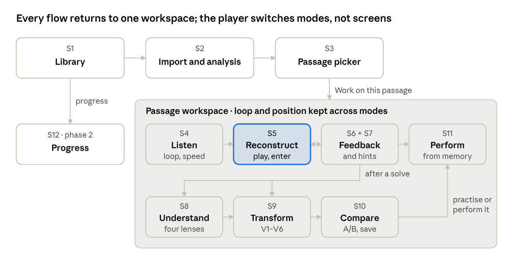
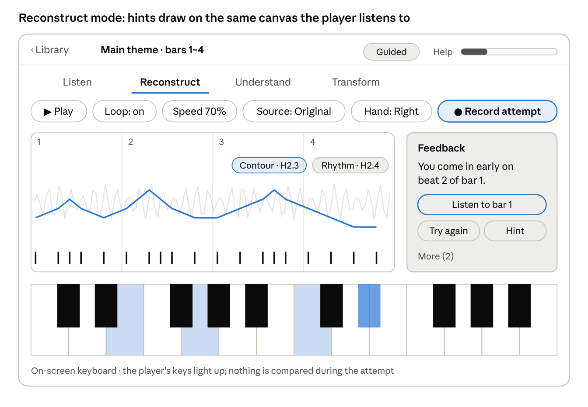

<!-- Exported from the Motiff Lab specification doc (https://claude.ai/artifact/8uR7nDk6Z7ar8vLjbsCMz3) on 2026-10-22. Edit here or in the doc; keep them in sync. -->

# MVP UX Specification

*Stage note: these flows specify the reconstruction and audio experience (Stages 2–3). Stage 1 screens N1–N7, built on the same workspace layout, are in MVP · Stage 1.*

## Screen map

The MVP has 12 screens, S1 to S12; eight of them are modes and panels of a single passage workspace, so the player never loses the loop they are working on.

*Figure: screen map · 12 screens, one workspace*

The main path runs Library → Import → Passage picker → Listen → Reconstruct ⇄ Feedback and hints, then after a solve to Understand, Transform and Compare. Flows 1–6 below follow that path; requirement IDs in brackets point to the PRD tab.

## Layout and interaction principles

One workspace with four modes (Listen, Reconstruct, Understand, Transform) keeps the passage, loop and playback position fixed while the player changes what they are doing. Tablet landscape is the main practice layout; phones stack the same parts vertically.

*Figure: wireframe · workspace in Reconstruct mode, tablet landscape, two hints open*

The wireframe shows two structural hints drawn onto the canvas and the feedback card beside it; the reference notes stay hidden.

| Part | Tablet landscape | Phone portrait |
| --- | --- | --- |
| Top bar | Back, passage name, preset, help meter | Same, preset behind a menu |
| Mode switch | Tabs under the top bar | Bottom tab bar |
| Transport | One strip of pills | Two rows; secondary controls in a sheet |
| Canvas | Left two-thirds | Full width |
| Feedback, hints, explanations | Right column | Bottom sheets |
| Keyboard | Two octaves, scrollable, at the bottom | One and a half octaves; landscape rotation recommended for attempts |

**Rules for every screen**

- Listening first: in Explorer, the canvas starts with only the waveform and the bar grid.
- One primary action per screen, visually distinct.
- The original recording is always one tap away (the Source pill, or A/B in Compare).
- One visual language for certainty: detected notes solid, inferred notes outlined, user-confirmed notes with a check mark, uncertain notes faded and dashed.
- Hands differ by fill and pattern (right solid, left striped), not only colour.
- Everything in Transform can be undone; nothing overwrites the original.
- Prototype keyboard shortcuts: Space play, L loop, \[ and \] speed, R record, H hint, A/B compare.

## Flow 1: Import a recording and select a passage

The goal is to reach a playable 4-bar passage within two minutes of opening the app for the first time.

**S1 · Library (home)**

- Shows the player's pieces as rows: title, composer, length, quality badge, and passage-state chips (for example "2 solved · 1 in progress").
- Primary action: **Import recording**. Secondary: a "Start with a classic" row from the starter library (phase 2).
- The Free plan shows "2 of 3 imports left this month" next to the import button.

**S2 · Import and analysis**

1. The player picks a file from the device (FR-A1).
2. Upload progress, then analysis steps shown in plain words: "Finding notes", "Finding the beat", "Finding phrases", with an estimated time (NFR-1).
3. The player can leave the screen; a notification arrives when the piece is ready.
4. Result: a quality badge (Good, Fair, Poor). Fair and Poor show the reason and a tip, for example "Lots of room echo; short passages will work best" (FR-A3). A rejected file shows "No piano detected" and says the import was not counted (AC-03).

**S3 · Piece overview and passage picker**

- The full waveform with section bands (Intro, Theme A, Theme B) and markers for repeated motifs (FR-A9).
- Suggested passages as chips: "Main theme · bars 1–8", "Motif · bars 5–6 (repeats 4×)". Tapping a chip selects and plays it.
- Manual selection: drag across the waveform; edges snap to barlines, and a label shows the length in bars (FR-B1, AC-05). A pinch zooms in.
- Primary action: **Work on this passage**. It opens a bottom sheet to choose the assistance preset: Explorer (no hints shown), Guided (structural hints open) or Study (everything visible). The choice is remembered as the default.
- The passage opens in the workspace (S4) in Listen mode.

## Flow 2: Listen and reconstruct

Listening comes before any visual: in Explorer the canvas shows only the waveform and bar grid until the player asks for more.

**S4 · Workspace, Listen mode**

- Transport strip: play and pause, loop on or off, speed (25–100%), transpose, metronome, count-in (FR-B3).
- Source switch: Original, Left hand, Right hand, Original + piano (FR-B4). In Explorer, hand sources play the reference in a piano sound but show nothing on screen.
- **In context** plays two bars before and after the loop (FR-B5).
- Loop handles on the waveform can be dragged; they snap to beats.
- Primary action: **Try it** switches to Reconstruct mode with the loop and speed kept (FR-B8).

**S5 · Workspace, Reconstruct mode**

1. Input is chosen automatically: a connected MIDI keyboard, otherwise the on-screen keyboard. A small chip shows the input and opens the latency calibration (FR-C1).
2. The player picks an attempt mode: **Play along** (the original plays while they play) or **Call and response** (the loop plays once, then the player answers) (FR-C2).
3. The player picks the hand: Both, Left or Right. With one hand chosen, the other hand's reference plays quietly as accompaniment (FR-C8).
4. **Record** starts a one-bar count-in. Played keys light up on the keyboard; nothing is compared on screen during the attempt.
5. Step entry is the third input: the player taps notes onto an empty piano-roll grid, then presses **Check**.
6. When the attempt ends, the feedback card (S6) slides up within 500 ms (NFR-4).

The top bar always shows the passage name, the preset and the help meter (hint weight used so far).

## Flow 3: Reveal hints and get feedback

Feedback points to a place and an action; hints add one layer of information at a time on the same canvas, so the player never leaves the passage.

**S6 · Feedback card**

- One primary message with bar and beat, for example "You're missing 2 notes in bar 3" (FR-C5).
- A mini view of that bar with the player's own notes. Missing notes show as empty slots in time, never as pitches, unless a hint already revealed them.
- Actions: **Listen to bar 3** (loops just that bar), **Try again**, **Hint**.
- **More (3)** expands the other errors and the three scores.
- If the passage is solved (PRD thresholds), the card becomes a success state: "Solved with structural hints" and three next steps: **Play from memory**, **Understand it**, **Make a variation**.

**S7 · Hint drawer**

1. **Hint** opens a drawer from the right (bottom sheet on phones).
2. At the top, **Next best hint** with one line on why: "You came in early twice; try the rhythm landmarks."
3. Below, tiers 2 and 3 as sections with hint cards (name, one-line description). Cards that cannot be used are greyed out with a reason, for example "No clear key in this passage".
4. A revealed hint draws onto the canvas: contour as a line, rhythm landmarks as ticks on the grid, bass anchors and the tonal centre on the keyboard, chord names on the chord lane. Each overlay has a small label so the player knows which hint it is.
5. **Show everything** sits apart at the bottom. It asks for confirmation: "Show all notes? This counts as full help." (FR-C6).
6. **Reset hints** hides all overlays for a fresh try.

The help meter in the top bar grows with each hint and is neutral in colour; it is information, not a penalty.

## Flow 4: Understand the structure

Understand mode shows the reference, so it opens freely only after a solve or a full reveal; otherwise it asks first.

**S8 · Workspace, Understand mode**

1. If the passage is not solved, a sheet asks "This shows the notes. Open anyway?" Opening it counts as full help.
2. A lens switch chooses one view at a time: **Melody**, **Harmony**, **Rhythm**, **Texture** (FR-D1 to FR-D4).
   - Melody: interval labels between notes, the contour line, repeated notes marked.
   - Harmony: chord lane with inversions, the bass line highlighted, notes shared with the next chord linked.
   - Rhythm: beat grid with subdivisions, syncopations and anticipations flagged.
   - Texture: a label per bar (block chords, broken chords, arpeggio, ostinato).
3. Below the canvas, one to three explanation cards for the current lens, for example "The E in bar 3 arrives before the chord change and belongs to the next chord: an anticipation." (FR-D5).
4. Tapping a card highlights its notes and plays them (FR-D6).
5. Uncertain readings show both options, for example "Am or C/A", with an "interpretation" tag.
6. Each card has **Try it in a variation**, which opens Transform mode with a matching operation preselected, for example V1 for a syncopation.

In the browser prototype, Understand mode shows only the Harmony lens without explanations; the full set arrives in phase 2.

## Flow 5: Create, compare and save a variation

The default path changes one property, plays the result straight away, and puts the original one tap away.

**S9 · Workspace, Transform mode**

1. The player picks a source: the original passage, their corrected reference, or an existing variation.
2. Operation cards V1–V6 in a row, each with a name and one line, for example "Accompaniment pattern: change how the left hand plays the chords". Disabled cards say why (FR-E1).
3. Picking a card opens its parameter panel: chips for discrete choices, a stepper for numbers (FR-E3). Lock chips show what stays the same: "Melody locked", "Harmony locked" (FR-E2).
4. The result plays automatically within 300 ms (NFR-5). The description sentence appears under the canvas (FR-E4).
5. Actions: **Keep**, **Discard**, **Edit notes** (direct piano-roll editing, FR-E7), **Undo** and **Redo** (FR-E5).
6. Keeping a step adds it to the chain shown as breadcrumbs: "Original › Alberti 8ths › 1st inversion". Tapping a crumb goes back to that step.

**S10 · Compare**

- Three stacked lanes: Original, My attempt, Variation, each a mini piano roll on the same time axis (FR-E6).
- **A/B** switches the playing lane at the same musical position (AC-14). Long-press plays two lanes together.
- A differences overlay marks added, removed and moved notes, with shapes as well as colour (NFR-11).

**Save**

- **Save variation** proposes a name from the chain, for example "Alberti 8ths, 1st inversion", which the player can edit (FR-E8).
- Saved variations appear in the passage's list with play, rename, duplicate, delete, and **Export MIDI** (phase 2, FR-E10).
- **Practise this variation** opens Reconstruct mode with the variation as the reference, so the player can learn and perform their own version (FR-E9).

## Flow 6: Perform without help, and see progress

Performing from memory is the proof of learning, so it gets its own quiet screen.

**S11 · Perform**

1. Entered from the success card, the passage menu or a saved variation.
2. Everything visual is hidden: no notes, hints or chord lane. Only the transport, a count-in and **Record** remain (FR-C9).
3. The player chooses: with backing (the other hand or the original plays) or solo.
4. Result: **Passed** or **Not yet**, the three scores, and the one primary correction if not passed.
5. A pass moves the passage to "Performed from memory" (AC-11).

**S12 · Progress (phase 2)**

- Passages grouped by state: In progress, Solved with help, Solved without help, Performed from memory (FR-F2).
- Each row: highest hint tier used, attempts, last practised, number of variations.
- A simple chart of help used per solved passage over time, so the player sees growing independence (FR-F3).
- From phase 3, a skill profile with nine separate skills, never one overall score (FR-F4).

## System states

Every state names what happened and what the player can do next; none is a dead end.

| State | Where | What the player sees | Next action |
| --- | --- | --- | --- |
| First run | App start | Three short screens: what Motif Lab does, pick a default preset, connect a MIDI keyboard and calibrate latency (skippable) | Import or open a starter piece |
| Empty library | S1 | "Import a piano recording you love" with the starter library row | Import |
| Analysis running | S2, S1 row | Step names and an estimate; the row shows a progress ring | Browse other pieces; notification when done |
| Analysis failed | S2 | The reason and "This import was not counted" | Try another file |
| Low quality | S2, S3 | Fair or Poor badge with the reason and a tip | Continue, or pick a clearer recording |
| Uncertain passage | S3, S4 | "Uncertain passage" badge on the selection | Pick another passage or use Study |
| No MIDI keyboard | S5 | On-screen keyboard, with a tip to connect one | Connect, or carry on |
| MIDI disconnected mid-attempt | S5 | The attempt pauses; a toast says the keyboard disconnected | Reconnect and resume, or switch to on-screen |
| Offline | Any | A slim banner; import and sync disabled | Practise loaded passages |
| Plan limit reached | S1, S2 | A sheet listing what Pro adds and when the free count resets | Upgrade, or wait |
| Sync conflict | Any | A toast: "Notes updated from your other device" | None needed |
