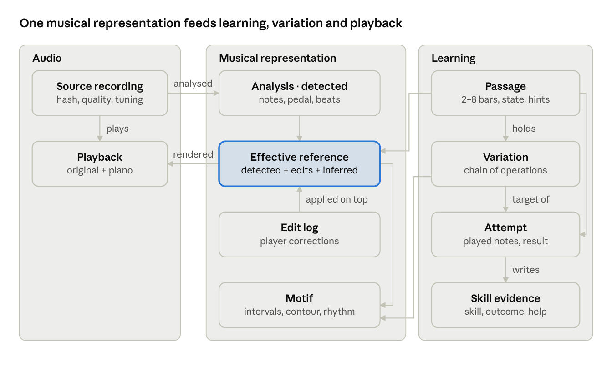
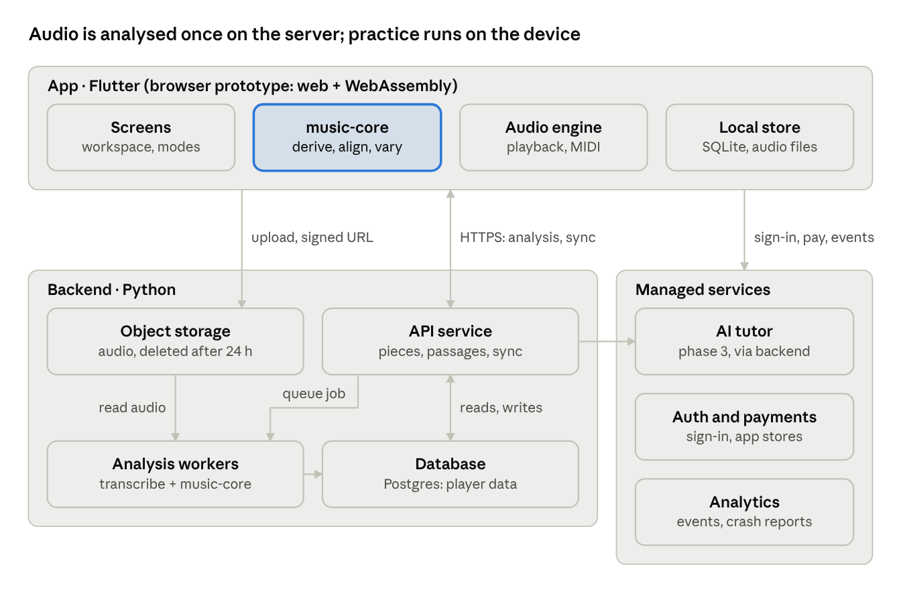

<!-- Exported from the Motiff Lab specification doc (https://claude.ai/artifact/8uR7nDk6Z7ar8vLjbsCMz3) on 2026-10-22. Edit here or in the doc; keep them in sync. -->

# Domain Model & Technical Architecture

*Stage note: the domain model here is shared by all stages. Stage 1 uses it with notation input (provenance "imported") and runs in the browser, as described in MVP · Stage 1, plus a thin AI gateway (decision record 0003); the analysis pipeline and backend arrive with Stage 3. The technology choices below (Rust, Flutter, FastAPI) are superseded by decision record 0001: C# music-core, Blazor WebAssembly, .NET MAUI and Azure Functions.*

## Domain model at a glance

Everything the player sees, hears, practises or transforms is computed from one effective reference: detected events, plus the player's edits, plus inferred structure. The rest of this tab defines each object.



*Figure: domain model · audio, musical representation, learning*

A passage is a time range of the effective reference. Its attempts target either the reference or a variation, and each attempt writes skill evidence. Variations transform motifs or note selections of the reference, and playback renders any of them alongside the original audio.

## Audio assets

The original recording lives on the player's device; the server holds it only for analysis and deletes it within 24 hours. Everything the player hears besides the original is rendered on the device from musical events.

| Asset | What it is | Where it lives | Lifetime |
| --- | --- | --- | --- |
| Source recording | The file the player imported, identified by its SHA-256 audio hash | Device app storage; server object storage only during analysis | Device: until the piece is deleted. Server: deleted within 24 h of analysis |
| Analysis audio | Decoded mono audio resampled for the models | Worker memory and scratch disk | Deleted when the job ends |
| Quality report | Scores for reverb, noise, clipping, note density, piano presence, tuning offset in cents | Part of the analysis document | With the analysis |
| Passage clip | Decoded audio for one passage plus 2 bars of context | Device cache | Rebuilt from the source recording when needed |
| Rendered audio | Piano sound for reference, hands, attempts and variations, synthesised from events | Device, generated during playback | Not stored |
| Library recording | Licensed recording of a public-domain piece | CDN | Permanent; licence stored per recording |
| Stems (phase 4) | Separated instrument parts of a layered recording | Server during analysis, then device cache | Server: 24 h. Device: until the piece is deleted |

Because audio never syncs, a second device shows the notes, attempts and variations at once, and asks the player to import the same file to hear the original. A matching audio hash links it to the existing analysis without a new upload.

## Musical events and layers

One event model serves display, hints, feedback, explanations, variations, playback and export, so no module keeps its own interpretation of the passage. Events sit in three layers, and every event records where it came from and how sure the system is.

**Time**

- A time map converts between audio seconds and musical time (bar, beat, tick at 480 ticks per quarter note), built from the beat list, the tempo curve and meter segments.
- Events store both: `onset_s` for audio sync and `pos` (bar, beat, tick) for grid logic.
- A tuning offset in cents keeps rendered sound in tune with the original.

*Implementation note: decision record 0002 (`docs/decisions/0002-canonical-time.md`) makes absolute canonical ticks the stored truth for notation input, with bar and beat derived from a meter map. It also defines exact source conversion and the rounding policy.*

**Event types**

| Type | Key fields | Layer |
| --- | --- | --- |
| Note | pitch, onset\_s, offset\_s, sounding\_offset\_s (with pedal), velocity | Detected |
| Pedal | on\_s, off\_s | Detected |
| Beat | time\_s, is\_downbeat, meter | Detected |
| Annotation on a note | hand, voice (melody, inner, bass), scale degree, chord-tone role (chord tone, passing, neighbour, anticipation, suspension) | Inferred |
| Chord | span, root, quality, bass, inversion, alternatives \[label, probability\] | Inferred |
| Key | span, tonic, mode, alternatives | Inferred |
| Section, phrase | span, label | Inferred |
| Motif occurrence | note ids, motif id, kind (exact, transposed) | Inferred |

**Layers**

1. **Detected:** model output for one analysis version. Never changed after creation.
2. **User edits:** the player's corrections, stored as an edit log (see User corrections).
3. **Inferred:** derived by rules from detected events plus edits. Always recomputable, never edited directly except for chord relabels, which are stored as edits.

The effective reference is detected ⊕ edits, followed by recomputing the inferred layer.

**Provenance and confidence**

Every event carries `provenance` (detected, inferred, user\_confirmed, user\_edited), `confidence` from 0 to 1, `pipeline_version`, and for inferred events `derived_from` (the event IDs it depends on). Inferred confidence is the product of its inputs' confidences and the rule's own certainty, so an uncertain note makes the chord built on it uncertain too. Display rules map provenance to visuals (UX tab), and hints use only events with confidence ≥ 0.6 (PRD).

```json
{
  "id": "n_0142",
  "type": "note",
  "pitch": 76,
  "onset_s": 12.418,
  "offset_s": 12.902,
  "sounding_offset_s": 13.640,
  "pos": { "bar": 5, "beat": 2, "tick": 240 },
  "velocity": 64,
  "hand": "right",
  "voice": "melody",
  "provenance": "detected",
  "confidence": 0.91,
  "pipeline_version": "0.3.1"
}
```

## Motif representation

A motif is an ordered list of note IDs in one voice, usually 3–16 notes, plus several derived views of the same notes. Each view is invariant to something different, which is what lets the app find repeats, build hints, drive variations and set transfer tasks from one object.

| View | Example for a 5-note motif | Invariant to | Used by |
| --- | --- | --- | --- |
| Pitches (MIDI) | 76 74 72 74 76 | Nothing | Playback, feedback |
| Intervals (semitones) | −2 −2 +2 +2 | Transposition | Exact or transposed repeats |
| Diatonic steps in the key | −1 −1 +1 +1 | Transposition within the key, mode | V4 sequence, transfer tasks |
| Contour | D D U U | Interval size | Hint H2.3, melodic shape |
| Rhythm (inter-onset intervals in beats) | 1 ½ ½ 1 | Pitch | Hint H2.4, V1 |
| Metric positions | beat 1, 2, 2.5, 3, 4 | Pitch | Syncopation and anticipation detection |
| Harmonic context | chord per note + chord-tone role | Register | Explanations, V5 |

**Similarity**

- Each note becomes a token of (diatonic step, inter-onset ratio). Two motifs are compared by a weighted edit distance over those tokens, normalised to 0–1.
- Occurrences are "exact" (distance 0, same pitches), "transposed" (distance 0, different start) or, from phase 3, "varied" (distance under 0.3).
- Motif discovery scans the melody voice for repeated token strings of length 3–16 and keeps those that occur at least twice; FR-A9 needs only exact and transposed repeats.

**Where motifs come from**

- Suggested by analysis (repeats), shown as chips on the passage picker.
- Created by the player by selecting notes in Understand or Transform mode.
- A passage can hold several motifs; a variation always records which motif or which notes it transformed.

## User corrections

Corrections are an append-only edit log per player and piece, applied on top of the detected layer. The detected layer is never overwritten, so every edit can be undone, studied, and carried to a newer analysis.

| Edit operation | Payload | Effect |
| --- | --- | --- |
| add\_note | pitch, onset, offset, hand | New note, provenance user\_edited, confidence 1 |
| delete\_note | note ID | Note hidden from the effective reference |
| set\_pitch, set\_timing, set\_duration | note ID, new value | Field changed; old value kept in the log |
| set\_hand, set\_voice | note ID, value | Hand or voice changed; hands-separate playback follows |
| confirm | event ID | Provenance becomes user\_confirmed; confidence 1; no value change |
| relabel\_chord | span, label | Chord replaced; the label wins over inference |
| move\_barline, set\_meter | position, value | Time map rebuilt from that point |

**Rules**

1. Each entry stores user, piece, analysis version, timestamp, device and the previous value.
2. After an edit, music-core recomputes the inferred layer only in a window of one bar around the change, which keeps updates under 200 ms (FR-A12).
3. Edits are private to the player. With opt-in, anonymous edit statistics (field, old confidence, size of change) can improve models; note content is never shared.
4. Two devices: last write wins per event field, using server receive time; both entries stay in the log.
5. New analysis version: old notes are matched to new ones by optimal assignment on (same pitch, onset within 50 ms). Matched edits are replayed; unmatched ones are kept and flagged for the player.

## Transformations

A variation is a chain of pure operations over a source: given the same events, context and parameters, an operation always returns the same events and a structured diff. The diff drives the description, the compare overlay and a check that locked dimensions really stayed locked.

**Objects**

- **Variation:** id, passage ID, source (the effective reference or another variation), chain of operations, name, cached result events, description, created and updated times.
- **Operation:** op ID (V1–V6 or edit), parameters, scope (hand, voice, bars or a motif), seed, engine version.
- **Context passed to every operation:** time map, key, chords, hand and voice assignment, constraints (piano range, hand span, no voice crossing).
- **Diff:** added, removed, moved (time), re-pitched and re-voiced notes, each with bar and beat.

**Execution**

1. Resolve the source events (effective reference or the parent variation's result).
2. Run each operation in the chain: `apply(events, context, params, seed) → (events, diff)`.
3. Check locks: for example V2 asserts that melody notes are unchanged. A failed lock check rejects the step and logs a bug; the player sees "This change didn't work on this passage".
4. Check constraints; flag, but keep, results that exceed a hand span or the range.
5. Fill the description template for the operation from the diff and context (PRD, Variation operations).
6. Cache the result; undo and redo move a pointer along the chain. An "edit" step stores a note-level patch.

**Explanations stay honest**

Descriptions only state facts present in the diff, such as counts, bars, beats, intervals and pattern names. Musical judgements ("smoother", "more tension") are added only when a rule can measure them, for example total voice-leading distance in semitones going down.

## Attempts and alignment

An attempt is matched to its target in five steps on the device, within 500 ms for 8 bars (NFR-4). The result feeds feedback, scores, passage state and skill evidence.

**Attempt record**

id, passage ID, target (reference or a variation ID), mode (play-along, call-and-response, step entry), hand, input (MIDI, on-screen, step), preset, hints open, playback speed, latency offset in ms, played notes (pitch, onset, offset, velocity on the device clock), start time.

**Alignment**

1. **Normalise time.** Play-along: subtract the calibrated latency, map the device clock to passage time through the playback clock, then to musical time. Call-and-response: estimate a global tempo scale (0.5× to 2×) and offset by dynamic time warping on onset sequences, with a pitch-aware cost.
2. **Group chords.** Notes starting within 50 ms form one slice, in both the attempt and the target.
3. **Match notes.** Optimal one-to-one assignment within a time window, cost = onset distance in beats + pitch cost (0 for the same pitch, 0.3 for the same pitch class in another octave, 1 otherwise). Pairs above a cost threshold become one missing and one extra note.
4. **Classify errors** using the types and order in the PRD Feedback rules, ignoring velocity, durations under pedal and grace notes.
5. **Score** pitch, rhythm and completeness, choose the primary error, and update the passage state.

**Result**

scores; errors \[type, bar, beat, reference note IDs, played note IDs\]; primary error; solved flag.

**Skill evidence**

Each attempt also writes evidence rows: skill, passage, outcome, help weight. Error types map to skills: wrong pitch to pitch, wrong interval size to interval, wrong direction to contour, displacement and duration to rhythm, bass movement to bass line, harmonic mismatch to harmony. Variation work writes evidence for motif development and variation making. Phase 3 turns these rows into the skill profile.

## Playback engine

One master clock runs in musical time; every source is scheduled against it through the time map. That is what makes A/B switching, loops and hands-separate practice line up exactly.

| Source | How it sounds | Speed change | Transpose |
| --- | --- | --- | --- |
| Original | Decoded passage clip | Time-stretch with pitch kept | Pitch shift |
| Reference, left hand, right hand | Sampled piano from events, pedal applied, detuned to match the recording | Re-scheduled at the new tempo; no stretching | MIDI transpose |
| Attempt | Same piano from the played notes | Re-scheduled | MIDI transpose |
| Variation | Same piano from the result events | Re-scheduled | MIDI transpose |
| Metronome and count-in | Click on beats from the time map | Follows the clock | — |

**Behaviour**

- Loops are sample-accurate, with a 5 ms crossfade at the loop point (gap under 20 ms, NFR-3).
- A/B switching crossfades in 10 ms at the same musical position (within 50 ms, AC-14).
- In the MVP, "left hand" and "right hand" use the rendered reference, because the original mix cannot be split; true isolation arrives with stems in phase 4.
- Output latency is measured per device and used to compensate MIDI timestamps.

**Platform choices**

- Prototype: Web Audio API with an AudioWorklet, Web MIDI, a WebAssembly time-stretch library, and a small sampled piano.
- Mobile: native audio modules (AVAudioEngine and its time-pitch unit on iOS; Oboe on Android with a time-stretch library), platform MIDI APIs, and the same sampled piano.
- Time-stretch library licences (some are GPL or LGPL) are checked in the prototype.

## Analysis pipeline

One neural model turns solo piano audio into notes; every other step is a rule over those notes, so the inferred layer can be rerun on the device after each correction. Layered music in phase 4 adds source separation in front of the same steps.

| Step | Produces | Layer | Approach | Candidate tools |
| --- | --- | --- | --- | --- |
| 1. Decode and check | Mono audio, quality report, piano presence, tuning offset | — | Signal measures plus a small instrument classifier | librosa |
| 2. Transcribe | Notes with velocity and confidence; sustain pedal | Detected | Neural piano transcription model | ByteDance piano transcription, Onsets and Frames, basic-pitch |
| 3. Beats and meter | Beats, downbeats, tempo curve, meter | Detected | Beat tracking on audio, checked against note onsets | librosa, madmom |
| 4. Key | Key segments with alternatives | Inferred | Note histogram against key profiles | music-core; music21 to prototype |
| 5. Hands and voices | Hand and voice per note | Inferred | Pitch split plus voice continuity; top and bottom lines per hand | Own code (music-core) |
| 6. Chords | Chord spans with inversions and alternatives | Inferred | Name the sounding pitch set per beat window, merge repeats | music-core; music21 to prototype |
| 7. Note roles | Chord tone, passing, neighbour, anticipation, suspension | Inferred | Rules over notes, chords and metric position | Own code |
| 8. Sections, phrases, motifs | Spans and motif occurrences | Inferred | Self-similarity and token-string repeats | Own code |
| 9. Passage suggestions | Ranked passages of 2–8 bars | Inferred | Score = motif repeats + phrase boundaries + mean confidence | Own code |
| 10. Calibrate and package | Calibrated confidences; one analysis document | — | Confidence calibration fitted on the benchmark set | Own code |
| Later: notation (phase 3) | MusicXML | — | Quantise to the grid, then engrave | music21, Verovio |
| Later: layered music (phase 4) | Instrument parts | Detected | Source separation, then steps 2–10 per part | Demucs |

Steps 1–3 need the server (GPU for step 2, CPU fallback). Steps 4–9 live in music-core, one Rust library used by the workers (Python bindings), the prototype (WebAssembly) and the app (native bindings), so the server and the device always produce identical results.

Handling uncertainty is a product requirement, not an afterthought: quality scoring (FR-A3), faded low-confidence notes (AC-04), hints only from confident notes, and corrections (FR-A12). Tool names come from general knowledge; licences must be checked before commercial use, as some model weights are non-commercial only and some libraries are GPL, LGPL or AGPL.

## System architecture

The architecture follows the vision's separation of concerns: analysis on the server, and the learning engine, transformation engine and playback on the device, all sharing one musical representation through music-core.



*Figure: system architecture · app, backend, managed services*

The app uploads audio straight to storage, the API queues a job, and a worker transcribes the audio and runs music-core to write the analysis document; the app downloads it once, caches it, and works offline from then on.

| Vision component | Where it lives | Technology |
| --- | --- | --- |
| Audio ingestion | App (file import, hashing) and object storage | S3-compatible storage with a 24-hour delete rule |
| Analysis | Analysis workers | Python, piano transcription model, music-core bindings; GPU containers that scale to zero, CPU fallback |
| Musical representation | Analysis document plus music-core types | JSON document; Rust library with WebAssembly, native and Python bindings |
| Learning engine (hints, attempts, feedback) | music-core and app screens | Rust (alignment, scoring); Flutter UI |
| Transformation engine | music-core | Rust, pure functions, seeded |
| Playback engine | App audio engine | Web Audio (prototype); AVAudioEngine and Oboe (mobile) |
| User workspace | App screens | Flutter, custom canvas for piano roll and keyboard |
| Progress | API, database, local store | FastAPI, managed Postgres, SQLite on the device |
| Accounts and billing | Managed services | Managed auth; app-store subscriptions through a billing service |
| AI tutor (phase 3) | Backend calling an LLM API | Keeps the API key off the device; answers grounded in the analysis document |

Writing music-core in Rust is a proposal: it gives one implementation for browser, phone and server, at the cost of a steeper start than TypeScript. The open questions in the Overview track this choice.

## Storage, sync and API

The server is the source of truth for everything except audio. Analysis documents are shared by audio hash; everything a player creates is private to that player.

**Server tables (Postgres)**

| Table | Key columns | Notes |
| --- | --- | --- |
| users | id, email, plan, locale, note\_naming, created\_at |  |
| pieces | id, user\_id, audio\_hash, title, composer, duration\_s, quality, analysis\_id | The player's library entry |
| analyses | id, audio\_hash, pipeline\_version, status, document\_url, created\_at | Shared by all pieces with the same hash; the document is gzipped JSON in object storage |
| library\_pieces | id, title, composer, recording\_licence, audio\_url, analysis\_id | Starter library |
| edit\_log | id, user\_id, piece\_id, analysis\_id, op, payload, previous, device\_id, created\_at | Append-only |
| passages | id, piece\_id, start\_pos, end\_pos, preset, state, max\_tier, settings | Settings hold loop, speed, open hints |
| motifs | id, passage\_id, note\_ids, origin | origin = suggested or player |
| attempts | id, passage\_id, target\_id, mode, hand, input, preset, scores, primary\_error, solved, help\_weight, played\_notes, started\_at | played\_notes kept 90 days for research with consent, otherwise dropped after scoring |
| hint\_events | id, passage\_id, attempt\_id, hint\_id, tier, created\_at |  |
| variations | id, passage\_id, source\_id, chain, name, description, result\_cache, updated\_at |  |
| skill\_evidence | id, user\_id, skill, passage\_id, outcome, help\_weight, created\_at |  |
| subscriptions | user\_id, plan, store, renews\_at | From the billing service |

**Device**

SQLite mirrors the player's rows plus cached analysis documents and the audio files. Writes go to an outbox and sync when online; the server returns changes since a per-table cursor. Conflicts follow the User corrections rules.

**API (REST, JSON, versioned under /v1)**

| Method | Path | Purpose | Phase |
| --- | --- | --- | --- |
| POST | /pieces | Register by audio hash; returns an existing analysis or a signed upload URL | 1 |
| POST | /pieces/{id}/analyze | Queue analysis after upload | 1 |
| GET | /analyses/{id} | Status, then the analysis document | 1 |
| GET | /library | Starter library | 2 |
| GET, POST | /pieces/{id}/passages | List or create passages | 2 |
| PATCH | /passages/{id} | State, settings, preset | 2 |
| POST | /pieces/{id}/edits | Append edit-log entries in a batch | 2 |
| POST | /passages/{id}/attempts | Store an attempt and its result | 2 |
| POST, PATCH, DELETE | /passages/{id}/variations, /variations/{id} | Save, rename, delete variations | 2 |
| GET | /sync?cursor= | Changes since the cursor, all tables | 2 |
| POST | /events | Batched analytics events | 1 |
| POST | /tutor/explain | AI explanation of a chord or passage | 3 |

In phase 1 only the analysis endpoints and /events exist; the prototype keeps everything else in browser storage. MIDI and MusicXML export run on the device, so they need no endpoint.

The analysis document holds the pipeline version, quality report, time map, and events grouped by type, each in the shape shown in Musical events and layers.
