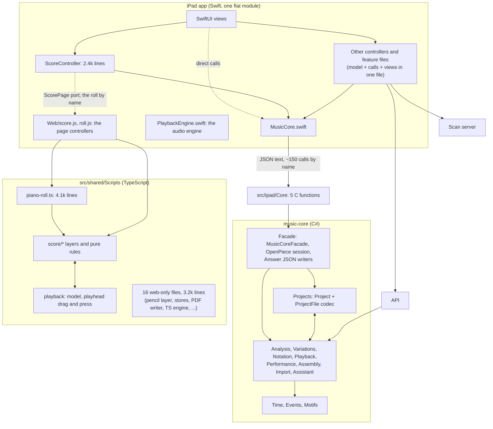
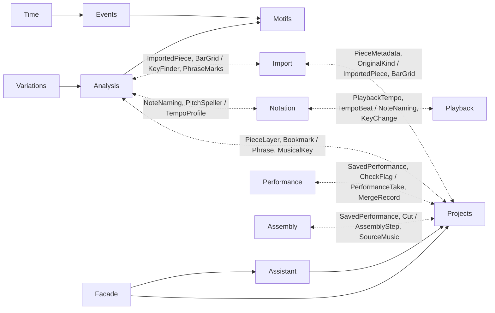
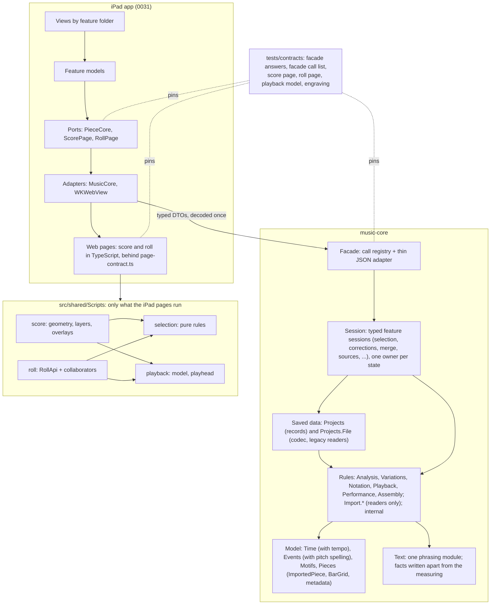

# Refactoring audit: structure and architecture of the repository

Status: current, second edition, 2026-11-16, measured on `develop` at `a2d767b` (after #634, #635 and #636). The plan
of the refactoring task; its three decisions were taken by Andrei on 2026-11-16, 21:29 UTC (section 6). It replaces, in place, the first edition of the same day (PR #632,
measured on `0d2bc52`, still readable as `git show 06b49d2:docs/REFACTORING_AUDIT.md`); section 0 says what changed
and why. The web's sizes that 0032 quotes are in that first edition. Read-only: no source file was changed to write it. It
builds on [decision record 0031](architecture/adr/0031-ipad-score-modules.md), the [iPad UI review](code-map/ui-review-2026-11.md),
the code maps in [`code-map/`](code-map/), the quality ratchet ([`governance/quality/README.md`](../governance/quality/README.md))
and the layout of [0033](architecture/adr/0033-repository-layout.md) ([`repository-structure.md`](repository-structure.md)).

Scope: the active code only, as [0032](architecture/adr/0032-ipad-first-web-archived.md) and 0033 define it: music-core,
the API and the scan server (`src/backend`), the iPad app (`src/ipad`, `tests/ipad`) and what the iPad bundles from the
former web project (`src/shared`, `tests/shared`, `tests/contracts`). The archived web (`archive/`) is out of scope and
was not read (`governance/roles/common.md`, "Platform focus"); what this audit says about the web comes from
[`web-archive.md`](web-archive.md) and from the first edition.

Goal: a surgical plan that brings music-core, the Swift iPad app and the shared score layer to SOLID, strict module
boundaries and high locality of context, so that an agent can change one module without loading the project.

How it was measured: line counts and outlines of every tracked source file outside `archive/`; the namespace and import
graphs built from the sources; the import closure of the iPad's two pages (`src/ipad/App/Web/score.js`, `roll.js`) over
`src/shared/Scripts`; `tools/quality/baseline.json`; a Release build of `MotiffLab.slnx` and every suite that runs on
Linux; the workflows as they are on `develop`. Limits are listed in [section 7](#7-what-this-audit-did-not-do).

## 0. What changed since the first edition

### 0.1 Three pull requests

| Pull request | What it did | Effect on this audit |
| --- | --- | --- |
| #634 (0032) | iPad first; the web app archived, frozen, no web tracks, no browser tests, no web deploys | The web leaves the refactoring: its score (3/10), its monolith registry, `PlaybackLab` as a dangerous node and all of the first edition's web-only steps are dropped |
| #635 (0033) | `src/{backend,ipad,shared}`, `tests/{backend/{Unit,Integration,Acceptance},ipad,shared,contracts}`, the web in `archive/web`, out of the solution and of CI; `src/shared/MotiffLab.Shared.csproj` builds the TypeScript the iPad bundles | Every path below is the new one. The shared score layer has a home and a build of its own. The archived web does not compile, so a move in music-core or `src/shared` no longer has to keep it compiling |
| #636 | Agents read whole files and use `Explore` sub-agents; workflow run names; the `iPad` workflow runs on every pull request that touches what the app is built from (`src/ipad`, `tests/ipad`, `src/shared`, music-core, `design/kit`, `tests/contracts`), compile-only without the label `ipad-tests`; music-core's framework cached (`ipad-core.yml`); Andrei's Mac as a runner (`IPAD_RUNNER`) | A Swift compile break caused by music-core or the shared modules is now seen on the pull request, not only at the tag. It is still not a required check, and a renamed JSON field still compiles |

Apart from paths, no code in `src/backend`, `src/ipad` or `src/shared` changed since `0d2bc52`: compared file by file,
every difference in a moved file is a comment that names a path. The numbers for music-core and the iPad app are therefore
the first edition's, re-checked where noted; the suites were run again on `a2d767b` (section 5.1).

### 0.2 What the moves already resolved

| First edition | Now |
| --- | --- |
| L6: Razor components call JavaScript by string from 113 files | Gone from the active code (archived) |
| L8: the shared TypeScript belongs to the web project; an iPad task must build the web | Resolved: `src/shared` is its own project (`dotnet build src/shared`), bundled by `src/ipad/App/project.yml` from `../../shared/…`; the `dependencies` check follows the pages' imports there |
| Node 3: `PlaybackLab` (51 files, 14.6k lines, no unit test) | Archived; no longer a node of the active code |
| D1: two application sessions (`OpenPiece` and `PlaybackLab`) | `OpenPiece` is the only one in the active code. Decision 1 of the first edition is answered by 0032 |
| D2: two page controllers (`score-view.ts` and `score.js`) | `score-view.ts` is archived; `score.js` is the only page controller |
| D5, D7, D8, D10, D18: metronome, library rules, tempo text, scan client, score-mark CSS kept twice | One side archived each; the Swift (or `score.css`) side is the only live implementation |
| D9, D11, D12: sync clients, the assistant's turn format, flat payload packing | Reduced: the web's C# half is archived (section 4.4) |
| Decision 3: fix the red browser suite (W0.2) during the iPad period | Answered by 0032: no browser tests; the suite is archived with the web |
| Decision 2: the 19 switches the web branches on | The web's branches are archived; the question changes (section 6, decision 2) |
| «Every type is public because the web consumes them» (4.2) | The only consumers left are the API (`Accounts`, `Assistant.Conversation`, `Projects`, the root namespace), `src/ipad/Core` (`Facade`) and the tests, so the rule engines can become internal (W1.12) |
| Rule «waves 0–2 touch web pages only for a forced `using`» | Replaced: no step touches `archive/`, except W0.6's move of the web-only modules into `archive/web` (decision 1), which reads nothing there; reactivation adapts the web to whatever music-core and `src/shared` are then (`web-archive.md`, "Reactivation", step 3) |

### 0.3 What the moves brought to light

- **The shared layer carries web-only code.** Of the 58 TypeScript files in `src/shared/Scripts` (16,948 lines), the
  iPad's two pages reach 41 (13,635 lines) through their imports. Of the other 17, `score-page.ts` holds the A4 layout
  the node tests engrave with; 16 files (3,175 lines) are reached by no page and imported by no live module, only by
  node tests (section 3.3). They moved to `src/shared` because their folders did.
- **The score page lost its only DOM-level net.** The browser suite was red, but it was the only test that ran the shared
  layers in a real page. Now `score.js` (1,631 lines, no types, no lint, outside the duplicate check) and the layers it
  drives are exercised only by the UI walk on macOS (section 5.2).
- **The experiment catalogue lists 23 `experimental.*` switches that no active code reads** (section 4.5).

### 0.4 Old step ids

Ids that survive keep their meaning; dropped ones are not reused.

| First edition | Second edition |
| --- | --- |
| W0.1 (maps `core.md` and `web.md`) | W0.1, `core.md` only, plus the index links |
| W0.2 (browser suite green), C7, C8, C11 | Dropped (0032) |
| W0.3, W0.4, W1.1–W1.11, W2.0–W2.13 | Unchanged ids; guards that named the browser suite now name C5 or C6 |
| W0.5 (shared cases for metronome, ink, tempo text) | W0.5, ink geometry and engraving constants only (the metronome and tempo text have one live side) |
| W2.14 (the roll's port, then `PianoRoll`'s collaborators) | W2.14, the roll's port; `PianoRoll`'s split is W3.12 |
| W3.1–W3.4, W3.7, W3.8, W3.10 (web) | Dropped (0032) |
| W3.5 (`Scripts/selection`, folder edges) | W3.11 |
| W3.6 (`score-view.ts`, `svg-to-pdf.ts`) | W3.13 (`svg-to-pdf.ts`, `score-geometry.ts`; `score-view.ts` is archived) |
| W3.9 (rules both apps re-implement into music-core) | Dropped: with the web archived each has one live side; payload packing is in W1.5 |
| — | New: W0.6 (the web-only modules out of `src/shared`), W0.7 (C5, the score page's test), W1.12 (internal rule engines), W3.14 (layers: drawing apart from input); wave 3's new steps take ids from W3.11 on |

## 1. Executive summary

### Structural health

| Subsystem | Score | Why |
| --- | --- | --- |
| **music-core** (C#, 296 files, 60.1k lines) | **7 / 10** | Pure and deterministic, no I/O, no UI; its only package is PdfPig; the `dependencies` check keeps web, cloud and AI out; 2,130 tests, 92 % of lines and 84 % of branches covered. Against it: 7 pairs of namespaces depend on each other; two hand-written JSON codecs of 3.6k and 2.2k lines; analysis and bilingual text live in the same classes; the application session of the iPad (`OpenPiece`) is welded to JSON text; 578 public types against 90 internal, though only the API, the iPad's native wrapper and the tests now consume them. Unchanged since the first edition |
| **iPad app** (Swift, 127 files, 38.5k lines, plus 1.9k lines of hand-written JavaScript in `src/ipad/App/Web`) | **4 / 10** | One flat folder and one module; `ScoreController` (2,396 lines) is read by 35 files; music-core's answers are untyped everywhere (674 `as?` casts and 342 `[String: Any]` in 53 files); 25 files hold SwiftUI views next to network, file or music-core calls. For it: 0031 is accepted and its first two steps are merged, 451 unit tests ran green on macOS, the old-mode branches went in v0.6.5, literal copy-paste is near zero, and since #636 every pull request that touches its inputs compiles it. Unchanged score: #636 catches a compile break, not a contract break |
| **Shared score layer** (`src/shared/Scripts`, TypeScript, 58 files, 16.9k lines) | **5 / 10** | For it: its own project and home (0033); `tsc` strict, one `any`; the pure modules are well tested (46 node test files, 521 tests, green); the `dependencies` check follows the iPad pages' imports; the score page's command and message names are pinned by `tests/contracts/score-page.json`. Against it: `piano-roll.ts` is one class of 4,077 lines with no direct test; 16 files and 3.2k lines are web-only and dead for the iPad; folders depend on each other (`score` ↔ `playback`); the page that drives it (`score.js`) has no type check, lint, duplicate check or DOM-level test |

Not scored, both small and healthy: the API (16 files, 1.8k lines, 79 tests) and the scan server (Python, 1.8k lines with
its tests).

### The five most dangerous nodes

1. **The facade contract between music-core and the iPad app.** About 150 calls dispatched by string name in five
   `switch` blocks; 1,399 hand-written `json.Write…` calls on the C# side; on the Swift side 117 `facadeObject` reads in
   40 files that fall back to a default when a field is missing or renamed. Nothing names the contract as data. Since
   #636 a pull request that changes music-core compiles the Swift app, but a renamed or removed field compiles and reads
   as a default, so the break shows only at Andrei's test. Every refactoring of the core's facade or of a Swift feature
   crosses this boundary.
2. **The iPad score screen:** `ScoreController.swift` (2,396), `ScoreScreen.swift` (1,960) and `src/ipad/App/Web/score.js`
   (1,631, outside every quality check). 45 published values, 176 functions, 14 unrelated sections sharing one state.
   Decision record 0031 (accepted) describes the cure; steps 1a and 2 are merged (#630, #631), eleven remain (1b, the seven models, 10, 11, 12).
3. **The iPad's page layer: `score.js` and `roll.js` over the shared modules.** `piano-roll.ts` (4,077 lines, 123 fields,
   181 methods) has no node test of its own and carries selection paths no host may use any more (section 4.5);
   `score.js` is untyped JavaScript that re-implements nothing now, but no test runs it outside the device. With the
   browser suite archived, a change to `Scripts/score` or `Scripts/roll` that breaks a page is seen only on the iPad.
4. **The saved-data core:** `Project` (35 state properties, 105 public members across its partial files) and the
   `ProjectFile` codec (3,605 lines, readers for versions 1 to 16), in a namespace that depends on `Import`, `Analysis`,
   `Variations`, `Performance` and `Assembly` and is depended on by them. It is well tested (95 % of lines), which makes it
   safe to split, but it is where a mistake costs a player's work.
5. **Assembly and merging:** the hardest musical logic with the thinnest net: `Assembly` 82 % of lines and 61 % of
   branches, `AssemblyMatch.cs` 66 %, `OpenPiece.Merge.cs` 67 %. The iPad's merge (`performance.merge`) and the edits
   layer of v0.6.5 run through it.

The first edition's node 3, `PlaybackLab`, is archived (section 0.2).

### What is healthy and must be kept

- music-core has no dependency on the apps, the cloud or AI, and a check enforces it.
- One source of truth for the project file: the C# reader and writer, golden files for versions 12, 15 and 16, the
  tolerant reader, and the API checking only the envelope ([`project-file.md`](project-file.md), 0026).
- Shared case files already pin cross-platform rules: the playback model, scrubbing and the analysis answers
  (`tests/ipad/MotiffLabTests/Golden/*.json`, read by node, xUnit and XCTest), and the score page's names
  (`tests/contracts/score-page.json`, read by node and XCTest). This is the pattern to extend; `tests/contracts` is its
  home (0033).
- Protected acceptance scenarios (`tests/backend/Acceptance/MotiffLab.Acceptance.Tests`) go only through the facade and
  may not be edited by the agent that broke them.
- The ratchet is blocking since 2026-11-16: baselined code may not grow. It, jscpd and the `dependencies` check skip
  `archive/`.
- One tree for live code and one for tests (0033): `src/` and `tests/` say what is maintained, `archive/` what is not.

## 2. Topology and dependency maps

### 2.1 Projects and folders as they are

| Path | What it is | Size | Built and tested by |
| --- | --- | --- | --- |
| `src/backend/MotiffLab.MusicCore` | The domain: 19 namespaces (table in 2.4) | 296 files, 60,070 lines | `build-test`; `tests/backend/Unit/MotiffLab.MusicCore.Tests` (2,130 tests), `tests/backend/Acceptance/MotiffLab.Acceptance.Tests` (24) |
| `src/ipad/Core` | NativeAOT wrapper: `Exports.cs`, five C functions `ml_version`, `ml_open`, `ml_call`, `ml_close`, `ml_free` over `MusicCoreFacade` | 242 lines | compiled by `build-test`; published as an xcframework by the `iPad` workflow (cached on `develop`) |
| `src/backend/MotiffLab.Api` | ASP.NET Core API: projects in Cosmos DB, profile, plan, the assistant relay | 16 files, 1,799 lines | `build-test`; `tests/backend/Integration/MotiffLab.Api.Tests` (79); deployed by `API` |
| `src/backend/omr` | The scan server (Python: homr, Basic Pitch), its pytest tests inside | 1,810 lines with tests | `pytest` in `build-test` when it changes; `Scan server` workflow |
| `src/ipad/App/MotiffLab` | The iPad app: one XcodeGen target, 127 Swift files in one folder | 38,530 lines | `iPad` workflow on macOS: `tests/ipad/MotiffLabTests` (451 tests) on every push to a pull request that touches its inputs (`ipad-gate`, required on `develop`), on `develop`, on tags and by hand; `tests/ipad/MotiffLabScreens` (6 UI tests) compiled on a pull request, run on tags and by hand (since #642) |
| `src/ipad/App/Web` | The pages inside the app's two web views: `score.js`, `roll.js`, their HTML and CSS | 2,188 lines | nothing compiles or lints them; the `dependencies` check follows their imports; `score-page-contract.test.mjs` checks `score.js`'s names |
| `src/shared` (`MotiffLab.Shared.csproj`) | `Scripts/score` (25 files), `roll` (12), `playback` (6), `layout` (9), `storage` (6), compiled to `wwwroot/js`; `wwwroot/i18n`, `audio/piano`, `lib/verovio`; `Playback/FurElise.musicxml` | 58 TypeScript files, 16,948 lines | `tsc` in `build-test`; ESLint and jscpd in the quality check; `tests/shared` (46 files, 521 node tests) |
| `tests/contracts` | Fixtures both sides of a contract read: `score-page.json` | 1 file | node and XCTest |
| `design/kit` | Tokens, component CSS, mockups, fonts, icons | — | the iPad reads `tokens.css` (`Design.swift`); `tests/shared/design.test.mjs` |
| `tools/quality`, `governance` | The ratchet, the dependency check, the guards | — | `node --test` in `build-test` (29 guard tests) |

### 2.2 How the parts talk, and where the truth lives

| Boundary | Mechanism | Typed? | Source of truth | What checks it |
| --- | --- | --- | --- | --- |
| iPad Swift → music-core | `ml_call(piece, name, json)` → `MusicCoreFacade.Call` → `OpenPiece.Call` / `OpenDocument.Call` / `…Request` | **No.** Names are strings; requests are `[String: Any]` encoded by `facadeRequest`; answers are read with `as?` | Only the C# code. The contract's text is a 115-line XML comment in `MusicCoreFacade.cs` and 0020; `motifflab_core.h` still says contract 3 and `MusicCore.swift` contract 5 (it is 12) | xUnit facade tests (C# side only); XCTest `FacadeTests` on macOS; the analysis golden on both; since #636 a compile of the app on the pull request |
| Swift ↔ `score.js` | The score page through one port since #631 (0031 step 2): `ScorePage` sends a `PageCommand` (the 41 functions of `window.motiff`) and decodes a `PageEvent` (22 message kinds) | Names only; arguments and payloads are `Any` and dictionaries | `tests/contracts/score-page.json` for the names; hand-kept for payloads | `tests/shared/score-page-contract.test.mjs` in `build-test`, `ScorePageContractTests` on macOS |
| Swift ↔ `roll.js` | 23 `callAsyncJavaScript` calls by function name into `window.roll` in `RollController`, one more in `ScoreScreenViews` | No | Hand-kept | Nothing |
| `score.js`, `roll.js` → shared modules | ES imports of `wwwroot/js/<folder>/…` | Yes inside the TypeScript; `score.js` itself is untyped | The TypeScript sources | `tsc`; the `dependencies` check (an import of a folder the app does not bundle fails) |
| iPad ↔ project file | `.motiff.json` version 16, read and written only by `ProjectFile` behind the facade | Yes | `ProjectFile.cs` + `project-file.md` | Golden files, 95 % coverage |
| iPad ↔ API | REST with a bearer token; the assistant's turn format | The API shares `Assistant.Conversation` with music-core; Swift re-declares it (`AssistantChat.swift`, `JSONValue`) | The core's types for C#; hand-kept in Swift | API tests; XCTest |
| iPad ↔ scan server | HTTP `/recognise`, `/transcribe` | Hand-written on two sides (Python, `Scan.swift`) | None | pytest; XCTest |
| Design tokens | `design/kit/tokens.css`, parsed by `Design.swift`; canvases read them via `Scripts/layout/tokens.ts` | Yes | The kit | node test, XCTest |
| Interface text | `src/shared/wwwroot/i18n/*.json`, `src/ipad/App/Words/*.json` (iPad only), sentences built inside music-core by `Words` | — | Three places, by design | `tests/shared/i18n.test.mjs` |

So there is one source of truth for the saved data, and **none for three wire contracts the iPad depends on** (facade
payloads, page payloads, the roll): each is duplicated by hand on its two sides; only the score page's names are data.

### 2.3 As-is

One application layer is left, the facade's `OpenPiece` (selection, what was understood, the variation chain,
corrections, merging, sources), and it speaks only JSON text. One page controller is left, the iPad's `score.js`, and
one live playback engine, `PlaybackEngine.swift`. The cost now sits in the untyped boundary between the two halves of the
iPad app (Swift and music-core) and in the size of three files (`ScoreController`, `ScoreScreen`, `piano-roll.ts`).

### 2.4 As-is inside music-core

Unchanged since the first edition (no code changed).

| Namespace | Files | Lines | Public / internal types | Uses (other namespaces) |
| --- | --- | --- | --- | --- |
| `Time` | 8 | 715 | 13 / 0 | — |
| `Events` | 9 | 674 | 19 / 0 | Time |
| `Motifs` | 5 | 717 | 12 / 0 | Time, Events |
| `Settings`, `Accounts` | 5 | 560 | 13 / 0 | — |
| `Analysis` | 38 | 10,486 | 126 / 3 | Time, Events, Motifs, **Import, Notation, Playback, Projects** |
| `Variations` | 24 | 4,766 | 66 / 0 | Time, Events, Motifs, Analysis |
| `Notation` | 10 | 2,512 | 16 / 3 | Time, Events, **Playback, Import, Analysis** |
| `Playback` | 7 | 685 | 16 / 0 | Time, Events, **Import, Notation** |
| `Import` (Midi, MusicXml, Scan, Transcription, Vector) | 56 | 11,100 | 102 / 42 | Time, Events, **Projects, Analysis**, Motifs |
| `Performance` | 8 | 1,449 | 25 / 0 | Time, Events, **Projects**, Import, Playback, Export |
| `Assembly` | 10 | 2,168 | 26 / 0 | Time, Events, Analysis, **Projects**, Playback, Performance, Import, Notation |
| `Projects` | 46 | 10,713 | 102 / 5 | **Import (82 uses)**, Variations (62), Analysis, Performance, Assembly, Export, Motifs, Settings, Playback |
| `Experiments`, `Invitations`, `Analytics`, `Export` | 7 | 1,223 | 18 / 0 | Variations, Motifs, Analysis, Playback |
| `Assistant` | 30 | 4,354 | 51 / 7 | Projects, Variations, Analysis, Events, Time, Notation, Motifs, Assembly |
| `Facade` | 32 | 7,858 | 2 / 30 | everything |

The dotted pairs are the seven mutual dependencies. Each is caused by a handful of value types that sit in the namespace
of the feature that first needed them: `ImportedPiece` and `BarGrid` in `Import`, the pitch spelling in `Notation`, the
tempo model in `Playback`, the saved records in `Projects`.

Who uses music-core's public surface now: the API (`Accounts`, `Assistant.Conversation`, `Projects`, the root
namespace), `src/ipad/Core` (`Facade` only) and the tests. The archived web, which used 27 namespaces directly, no longer
compiles and no longer counts as a consumer (0033).

### 2.5 To-be

Rules of the target:

1. Dependencies point one way: views → models (feature state) → ports → adapters; in the core, facade → session → saved
   data → rules → model; in `src/shared`, `score` and `roll` → `selection` and `playback` → `layout`. No pair of
   namespaces or TypeScript folders depends on each other. The `dependencies` check states the allowed edges, so a new
   cycle fails `build-test`.
2. Every wire contract exists once as data under `tests/contracts/` and is read by the tests of both of its sides.
3. One owner per state (CLAUDE.md, «Writing code» 3): a feature's state lives in its session or model, never in a view,
   a page or a composition root.
4. A feature is a folder that holds its model, its port use and its views; an agent changing it reads that folder, the
   port's contract and the code map.
5. The application session is written once, in the core; the JSON facade is an adapter over it. Only the facade and the
   types the API shares are public.
6. `src/shared` holds only what the iPad bundles and runs; web-only code is in `archive/web` (decision 1, section 6).

## 3. Registry of monoliths

95 tracked code files outside `archive/` are longer than 350 lines (the first edition counted 128 with the web): 31 in
music-core, 35 in the iPad app (with `src/ipad/App/Web`), 10 in `src/shared`, 17 tests, 2 tools. 26 are over the quality
threshold of 600 lines; 17 are 800 lines or more. «Deps» is the number of `using` / `import` lines.

### 3.1 music-core

Unchanged since the first edition.

| File | Lines | Deps | Responsibilities mixed | Split into |
| --- | --- | --- | --- | --- |
| `src/backend/MotiffLab.MusicCore/Projects/ProjectFile.cs` | 1,744 | 11 | 8: the envelope and version switch; readers of versions 1–15; ink and marks; bookmarks, resume points, Check; performances and merges; phrases, scan, transcription, bars; the variation chain and every operation's parameters; JSON primitives and the tolerant reader's unknown entities (92 methods) | Keep `ProjectFile.Read` / `.Write`. Move the rest to `Projects/File/`: `JsonRead` (primitives, also used by `Facade/Request`), `Legacy/` (everything `ReadEarlier` needs), `MarksCodec`, `PerformanceCodec`, `VariationCodec`, `UnknownEntities`. Golden files pin it. Done (v1.1 c-1): `ProjectFile` (254 lines) keeps `Read`, `Write`, the version switch and the ink; `Projects/File/` holds a codec per part (the five named, `ProvenanceCodec`, `EditsCodec`, `OriginCodec`, `OriginalsCodec`, `NotesCodec`, `WorkspaceCodec`, `AssemblyCodec`, `MetadataCodec`), `JsonRead`, `JsonWrite`, `SpanCodec`, `UnknownEntities` and `Legacy/` (`EarlierFile`, `EarlierOrigins`); `Facade/Request` does not use the primitives |
| `…/Notation/NotationGenerator.cs` | 1,597 | 8 | 6: planning bars and parts; rhythm of heard notes (`Snap`, `AsHeard`); tuplets; staves, clefs and voices; beams and rests; writing MEI with tempos and directions (20 types, 69 methods; `PlanPart` complexity 28) | `NotationPlan`, `HeardRhythm`, `StaffLayout`, `MeiWriter`; `NotationGenerator` keeps `FromMidi` / `FromMusicXml` / `Generate` |
| `…/Facade/Answer.cs` | 1,366 | 16 | 12 or more: the JSON of every feature (piece, project, phrases, selection, facts, circle, harmony, DNA, variation, checks, notation, roll, playback, catalogue); coupled to 216 types; `Dna` is 153 lines | `Answer.<Feature>.cs` by feature and `JsonWrite` for the primitives; later each writer sits beside the typed result of its session. Done (v1.4 c-1): `Answer.cs` (140 lines) keeps the answer, the error and the shapes every answer shares; `Answer.Piece`, `.Understanding`, `.KeyCircle`, `.Dna`, `.Variation`, `.Notation` and `.Playback` sit beside the earlier parts; the primitives are the root's `JsonWrite` |
| `…/Import/MusicXml/MusicXmlImporter.cs` | 1,275 | 6 | 6: loading and sniffing XML and MXL; the part list; the per-part reader (notes, ties, slurs, tuplets, graces, barlines, repeats, directions, key, time); merging parts; aligning bars; issues (`Build` is 256 lines, complexity 43) | `MusicXmlDocument` (load), `PartReader` in its own files by element group, `MusicXmlAssembler` (`Build` cut into ties, slurs, barlines, texts) |
| `…/Import/Transcription/BarGrid.cs` | 1,055 | 4 | 5: the grid as a model (signature and beat lookup); beat tracking; bass tracking; search and refine; applying the grid to notes | `BarGrid` (model, moved to `Pieces`), `BeatTracker`, `GridSearch`, `GridApply`; `BarGrid.Sections.cs` (382) becomes `LiveSections` |
| `…/Projects/Project.cs` | 978 | 10 | 7: the aggregate's 35 properties; creation from a file, a document, a recognition; originals; bookmarks and categories; resume points; performances; assembly; plus summary and saved-record types (105 public members with its partials) | First a file per sub-aggregate (`Project.Bookmarks`, `.ResumePoints`, `.Performances`, records in their own files); then, as a separate decision, group the state as the file's three layers (originals, notes, workspace; 0030). Done (v1.1 c-2): `Project.cs` (281 lines) keeps the aggregate's own state, creation and the online copy; `Project.Originals`, `.Bookmarks`, `.ResumePoints`, `.Performances`, `.Assembly`, `.Check`, `.Settings`, `.Observations` beside the earlier partials; `ProjectSummary`, `SavedMotif`, `SavedVariation` and `ProjectFileException` in their own files |
| `…/Variations/OperationTemplates.cs` | 818 | 4 | 2 at scale: the explanation text of about 15 operations, in two languages, with its own formatters (`Revoiced` complexity 38, `Densified` 34) | One template file per operation family; formatters to the phrasing module |
| `…/Analysis/MotifAnalyzer.cs` (+ `.Character.cs` 374, `.Rhythm.cs`, `.Texture.cs`) | 739 | 3 | 4: measuring the melody; reading the key; facts as sentences; English and Russian grammar helpers (`Analyze` 129 lines) | `MotifMeasures` (numbers) and `MotifFacts` (sentences) per lens; helpers to the phrasing module |
| `…/Facade/OpenPiece.cs` (+ 8 partial files, about 2,500 lines) | 734 | 17 | 8: the session's state; import, open, transcribe; dispatch; phrases and levels; selection; understanding, Try, variation; notation; playback and roll; save. Every method takes a `Request` and returns JSON text | Typed feature sessions (`SelectionSession`, `CorrectionsSession`, `MergeSession`, `SourcesSession`, `PerformanceSession`, …), each the owner of its state; `OpenPiece` composes them; JSON only in the adapter |
| `…/Analysis/Harmony.cs` | 674 | 2 | 3: chord types; finding chords (windows, scoring); harmony facts as text | `ChordModel`, `ChordFinder`, `HarmonyFacts` |
| `…/Analysis/PieceDna.cs` | 593 | 4 | 3: 11 record types; seven lanes; the key read from notes | `DnaModel`, `DnaLanes`, key reading shared with `KeyFinder` |
| `…/Facade/MusicCoreFacade.cs` | 532 | 6 | 4: the registry of open pieces; four ways to open; the dispatch of piece 0; a 115-line history of the contract in a comment | The history to `docs/`; a call registry as data (name, handler, «showing», «without a piece») in place of the `switch` blocks and name lists |
| `…/Analysis/SentenceMap.cs` | 526 | 2 | 3: the model and its edits; suggesting sentences (`Group` complexity 21); facts as text | `SentenceMap`, `SentenceFinder`, `SentenceFacts`. Done as partial files (v1.2 c-1): `Analysis/Phrasing/SentenceMap.cs`, `.Grouping.cs`, `.Facts.cs`, records in `Sentence.cs`; `Group` itself is still to cut |
| `…/Projects/PieceParts.cs` | 524 | 5 | 3: the parts model; splitting a PDF, notes or a recording; cuts and titles | `PiecePart` types; a splitter per origin |
| `…/Analysis/PhraseBoundaries.cs` | 508 | 2 | 3: evidence types; the finder (slurs, rests, repeats); the player's boundaries | One file per kind of evidence. v1.2 c-1: `Analysis/Phrasing/PhraseBoundary.cs` (evidence types) and `PhraseBoundaryFinder.cs`; the player's boundaries go through `PhraseEdits.AppliedTo`; one file per kind of evidence is still to do |
| `…/Variations/VariationFacts.cs` | 503 | 4 | 2: the Keep checks; the explanation text (`Explain` 112 lines, complexity 34) | `KeepChecks`, `VariationExplanation` |
| `…/Experiments/ExperimentCatalogue.cs` | 475 | 6 | 3: types; four experiments; the context and its text | Types apart; one file per experiment |
| `…/Import/Midi/MidiImporter.cs` | 472 | 3 | 2: the import; the track reader with the pedal | `TrackReader` in its own file |
| `…/Projects/SourceOperations.cs` | 466 | 2 | 2: originals (add, remove, revive); Notes (add, delete, recognise, make working) | `OriginalOperations`, `NotesOperations`. Done (v1.1 c-2) |
| `…/Import/PieceImporter.cs` | 445 | 6 | 3: sniffing the format; importing; the model `ImportedPiece` every namespace uses | `ImportedPiece`, `ImportedTrack` to `Pieces` (this breaks three cycles); `FormatSniffer` |
| `…/Analysis/StructureAnalyzer.cs` | 432 | 4 | 2: recurrences and spans; facts as text | Measures and facts apart |
| `…/Projects/ProjectFile.Layers.Read.cs` | 401 | 3 | 1: the reader of version 16 | Leave; it moves into `Projects/File/`. Done (v1.1 c-1): split by layer into `OriginalsCodec`, `NotesCodec`, `WorkspaceCodec` |
| `…/Analysis/ShortMap.cs`, `PhraseMap.cs` | 399, 396 | 2, 3 | Each: a level's model, its suggestion and its edits. With `SentenceMap` they are three parallel implementations of `Make…`, `JoinWithNext`, `SplitAt`, `Snap`, `EditsFor` | One edit algebra for the three levels. Done (v1.2 c-1): `PhraseEdits` (`Adding`, `Removing`, `AppliedTo`) and `LevelEditor` in `Analysis/Phrasing`; the cuts in `ShortMap.Cuts.cs` |
| `…/Analysis/MusicalIdeas.cs` | 395 | 2 | 2: finding ideas; text | Measures and facts apart |
| `…/Assembly/Assembled.cs` | 391 | 5 | 2: replaying the journal; `Carry` (105 lines, complexity 26) | One method per step kind; raise branch coverage first (Assembly: 61 %) |
| `…/Performance/PerformanceComparison.cs` | 381 | 2 | 2: matching (`Compare` 123 lines); classifying | `NoteMatcher`, `DifferenceClassifier` |
| `…/Import/Scan/ScanRepair.cs` | 371 | 5 | 2: parsing the scan's MusicXML; mending and re-timing | Leave until touched |
| `…/Facade/Answer.Project.cs` | 361 | 7 | Part of `Answer` (marks, bookmarks, resume, Check, settings) | With `Answer.cs` |

(`…` is `src/backend/MotiffLab.MusicCore`.)

### 3.2 iPad app

`src/ipad/App/MotiffLab` unless the path says otherwise. Unchanged since the first edition, except the «ports» column:
four of the web's rule files these were ported from are archived, so the Swift file is now the only live implementation.

| File | Lines | Deps | Responsibilities mixed | Split into |
| --- | --- | --- | --- | --- |
| `ScoreController.swift` | 2,396 | PDFKit, SwiftUI, UTType, WebKit | 14 sections over one state: the page's plumbing, phrases and selection, bookmarks, margin notes and highlights and layers, Check, corrections, the roll's note editor, versions, sources, merging, focus, resume and beats, strokes, selection history; 45 `@Published`, 176 functions, 37 music-core calls, 38 page calls (through `ScorePage` since #631) | 0031 section 3: `PenModel`, `SelectionModel`, `MarksModel`, `CheckModel`, `SourcesModel`, `MergeModel`, `FocusModel` over the ports `ScorePage` and `PieceCore`; the controller stays as the composition root. S6 done (v0.10 d-4, #723): `PenModel`, `MarksModel`; v1.6 i-8: `CheckModel` |
| `ScoreScreen.swift` | 1,960 | SwiftUI, WebKit | 6: the layout of the layers (`layers`, 143 lines); wiring of every controller's callbacks (`wire`); sources and views; the roll drawer and its playheads; resume; 12 view types (bar, pill, selection menu, focus bar, panels) with 70 pieces of view state | 0031 section 4: `ScoreScreen+Roll`, `+Sources`, `+Expand`, `+Playback`; each view type in its own file. Part 1 done (v1.6 i-9): `ScoreScreen` (353 lines) lays out the layers; `ScoreScreenBars`, `+Panels`, `+Roll`, `+Sources`, `+Reactions`; `ScoreBar`, `Pill`, `SelectionMenu`, `FocusBar`, `MorePanel`, `ScoreWebView` in their files |
| `src/ipad/App/Web/score.js` | 1,631 | 16 imports | 9: page layout and paging; bookmarks; margin notes; Check flags; version markers and tints; playheads and cards; the pen and rubbing; selection plumbing; reporting to Swift. 82 functions around one `state` object, 41 exported to `window.motiff` | 0031 step 11: TypeScript modules behind `page-contract.ts`, in the lint, type and duplicate checks. Done (v1.2 i-1, W2.13) |
| `Dna.swift` | 1,243 | SwiftUI | 4: decoding the `dna` answer (`DnaMap`); the lanes' drawing; the harmony rows and the circle; cards; playing a section (`DnaPlaying`). `DnaScreen` is 890 lines | Done (v0.10 d-1, #723): `DnaModel` (typed decode), `DnaScreen`, `DnaLanes`, `DnaHarmony`, `DnaCards`, `DnaPlaying` |
| `Pdf.swift` | 901 | PDFKit, SwiftUI | 5: `PdfController` (15 published values, bookmarks, save, music-core calls); the PDFKit view; the screen; Contents; More with sources | `Pdf/PdfController`, `PdfPagesView`, `PdfScreen`, `PdfContents`, `PdfMore` |
| `PlaybackEngine.swift` | 852 | Foundation | 4: messages; musical time; voices and clicks; reports. Ported from `playback-processor.ts`, which no page runs any more (3.3) | `PlaybackEngine+Time`, `+Voices`, `+Reports`; keep it one type, it is cohesive |
| `Insights.swift` | 821 | SwiftUI | 3: facts decoded from JSON; `InsightsController` (13 published values, 6 music-core calls); 7 views | `InsightsModel`, `InsightsController`, `InsightsViews` |
| `Bookmarks.swift` | 722 | SwiftUI | 4: bookmark types and their decode; `ContentsController`; the card; the drawer with 9 views | `BookmarkModel`, `ContentsController`, `BookmarkCard`, `ContentsDrawer` |
| `Versions.swift` | 708 | SwiftUI, UTType | 3: four decoded shelves (`VersionShelf`, `MergeInfo`, `SourcesInfo`, …); the version bar; the merge views (18 types) | `VersionModel`, `MergeModel` types, `VersionViews`, `MergeViews` |
| `LibraryView.swift` | 598 | SwiftUI, UTType | 4: the library screen (31 pieces of view state); file operations; opening and switching views of a piece; online copies | `LibraryModel` (open, switch, delete as one owner: UI review «three guards for one switch»), `LibraryView` |
| `SourcesSheet.swift` | 596 | SwiftUI, UTType | 2: the sheet; rows, menus and dialogs | Rows and dialogs in their own files |
| `Player.swift` | 566 | AVFoundation, QuartzCore, SwiftUI | 4: the audio graph; the playback model's state (14 published); loading scores from music-core; polling reports | `PlayerAudio` (engine node), `PlayerModel`, `PlaybackScore` decode |
| `SettingsView.swift` | 560 | PhotosUI, SwiftUI | 3: `DeviceSettings` (a store); the settings sheet; the account panel and profile editor | `DeviceSettings` to its own file; `AccountPanel` to the account feature |
| `Check.swift` | 558 | SwiftUI | 3: Check types and decode; corrections; the drawer | `CheckModel`, `CheckDrawer` (v1.6 i-8: `CheckModel` done) |
| `RollController.swift` | 550 | SwiftUI, WebKit | 3: the web view and its messages; the editor; input rules | 0031 step 12: a typed `RollPage` port |
| `LibraryTools.swift` | 550 | SwiftUI | 11 view types of the library's list | By view group |
| `Account.swift` | 521 | Foundation, UIKit | 4: MSAL sign-in; the plan and Pro features; the profile; HTTP requests | `AccountSession`, `PlanModel`, `ProfileModel`, `ApiClient` |
| `Design.swift` | 520 | CoreText, SwiftUI, UIKit | 3: parsing `tokens.css`; fonts; 10 styles and components | `DesignTokens`, `DSType`, `DSStyles` |
| `PencilPalette.swift` | 506 | SwiftUI, UIKit | 3: Pencil gestures; the palette's geometry; the palette view | `PencilGestures`, `PaletteLayout`, `PencilPalette` |
| `FolderFoundSheet.swift` | 488 | SwiftUI | 1: views of one sheet (10 types) | By view |
| `PiecePartsSheet.swift` | 474 | PDFKit, SwiftUI | 2: `PieceSplitter` (5 music-core calls); the sheet | Controller and views apart |
| `Metronome.swift` | 447 | AVFoundation, SwiftUI | 4: the click clock on the audio thread; tempo rules (ported from the web's `metronome.ts`, archived: now the only implementation); the controller; the pill's views | `MetronomeClock`, `MetronomeTempo`, `Metronome`, `MetronomeViews` |
| `Reference.swift` | 427 | AVFoundation, SwiftUI | 3: answers decoded; the controller; its own piano | Model, controller, sound |
| `PdfInk.swift` | 406 | PDFKit, UIKit | 2: stroke geometry (a port of `pencil-marks.ts`, which `score.js` still runs: a live duplicate, D6); the controller's ink extension | `DocumentStroke` to the ink feature |
| `LibraryShelf.swift` | 401 | Foundation | 1: search, filter and order rules (the web's `LibraryShelf.cs` is archived: now the only implementation) | Leave |
| `Tempo.swift` | 399 | SwiftUI | 3: `TempoSetting`; `TempoReading` (the text rules, the web's copy archived); views | Model and views apart |
| `RollTools.swift`, `RecognitionViews.swift`, `PiecePropertiesSheet.swift`, `SourcesSwitch.swift`, `ReferenceChordsScales.swift` | 386, 385, 359, 356, 351 | SwiftUI | Views with small stores beside them (`RollZoom`, `RecordingListening`, `ReferenceSounding`) | Stores out of the view files when the feature is next touched |
| `Scan.swift` | 383 | PDFKit, SwiftUI | 3: the scan server client (HTTP); the engine choice; two panels | `ScanClient`, `ScanPanel` |
| `InkInput.swift` | 367 | UIKit | 2: the gesture recogniser; the live ink view | Leave |
| `PieceParts.swift` | 364 | Foundation | 1: value types and requests of the parts | Leave |
| `SourcesController.swift` | 352 | PDFKit, SwiftUI | 2: the sheet's operations; the hand-over between screens | Joins `SourcesModel` (0031 step 7) |

### 3.3 The shared score layer (`src/shared/Scripts`)

**Reach.** The iPad's pages import 19 modules directly; with what those import, 41 of the 58 files (13,635 lines) are
loaded. The other 17 are loaded by no page and imported by no loaded module. One of them, `score/score-page.ts` (138
lines), stays: it is the A4 layout (`A4_LAYOUT`, `EVEN_SPACING`) the node tests of live modules engrave with, and
`Engraver.swift` keeps the same values by hand (D19, C10). The other 16 (3,175 lines) are web-only; Swift names some of
them only in comments, as the place a rule was ported from.

| Not loaded by the iPad | Lines | What it was on the web | Node tests that read it |
| --- | --- | --- | --- |
| `playback/playback-processor.ts` | 1,085 | The AudioWorklet engine; `PlaybackEngine.swift` is its port and the only engine that runs | `playback-processor`, `playback-scrub`, `scrub-notes`, `scrub-rule` (the Swift side reads `scrub.json` too) |
| `score/pencil-layer.ts`, `pencil-history.ts`, `storage/pencil-store.ts` | 592, 66, 64 | The web's pen over the score; the iPad's pen is in `score.js` over `pencil-marks.ts` | `pencil-read-only` |
| `playback/playback-owner.ts` | 221 | The web's holder of the playback model; `Player.swift` holds it on the iPad | `playback-owner`, `scrub-notes` |
| `score/pdf-document.ts` | 174 | The web's PDF export (with the writing half of `svg-to-pdf.ts`) | `score-pdf` |
| `layout/drawer-resize.ts`, `long-press.ts`, `hold-repeat.ts`, `mode-keys.ts`, `bar-fade.ts`, `fragment.ts` | 172, 124, 116, 115, 97, 9 | The web's chrome: drawer, pill long press, hold to repeat, keyboard modes, bar fade, links | `drawer-resize`, `long-press`, `hold-repeat`; `mode-keys` by `score-modes`, `playheads`, `selection-gesture` |
| `storage/import-store.ts`, `heard-parts.ts`, `conversation-store.ts`, `idb.ts` | 125, 112, 85, 18 | IndexedDB stores of the web; the iPad keeps its data in Swift | `conversation-store` |

Moving the 16 out (decision 1) also removes the `layout` → `score` edge (only `mode-keys.ts` has it). Fourteen node
test files (2,270 lines) read them: eight read nothing else and move whole (`conversation-store`, `drawer-resize`,
`hold-repeat`, `long-press`, `playback-owner`, `playback-processor`, `playback-scrub`, `scrub-rule`); six also test
loaded modules and are split (`pencil-read-only`, `playheads`, `score-modes`, `score-pdf`, `scrub-notes`,
`selection-gesture`).

**Monoliths** (files over 350 lines):

| File | Lines | Deps | Responsibilities mixed | Split into |
| --- | --- | --- | --- | --- |
| `roll/piano-roll.ts` | 4,077 | 18 | 7 in one class: the viewport and zoom; painting (`drawRoll` 248 lines, complexity 91); the keyboard and gutter; the note editor; selection gestures (three generations: strips, modes, places); playheads; the legend. 123 fields, 181 methods; `TICKS_PER_QUARTER = 480` is a local copy of the core's ticks per quarter | 0031 section 4: `RollApi` interface plus collaborators (viewport, painter, editor, legend, input router); the selection generations no host uses removed once measured (4.5) |
| `playback/playback-processor.ts` | 1,085 | 0 | Cohesive engine, not loaded by the iPad | Out of `src/shared` with decision 1; `scrub.json` stays the shared case the Swift engine reads |
| `score/score-geometry.ts` | 710 | 2 | 2: reading a page's SVG into frames (`readPage` 124 lines); queries | `page-reader.ts`, `ScoreGeometry` |
| `score/svg-to-pdf.ts` | 666 | 0 | 3: parsing SVG (live: `score-geometry.ts` reads pages with it); path and shape operators (complexity 63) and text, used only by the web's PDF export | `svg-parse.ts` stays; the PDF half leaves with `pdf-document.ts` |
| `score/selection-layer.ts`, `selection-place-layer.ts` | 596, 559 | 7, 7 | Each one layer class with drawing, input and reporting together; `score.js` builds both | Drawing apart from input (the code map already asks for it) |
| `score/pencil-layer.ts` | 592 | 2 | The web's pen; not loaded | Out with decision 1 |
| `score/pencil-marks.ts` | 542 | 0 | Cohesive ink geometry, run by `score.js` and ported to `InkGeometry.swift` / `PdfInk.swift` | Leave; pin the port with a shared case file (C10) |
| `roll/roll-model.ts`, `roll-view.ts` | 376, 362 | 0, 1 | Cohesive, pure, tested | Leave |

### 3.4 Tests and tools over 350 lines

`tests/backend/Unit/MotiffLab.MusicCore.Tests/Facade/MusicCoreFacadeTests.cs` (1,328) and `tests/ipad/MotiffLabTests/FacadeTests.swift`
(701) test the same contract from its two sides without sharing a case; they become readers of the facade fixtures
(section 5.3). The others are long because they are lists of cases and need no split: `NotationGeneratorTests.cs` (632),
`PlaybackTests.swift` (598), `PencilTests.swift` (573), `ProjectFileGoldenTests.cs` (475), `playback-processor.test.mjs`
(468, leaves with decision 1), two `make_fixtures.py` (427, 386), `MusicXmlImporterTests.cs` (424),
`ExplanationAuditTests.cs` (421, with one method of complexity 56), `ProjectFileTests.cs` (408), `BarGridTests.cs` (403),
`StylusTests.swift` (364), `AssemblyTests.cs` (363), `ObservationTests.cs` (359), `PiecePartsTests.cs` (352).
Tools: `tools/quality/quality.mjs` (547), `infra/azure/setup.ps1` (482); out of scope here.

## 4. Diagnosis: contracts, leaks and duplicates

### 4.1 Direction of dependencies

| # | Finding | Evidence | Consequence |
| --- | --- | --- | --- |
| L1 | Seven pairs of core namespaces depend on each other (section 2.4) | The graph of `using` lines and type uses | A change in `Import` can force a read of `Projects`, `Analysis` and `Notation`; no namespace can be understood alone |
| L2 | The application session is fused with the wire format | Every `OpenPiece` method is `string Method(Request)`; `Answer` writers are called inside the use cases | The session cannot be tested without JSON, and Swift cannot get a typed answer |
| L3 | The persistence codec sits in the domain's namespace and knows every feature | `ProjectFile*.cs` in `Projects`, with 11 namespaces imported and CA1506 at 193 types | Acceptable for a mapper, but it should be a sub-namespace nothing else imports from. Done (v1.1 c-1): `Projects.File`, used only by `ProjectFile` |
| L4 | Analysis classes build bilingual sentences | `Words` is used in 26 files of `Analysis`, 23 of `Variations`; `MotifAnalyzer` holds `RussianInterval`, `WithArticle`, `Plural` | Measuring and wording change for different reasons; a wording fix reopens an analyser of 700 lines |
| L5 | SwiftUI views call music-core, the network, files and `UserDefaults` directly | 34 files call `MusicCore.*`; 25 files declare views next to such calls (`ScoreScreen.swift` 4, `Insights.swift` 6, `PiecePartsSheet.swift` 5, `SettingsView.swift` 4, …); `UserDefaults` in 19 files | A view cannot be previewed or tested without the framework; state has no single owner |
| L7 | TypeScript folders depend on each other | `score` ↔ `playback` (the hold timing constants `HOLD_MS`, `HOLD_SLOP` live in `score/selection-gesture.ts` and `playback/hold-place.ts`, `playhead-press.ts` import them; `score/playhead-grab.ts`, `playheads.ts` import `playback`); `layout` → `score` only through `mode-keys.ts` (web-only); `roll` → `score` for the selection rules | The pure selection rules and the hold timing have no folder of their own |
| L9 | The API is rebuilt and redeployed on any music-core change | `api.yml` paths include `src/backend/MotiffLab.MusicCore/**`; the API uses only `Accounts`, `Assistant.Conversation`, `Projects` and the root namespace | Every core refactoring step deploys the API to the `develop` servers. Acceptable (they hold test data only), but a wave-1 step can be held behind a failed deploy that it did not cause |
| L10 (new) | Web-only code sits among the live shared modules | Section 3.3: 16 files, 3,175 lines, loaded by no page | An agent reading `src/shared` for an iPad task reads code no iPad runs and may «fix» or reuse it; its tests keep it looking alive |

L6 and L8 of the first edition are resolved (section 0.2).

### 4.2 Encapsulation

- music-core: 578 public types against 90 internal. They were public because the web consumed them directly; the web is
  archived, and the consumers left are the API (4 namespaces), `src/ipad/Core` (the facade) and the tests. After the
  session is typed (L2), the rule engines behind it can become internal one namespace at a time, with
  `InternalsVisibleTo` for the tests (W1.12). Reactivating the web would then use the typed sessions, not the engines.
- iPad: one module, so every declaration without `private` is visible to all 127 files; `ScoreController` has about 360
  members of which about 130 are private. Raw `[String: Any]` crosses feature boundaries (117 reads of facade answers in
  40 files, 59 request builders in 27). Only 33 types are `Codable`.
- Shared layer: strict `tsc`, one `any`; the boundary to `score.js` is untyped because `score.js` is JavaScript.
- Error handling in Swift is silent by habit: 248 `try?`, two log statements in the whole app. A decode that fails
  shows as an empty screen, not an error.

### 4.3 Interfaces

The code base has almost no interfaces to be too wide: three in C# (`IVariationOperation`, `IProjectStore`,
`IAssistantModel`), one protocol in Swift (`PenHolder`) and the `ScorePage` port. The violation of interface segregation
is the opposite one: **wide concrete surfaces that every client depends on whole.**

| Surface | Width | Clients | Segregate into |
| --- | --- | --- | --- |
| `ScoreController` | about 200 members used outside it (0031) | 35 files; 50 `@ObservedObject` uses in 16 | The seven feature models; views observe only theirs |
| `window.motiff` | 41 functions, 22 message kinds | `ScoreController`, `ScoreScreenViews`, `PracticeView` | `PageCommand` / `PageEvent` exist since #631 as one flat list; each feature model gets its own part of it |
| `PianoRoll` | 181 methods | `roll.js` (the web's host is archived) | `RollApi` split into view, selection, editing and playhead interfaces, sized to what `roll.js` calls |
| `Answer` (static) | 34 writers, 216 types | every facade file | By feature |
| `Project` | 105 public members | core, facade, API | Operations per sub-aggregate; later the three layers |
| `MusicCoreFacade.Call` | about 150 names, three lists of «which calls are allowed when» | the iPad | The call registry |

### 4.4 Duplicates

The duplicate check reports 0.24 % of copied lines, which is true for literal copies in the files it reads. It does not
read `src/ipad/App/Web/**`, and it cannot see the same rule written in two languages. Those are the real duplicates, with
what the archive did to each:

| # | Concept | Copies | Status on `develop` |
| --- | --- | --- | --- |
| D1 | The work session over a piece | `OpenPiece*.cs` and the web's `PlaybackLab` | **Gone** from the active code (web archived) |
| D2 | The score page's controller | `score-view.ts` and `score.js` | **Gone** (`score-view.ts` archived) |
| D3 | The playback engine | `playback-processor.ts` and `PlaybackEngine.swift` | One live side (Swift); the TS engine leaves with decision 1, `scrub.json` stays |
| D4 | The playback model and playhead drag | `playback-model.ts`, `playhead-drag.ts` (run by `score.js`) and `PlaybackPosition.swift`, `PlayheadDrag.swift` | **Live**, pinned by `playback-model.json` (good) |
| D5 | The metronome's rules | `metronome.ts` and `Metronome.swift` | **Gone** (`metronome.ts` archived) |
| D6 | Ink geometry (anchoring, erasing, rubbing) | `pencil-marks.ts` (run by `score.js`) and `InkGeometry.swift`, `PdfInk.swift` | **Live**, nothing pins it: C10 |
| D7 | Library search, filter and order | the web's `LibraryShelf.cs` and `LibraryShelf.swift` | **Gone** (web archived) |
| D8 | The tempo's reading and its text | the web's `TempoReading.cs` and `Tempo.swift` | **Gone** (web archived) |
| D9 | Sync, online copies, account and plan clients | the web's `Account/*.cs` and `CloudSync.swift`, `OnlineProjects.swift`, `Account.swift` | **Gone** as a duplicate; the sync decisions stay in the core (`ProjectSync`) |
| D10 | The scan server client | the web's `ScanService.cs` and `Scan.swift` | **Gone**; the HTTP shape is still hand-kept against Python |
| D11 | The assistant's turn format | `Assistant.Conversation` (core, used by the API) and `AssistantChat.swift` | **Live**, C# ↔ Swift, nothing pins it |
| D12 | Flat payload packing | the web's `PlaybackPayload.cs`, `Playback/PianoRollData.cs`, `Facade/Answer.cs` | **Gone** (v1.4 c-1): `PianoRollData` packs the roll and `Facade/Answer.Playback.cs` writes its arrays with `JsonWrite`'s list writers, not `Answer.Roll`'s own copies; the playback score has had no flat payload since the web's `PlaybackPayload` was archived |
| D13 | Three phrase levels' edit operations | `ShortMap.cs`, `PhraseMap.cs`, `SentenceMap.cs` | **Gone** (1.2 c-1): one edit algebra, `Analysis/Phrasing/PhraseEdits.cs` and `LevelEditor.cs` |
| D14 | Small wording helpers | `Bars(first, last, Words)` in 5 files; `Listed`, `Count`, `WithArticle`, `Plural` twice each | **Live**: W1.8 |
| D15 | Reading «now» from a request | `Now(Request)` in 5 facade files (`OpenPiece.Project`, `OpenDocument`, `SourceRequest`, which the drafts call, `LibraryRequest`, `PartsRequest`) and `project.save`'s own optional reading | **Gone** (v1.5 w17-5): a session takes `DateTimeOffset now`, its adapter reads it with `Request.Now` («now», else the clock) or, for project.save, `Request.SentNow`, the one reader of the time in the facade but for sync.online (below); the five `Now` helpers and the inline readings of `project.save` (both kinds of piece) and `Open` are gone. The selection, corrections and performances sessions read no time; the sources and marks sessions take `now`. The one exception: `sync.online`'s "now" stays `SyncRequest.Time`, read as its other times are (assumed UTC, its own message) |
| D16 | The JSON primitives of the two codecs | `Projects/File/SpanCodec.cs`, `MarksCodec.cs`, `Facade/Answer.cs`, `Facade/OpenDocument.cs` (baselined duplicates) | **Gone** (v1.4 c-1): `JsonWrite` in the root namespace (an enum's name, lists of texts and of numbers) for both; a stroke, a filter and a key signature written once in the codec, which the facade reaches through `ProjectFile` (decision of 2026-11-19) |
| D17 | Pitch names | `roll-model.ts` `pitchName` and the core's `Pitch` and `NoteNaming` | **Live**, a comment |
| D18 | The score marks' CSS | the web's `app.css` and `score.css` | **Gone** (`app.css` archived) |
| D19 (new) | The A4 engraving options | `score-page.ts` (read by node tests) and `Engraver.swift` | **Live** by hand: a shared case file (C10) or the constants in one place |

D4, D6 and D19 are deliberate (0019: the score page runs TypeScript, the PDF pieces Swift) and are pinned, not removed.
D11 and D13 to D17 can be removed.

### 4.5 Dead code and context rot

- **The web-only modules in `src/shared`** (section 3.3, L10): 16 files, 3,175 lines, plus their node tests.
- **Experiment switches.** `Settings/SettingsCatalogue.cs` still lists 23 `experimental.*` switches. No active code
  branches on any of them: the iPad dropped its switches in v0.6.5 (#625) and the web, which branched on 19, is archived.
  What remains is the catalogue, its tests (`SettingsTests`) and comments that name a switch as the history of a rule.
  They are removed in W1.11 (decision 2, section 6).
- **Selection paths no host may use.** The code maps say the iPad always passes `places` and the web passed none
  (`docs/code-map/score.md`, `roll.md`). With the web archived, the branches taken without `places` in
  `selection-layer.ts` and `piano-roll.ts` (the strips' hold gesture of 0.6.1, the modes of 0.5) may be dead, but
  `roll.js` still imports `rangeBars` from `roll-strip-gesture.ts` and `score.js` builds both layers, so this needs a
  member-level measurement (W0.6) before anything is cut.
- **Stale contract texts:** the 115-line history in `MusicCoreFacade.cs`; `src/ipad/Core/include/motifflab_core.h`
  («contract 3, project file 12»); `MusicCore.swift` («contract 5, project file 14»). Agents read these as truth.
- **Comments that point at archived code.** Swift and TypeScript comments name web files as the origin of a rule
  (`Metronome.swift` → `long-press.ts`, `RollTools.swift` → `drawer-resize.ts`, `Insights.swift` → «the web app's
  experiment card», shared modules → «the web»). They now send an agent towards `archive/`, which it must not read.
  Reword when the file is next touched; the rule is in the comment, not in the archived file.
- **Types used only by tests** in music-core (candidates, to confirm with the reference finder before deleting):
  ~~`SecondFileSource`~~, `SurprisePick`, ~~`SelectionStep`~~, `MotifSourceReference`, `GridFit`, `SwingMeasure`,
  ~~`MeterStretch`~~, `InkThinning`, `Cadence` (struck: deleted in W1.11, v0.9 a-4). `Invitations` is two files of 27 lines that only hold `Passage` and
  `InvitationContext` for `Experiments`. With the web gone, re-run this list: types only the web used now look the same.
- **Missing map.** `governance/roles/common.md` requires a code map per area; `docs/code-map/` has `ipad`, `score` and
  `roll` but no `core.md`, the largest area. This audit and the code maps are not linked from `docs/README.md`.

## 5. Tests: the safety net

### 5.1 What exists and whether it runs

Run for this edition on a clean clone of `a2d767b` (Linux, .NET 10, Node 22):

| Suite | Where | Result today | Runs in CI |
| --- | --- | --- | --- |
| music-core unit tests | `tests/backend/Unit/MotiffLab.MusicCore.Tests` (xUnit) | **2,130 passed**, 0 failed, 26 s | `build-test`, every pull request |
| Protected acceptance scenarios | `tests/backend/Acceptance/MotiffLab.Acceptance.Tests` (xUnit, through the facade) | **23 passed, 1 skipped** (a known defect) | `build-test` |
| API tests | `tests/backend/Integration/MotiffLab.Api.Tests` | **79 passed** | `build-test` |
| Shared node tests | `tests/shared/*.test.mjs` (46 files) | **521 passed** (593 in the first edition: the web halves moved to the archive with 0033) | `build-test` |
| Guards | `governance/tests` | **29 passed** | `build-test` |
| Scan server | `src/backend/omr/tests` (pytest) | not run here | `build-test` when it changes |
| iPad unit tests | `tests/ipad/MotiffLabTests` (XCTest, 451 tests) | cannot run on Linux; last runs green (v0.6.5 tag and #631 on 2026-11-16) | `iPad` workflow: on every push to a pull request that touches its inputs (`ipad-gate`, required on `develop`), on tags, by hand (since #642) |
| iPad UI tests | `tests/ipad/MotiffLabScreens` (6) | as above; the switch test only when asked | `iPad` workflow: compiled (scheme `Screens`, not run) on every push to a pull request that touches its inputs; the walk runs on tags, by hand with `walk` and nightly once the schedule is on `main`; the switch test by hand with `switch_test` and nightly (since #642) |
| Browser tests | archived with the web (0032) | not run | none |

Coverage of music-core (coverlet, the unit tests alone, measured for the first edition on `0d2bc52`; the code has not
changed): 92 % of lines, 84 % of branches. By namespace, lines / branches: `Time` 100 / 96, `Events` 99 / 95, `Motifs`
99 / 94, `Playback` 99 / 91, `Notation` 98 / 94, `Analysis` 97 / 90, `Import` 95 / 86, `Projects` 95 / 85, `Performance`
95 / 84, `Variations` 94 / 85, `Assistant` 94 / 80, `Facade` 94 / 79, **`Assembly` 82 / 61**. Weakest files:
`AssemblyMatch.cs` 66 %, `OpenPiece.Merge.cs` 67 %, `Import/Vector/Tuplets.cs` 68 %. The API's own code is 68–100 %
covered; `CosmosProjectStore` is not exercised (the tests use a store in memory).

### 5.2 What is not covered

| Gap | Size | Why a refactoring would regress it |
| --- | --- | --- |
| **The score page in a browser** | `score.js` 1,631, `roll.js` 311, and the 41 shared files they load | No test loads `score.html` or `roll.html`. The node tests cover the pure modules; the layers' DOM work, the page's state and its messages to Swift are exercised only by the UI walk on macOS. The archived browser suite was the only DOM-level test of the shared layers |
| **`piano-roll.ts`** | 4,077 lines | No node test imports it; only its pure helpers (`roll-model`, `roll-view`, `roll-place`, …) are tested. Its painting and its pointer handling are unpinned |
| **`selection-handles.ts`, `selection-menu.ts`, `verovio.ts`** | 222 + 63 + 54 lines | Loaded by the page, no node test |
| **`ScoreController`** | 2,396 lines | Built in four test files, mostly for its value types; `ScoreScreen`, `DnaScreen`, `InsightsController`, `ContentsController`, `PieceSplitter`, `ReferenceController` appear in no unit test. The order of calls to the page and to music-core is unpinned |
| **The facade contract as the iPad reads it** | about 150 calls | C# tests assert what the core writes; nothing on Linux asserts what Swift reads. A renamed field compiles (now also on the pull request, #636) and reads as a default |
| **Swift ports of shared rules** (D6, D19) | ink geometry, engraving options | No shared cases; the two sides can drift |
| **`Assembly` and merging in the facade** | branches 61 %, `OpenPiece.Merge.cs` 67 % | The hardest musical logic with the thinnest net |

### 5.3 Characterization tests to write before the cuts

A characterization test records what the code does now; its expected values come from the present behaviour, so it is
not a protected scenario and not a statement that the behaviour is right.

| ID | Pins | How | Needed before |
| --- | --- | --- | --- |
| C1 | Every facade answer the iPad reads | xUnit writes the answer of each showing call for three fixture pieces (a MusicXML piece, a heard recording, a PDF piece), in English and Russian, to `tests/contracts/facade/*.json` (as `AnalysisParityTests` does for `phrases` and `dna`); it fails on any byte change | Any change under `Facade/` (W1.5 onwards) |
| C2 | The facade's call list | The registry of call names as a file in `tests/contracts`; a node test scans `src/ipad/App/MotiffLab/*.swift` for the names it sends and fails on one that is not in the list. It runs on Linux in `build-test` | W1.6, and every Swift step |
| C3 | What Swift decodes | XCTest decodes the C1 files into the typed DTOs; a field the DTO needs and the file lacks fails on macOS | W2.2 onwards |
| C4 | The order of calls of the score screen | With the ports of 0031 in place, a recording fake of `ScorePage` and `PieceCore`; XCTest replays scripted scenarios (open, select, add a note, resolve a Check flag, start a merge, enter focus) and compares the transcript of commands and calls with a kept file | W2.4 to W2.10 |
| C5 | The iPad's score page | A headless browser (Playwright with Chromium on Linux; WebKit where available) opens `src/ipad/App/Web/score.html` over the compiled modules with a stub `webkit.messageHandlers`, sends `window.motiff` commands from `tests/contracts/score-page.json` and compares the messages posted and the overlays drawn with kept files. Runs in `build-test` (decision 3); where its files live is W0.7's choice | W0.7; any change to `Scripts/score`, `Scripts/roll` or `src/ipad/App/Web`; W2.13, W3.x |
| C6 | The roll's painting and input | A node test builds `PianoRoll` over a recording canvas context: a fixed payload and frame give a kept list of draw calls; scripted pointer sequences give a kept list of callbacks. Since v1.4 i-1: `tests/shared/roll-paint.test.mjs` over `roll-fake-dom.mjs`, kept in `roll-paint.kept.json` (drawing, posts, zoom and view; the pointer sequences of the viewport and the editor; since i-2 the press table's: Navigate, Select, two fingers, a playhead, the editor, a cancelled press, the mouse) | W2.14, W3.12 |
| C9 | Assembly | Unit tests for the uncovered branches of `Assembled.Carry` and `AssemblyMatch.Of` (`OpenPiece.Merge` was removed with the merge calls in v1.1 c-2, ADR 0034 section 8) | W1.9 |
| C10 | The live ports | Shared case files in `tests/contracts` for ink geometry (`pencil-marks.ts` ↔ `InkGeometry.swift`) and the A4 engraving options (`score-page.ts` ↔ `Engraver.swift`), read by node and XCTest, as `playback-model.json` is | Before either side of a port is cut |

C7, C8 and C11 of the first edition were web tests and are dropped.

## 6. Roadmap

Rules for every step:

- One step is one pull request to `develop` that one session can finish: it changes no behaviour, no saved data and no
  wire format; `dotnet build` and every suite of `build-test` stay green; `node tools/quality/quality.mjs` passes and the
  baseline entries of what moved are removed, never raised.
- A step that touches Swift, music-core, `src/shared` or `tests/contracts` gets the `iPad` workflow's compile on its pull
  request by itself (#636), and since #642 its Swift tests, which `ipad-gate` requires before it merges. A
  step that touches `Scripts/score`, `Scripts/roll` or `src/ipad/App/Web` runs C5 once it exists.
- A step moves code or adds a seam, never both with a behaviour fix. A defect found on the way is written down and fixed
  in its own pull request.
- The code map of the area is updated in the same pull request.
- No step reads or changes `archive/`, except W0.6's move of the web-only modules into `archive/web` (decision 1), which reads nothing there. A move of a public music-core type or of a shared module that the archived web
  used is fine; reactivation adapts the web (`web-archive.md`, "Reactivation", step 3). A step that changes what a live
  shared module would show the web adds one line to `web-backlog.md` (0032); a behaviour-preserving step does not.

Order: wave 0 first. Waves 1 and 2 can then run in parallel tracks (`src/backend` against `src/ipad`), except that the
facade steps (W1.5–W1.7) and the typed DTOs (W2.2) meet at C1 and C3: one of them leads, the other follows. Wave 3 follows
W2.13 (the score page in TypeScript), because both cut the same layers.

### Wave 0: the net (tests, maps and the dead weight)

| Step | What | Done when |
| --- | --- | --- |
| W0.1 | Code map `docs/code-map/core.md` from sections 2 and 3 of this audit; `docs/README.md` links it, the other maps and this audit | Under 3 KB, linked |
| W0.3 | C1 and C2: facade answer fixtures and the call list with its Swift scan | New tests green in `build-test` |
| W0.4 | C9: Assembly and merge branches | `Assembly` branch coverage at or above the core's average |
| W0.5 | C10: shared cases for ink geometry and the A4 engraving options | The same file read by both sides |
| W0.6 | The web-only modules out of `src/shared` as decision 1 says, with the parts of the node tests that read them; then a member-level sweep of the loaded modules with the TypeScript language service, writing down (not yet cutting) the branches no page takes | `build-test` green; the `dependencies` check and the iPad's compile green; the list in the shared code maps |
| W0.7 | C5: the score page's test, as decision 3 says | Green in `build-test` (decision 3) |

(W0.2 of the first edition is dropped.)

### Wave 1: music-core and the contracts

| Step | What | Guard |
| --- | --- | --- |
| W1.1 | New namespace `Pieces`: move `ImportedPiece`, `ImportedTrack`, `TrackHands`, `PieceMetadata`, `PieceDetails`, `OriginalKind` and the `BarGrid` model there. Removes `Import ↔ Projects` and `Analysis ↔ Import` | Compiler; all tests; the iPad's compile |
| W1.2 | Pitch spelling (`NoteNaming`, `SpelledPitch`, `PitchSpeller`, `KeyChange`) to `Events`; the tempo model (`PlaybackTempo`, `TempoBeat`, `TempoSource`) to `Time`. Removes `Analysis ↔ Notation` and `Notation ↔ Playback` | Compiler; all tests |
| W1.3 | Saved records that rule engines need (`SavedPerformance`, `PerformanceSource`, `Cut`, `CheckFlag` and its enums, `PieceLayer`, `Bookmark`) below `Projects`. Removes the last three cycles. Then state the allowed edges in the `dependencies` check (if that changes `governance/quality/README.md`, Andrei merges it) | Compiler; the check |
| W1.4 | `ProjectFile` into `Projects/File/` as in 3.1, one pull request per part (primitives, legacy, marks, performances, variations). Done (v1.1 c-1): one pull request, a commit per part | Golden files; `ProjectFile*Tests` |
| W1.5 | `Answer.cs` by feature; `JsonWrite` primitives shared with the codec (removes D16); one flat payload writer for the roll and the playback score (D12). Done (v1.4 c-1) | C1 |
| W1.6 | The call registry: names, handlers and flags as data; the `switch` blocks and the three name lists go; the contract's history moves to `docs/facade-contract.md`, generated from the registry; the stale comments in the header and in `MusicCore.swift` are corrected. Done (v1.4 c-2): `CallRegistry` over the features' `FacadeCall` lists and `CallFlags` (`Showing`, `WhileCorrectionsOff`, `NeedsPdf`, `OpenFirst`); the calls of `docs/facade-contract.md` written from it and checked, as `facade-calls.json` is | C1, C2 |
| W1.7 | Typed sessions out of `OpenPiece`, one a pull request, in this order: selection and understanding; corrections and the edits layer; merge (gone in v1.1 c-2, ADR 0034 section 8); sources; performances; marks and bookmarks. Each returns a typed result; the JSON adapter writes it (removes D15). First session done (v1.5 c-1): `Facade/Sessions/SelectionSession` owns the selection, what was understood, the Try chip, the chain and the working motif (select, understand, circle, try, variation, variation.clear, dna; the state behind idea.open, project.save, the summary and the edits layer), reads the piece through `SessionPiece`, takes typed values and returns typed results (`SelectionUnderstanding`, `SelectionCircle`, `VariationChain`, `PieceDna`, the saved motifs); `OpenPiece.Selection.cs` is its JSON adapter (`OpenPiece.Calls.Selection`). None of its calls reads the time, so D15 is unchanged by it. Second session done (v1.5 c-2): `Facade/Sessions/CorrectionsSession` owns the note editor's draft and its steps, the assistant's draft or the scan's variant accepted last, and the layer the corrections are laid with (the layer, what opening hid, the corrections laid one by one); each correction answers the edit log it makes and the open piece keeps it in its project; its results are `BarCorrections` and `LaidCorrections`, written by `Answer.Corrections`; `OpenPiece.Corrections.cs` is its JSON adapter (`OpenPiece.Calls.Corrections`, the 16 corrections calls), and `OpenPiece.EditsLayer.cs` is gone. None of its calls reads the time either. Third session done (v1.5 w17-3): `Facade/Sessions/SourcesSession` owns the drafts kept for drafts.undo (the drafts' calls reach it through `OpenPiece.Sources`) and the rules of the sources that need the notes (the PDF kept in the piece, the notes read from it as a version, relink, the iPad's mark, «Распознать ещё раз»); each answers the project it makes and the open piece keeps it; its results are `KeptFile`, `ReadScore` and `DocumentVersion`; `OpenPiece.Sources.cs` is its JSON adapter (`OpenPiece.Calls.Sources`, the six calls) and `OpenPiece.SourceLayers.cs` is gone. The calls that need no notes stay `SourceRequest.Calls`, shared with a piece without notes. Fourth session done (v1.5 w17-4): `Facade/Sessions/PerformancesSession` holds the rules of the versions compared with the piece (a version added and lined up, with the Check flags it gives a scanned piece; another score's file read as a version; the comparison and the comparison layer; bars taken, taken all, restored; a bar dismissed; a name), each against the printed notes the open piece hands it and answering the project it makes; it keeps no state of its own and reads no time; its results are the comparison (`PerformanceComparison`, written by `Answer.Performance`) and `AddedVersion`; `OpenPiece.Performance.cs` is its JSON adapter (`OpenPiece.Calls.Performances`, the eight calls), and the open piece keeps the printed notes and reads its notes again (`Printed`, `RefreshNotes` in `OpenPiece.cs`); sources.documentNotes adds its version over the pages linked and keeps both at once. Fifth session done (v1.5 w17-5), W1.7 complete: `Facade/Sessions/MarksSession` holds the rules of the marks (ink, margin notes, highlights, fingering) and the bookmarks (added titled by their bars in Practise, from a phrase when one spans them; changed, moved, removed; the Structure bookmarks from the sentences or the form) and their categories; it keeps no state, takes the time as `now` and answers the project it makes; `OpenPiece.Marks.cs` is its JSON adapter (`OpenPiece.Calls.Marks`, the 21 calls); the resume points, ideas, settings and Check stay `OpenPiece.Project` (`Calls.Project`), not a session of W1.7's list; D15 gone with it | C1; facade tests; acceptance |
| W1.8 | One phrasing module; `MotifAnalyzer`, `StructureAnalyzer`, `Harmony`, `SentenceMap`, `MusicalIdeas`, `VariationFacts` each cut into measures and facts (removes D14). Not done. The `Analysis.Phrasing` namespace (v1.2 c-1, a file per type) is the phrase-boundary module, not the wording module this row means: the Text layer (L3) of the target diagram | Analysis golden in both languages; `ExplanationAuditTests` |
| W1.9 | The algorithm files, one each: `MusicXmlImporter`, `NotationGenerator`, `BarGrid`, `OperationTemplates`, `Assembled`, `PerformanceComparison` | Their tests (94–98 % of lines today); C9 |
| W1.10 | `Project`: operations per sub-aggregate in their own files; `SourceOperations` in two; the phrase levels' one edit algebra (D13). Done (v1.1 c-2); D13 done in 1.2 c-1 | `Projects` and `Analysis` tests |
| W1.11 | Leftovers: `Invitations` into `Experiments`; the types only tests use, after the reference finder confirms; the experiment catalogue as decision 2 says | Compiler; `SettingsTests` |
| W1.12 | New: the rule engines internal, one namespace a pull request, after W1.7 has put a typed session in front of them; public stay the facade, the sessions' results and what the API uses (`Accounts`, `Assistant.Conversation`, the project envelope). Three pull requests, top layer first, since a type is exposed only by a public signature of its own layer or a higher one (`CORE_LAYERS`), so each reaches its final set. First done (v1.5 c-12w), layers 9 to 11: `Facade`, `Assistant`, `Analytics`, `Projects`, 83 types and 21 members only tests use internal; public stay what another project uses (the API: `Assistant.Conversation`, `ProjectFile.ReadEnvelope`, `ProjectEnvelope`, `ProjectSummary`; its tests: `Project.Create`, `ProjectFile.Write`, the assistant run in-process; the iPad and the acceptance tests: `MusicCoreFacade`) and the 69 types their public signatures name (the project's records, the assistant's draft and tool types). Second done (v1.5 c-12w2), layers 6 to 8: `Experiments`, `Assembly`, `Notation`, `Variations`, `Invitations`, `Analysis`, `Performance`, 173 types and 15 members only tests use internal; public stay the 82 types the public signatures above name (no other project uses one: `AssistantPiece`'s analyses, facts and doubts, the project's phrase levels, variations, assembly and saved performances, and what theirs name); the theory tests typed by an enum that went internal take its name. Third done (v1.5 c-12w3), layers 1 to 5: `Import`, `Playback`, `Pieces`, `Motifs`, `Export`, `Events`, `Time`, `Settings`, 100 types and 22 members only tests use internal; public stay what the API's tests use (`PieceImporter`, `ImportedPiece`, `Tick`, `TickSpan`) and the 94 types the public signatures above name (`PieceImporter`'s result, the notes, motifs, the imported piece's records, marks, edit log and provenance); `Accounts` and the root stay public. Done (v1.5 c-12w, c-12w2, c-12w3) | Compiler; the API's tests |

### Wave 2: the iPad app (decision record 0031, with three additions)

| Step | What | Guard |
| --- | --- | --- |
| W2.0 | Done: 0031 step 2, `ScorePage` with its contract file (#631); the Swift tests moved to `tests/ipad` (0033) | `iPad` workflow, green |
| W2.1 | Feature folders: move the 127 files into `Score/`, `Roll/`, `Playback/`, `Library/`, `Import/`, `Sources/`, `Pdf/`, `Assistant/`, `Reference/`, `Account/`, `Design/`, `Core/` (addition 1). File moves only; baseline entries re-keyed by the tool | `iPad` workflow; no diff inside files |
| W2.2 | `PieceCore` (0031 step 1b) with the facade's error decoded once, and typed DTOs: one `Decodable` type per answer, introduced with the feature that reads it (addition 2). The `[String: Any]` readers of a feature go in that feature's step | C3 |
| W2.3 | C4: the transcript tests of the score screen over fake ports | Green before W2.4 |
| W2.4 – W2.10 | 0031 steps 3–9, one model a step: Pen, Selection, Marks, Check, Sources, Merge, Focus | C4; `MotiffLabTests`; the device check at the next version |
| W2.11 | 0031 step 10: `ScoreScreen` wiring by concern; its 12 view types into files | UI walk |
| W2.12 | Feature files cut into model, controller and views: `Dna`, `Pdf`, `Insights`, `Bookmarks`, `Versions`, `Player`, `Account`, `Metronome`, `Reference`, `SettingsView` (addition 3), one a pull request | Their tests; UI walk |
| W2.13 | 0031 step 11: `score.js` to TypeScript behind `page-contract.ts`; `src/ipad/App/Web` enters the type, lint and duplicate checks. Done (v1.2 i-1): the page is 15 modules in `src/shared/Scripts/score/ipad-page` behind `Scripts/score/page-contract.ts`, in `tsc`, ESLint, jscpd and the ratchet; `Web/score.js` is only its entry (`docs/code-map/score-page.md`) | C5 |
| W2.14 | 0031 step 12: the roll's port (`RollPage`) with its contract file in `tests/contracts` | C6; `iPad` workflow |

### Wave 3: the shared score layer

| Step | What | Guard |
| --- | --- | --- |
| W3.11 | `Scripts/selection/` for the pure selection rules and the hold timing (`HOLD_MS`, `HOLD_SLOP`); breaks `score` ↔ `playback`; the allowed folder edges in the `dependencies` check (L7) | node tests; the check |
| W3.12 | `PianoRoll` into its collaborators (viewport, painter, editor, legend, input router) one a step, behind the `RollApi` of W2.14; the selection generations W0.6 found unused removed in their own pull request. Part 1 done (v1.4 i-1): the viewport (`roll-viewport.ts`) and the painter (`roll-painter.ts`, `roll-keys-draw.ts`, `roll-palette.ts`) are out, `piano-roll.ts` 4,070 → about 3,100 lines, its three drawing baseline entries gone; part 2 done (v1.4 i-2): the editor (`roll-editor.ts`), the legend (`roll-legend.ts`) and the input router (`roll-input.ts` over `roll-press.ts`, with `roll-fingers.ts`, `roll-head-press.ts`, `roll-rule-press.ts`, `roll-note-press.ts`, `roll-pointer-rules.ts`) are out, `piano-roll.ts` about 3,100 → 1,912 lines, the `onPointerMove` complexity entry gone; the C6 pointer scenarios were kept on the code before the move | C6; C5 |
| W3.13 | `score-geometry.ts` into `page-reader.ts` and `ScoreGeometry`; `svg-to-pdf.ts` keeps only its SVG parser (the PDF half left in W0.6) | node tests; C5 |
| W3.14 | `selection-layer.ts`, `selection-place-layer.ts`: drawing apart from input and reporting | node tests; C5 |

### Decisions (taken by Andrei, 2026-11-16, 21:29 UTC: all three as recommended)

1. **The web-only modules in `src/shared`** (16 files, 3,175 lines, and the parts of fourteen node test files that
   read them; section 3.3) **move to `archive/web`**, their tests to `archive/web/tests/web`, so `src/shared` is only
   what the iPad runs, as 0033 intended; reactivation brings them back with the rest. This is an exception to 0033's rule «nothing in `archive/`
   is changed», by Andrei's decision of 2026-11-16, 21:29 UTC, for this move only: the W0.6 task names `archive/web/**` in its
   `allowed_paths` for the move only (`.claude/hooks/archive-guard.mjs`), writes no other file there, and updates the
   inventory in `docs/web-archive.md` in the same pull request. `governance/roles/common.md` names reactivation as the
   only task that opens `archive/`; adding this move there is a change to the agents' rules, which Andrei merges, and
   W0.6 waits for it. Rejected: deleting them, or keeping them in place.
2. **The 23 `experimental.*` switches are removed** from `SettingsCatalogue` and its tests in W1.11; the features they
   guarded on the iPad are already switchless, and the web, if it returns, gets its switches back with its own code.
   Rejected: keeping the catalogue until the web's reactivation.
3. **A test of the iPad's score page in a headless browser (C5, W0.7) runs in `build-test`** on Linux with Playwright
   and Chromium: a few kept scenarios, not a suite. It tests iPad code (`src/ipad/App/Web` over `src/shared`), so it is
   not the web's browser suite 0032 removed. Rejected: relying only on the UI walk on macOS and the device test of each
   version.

The first edition's three decisions are answered by 0032 (section 0.2).

### What is deliberately not in the plan

Behaviour changes the reviews already list (the fair queue for music-core calls, closing a piece left by Back, the piano
decoded once): they are fixes, to be scheduled as fixes. A change of the wire format to generated serialisers: the
hand-written writers give byte-stable output that C1 can pin; generated ones would not. Splitting the iPad app into Swift
packages: feature folders give the locality now; packages can follow once the ports exist. Anything in `archive/`
beyond W0.6's move, including making the web compile again: that is reactivation, Andrei's decision (0032).

### Risks of the plan

| Risk | Where | Mitigation |
| --- | --- | --- |
| A facade step changes a field Swift reads, the app compiles and shows a default | W1.5–W1.7, W2.2 | C1 before W1.5, C2 before W1.6, C3 with W2.2; the facade steps and the DTO steps never in flight at the same time for the same answer |
| A shared-module step breaks a page on the device only | W0.6, W2.13, W3.x | C5 first (decision 3); the `dependencies` check for imports; the `iPad` workflow's compile |
| Two tracks touch the same files | waves 1 and 2 in parallel | Tracks split by path (`src/backend` against `src/ipad` and `src/shared`); `tests/contracts` changes go through the leading track |
| A refactoring step deploys the API on `develop` | every wave-1 step (L9) | Expected and harmless (test data); a failed deploy is not a failed step |
| The plan grows stale as versions land | all | Re-measure the numbers of an area at the start of its wave; this document is edited in place, not copied |

## 7. What this audit did not do

- `archive/` was not read: the web's numbers in section 0 come from the first edition and from `docs/web-archive.md`.
- Swift was not compiled or run here (no macOS); the Swift numbers are from the sources and from the workflow history.
- Dead code was measured at file level for `src/shared` (the import closure of the two pages) and at file and type level
  for music-core. Unused members in Swift and TypeScript need the reference finders (Roslyn, the TypeScript language
  service): W0.6.
- Coverage of music-core and the music-core and iPad counts of sections 2–4 were not re-measured: the code is unchanged
  since `0d2bc52` apart from paths. Cyclomatic complexity is quoted from `tools/quality/baseline.json`.
- Runtime behaviour, performance and the UI itself were out of scope; see the [iPad UI review](code-map/ui-review-2026-11.md).
