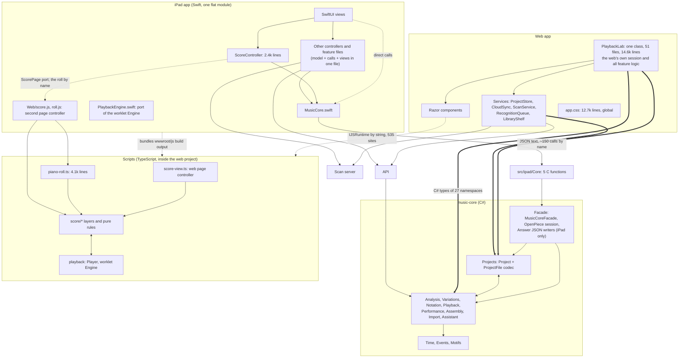
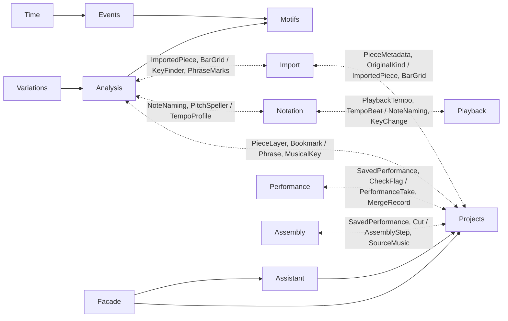
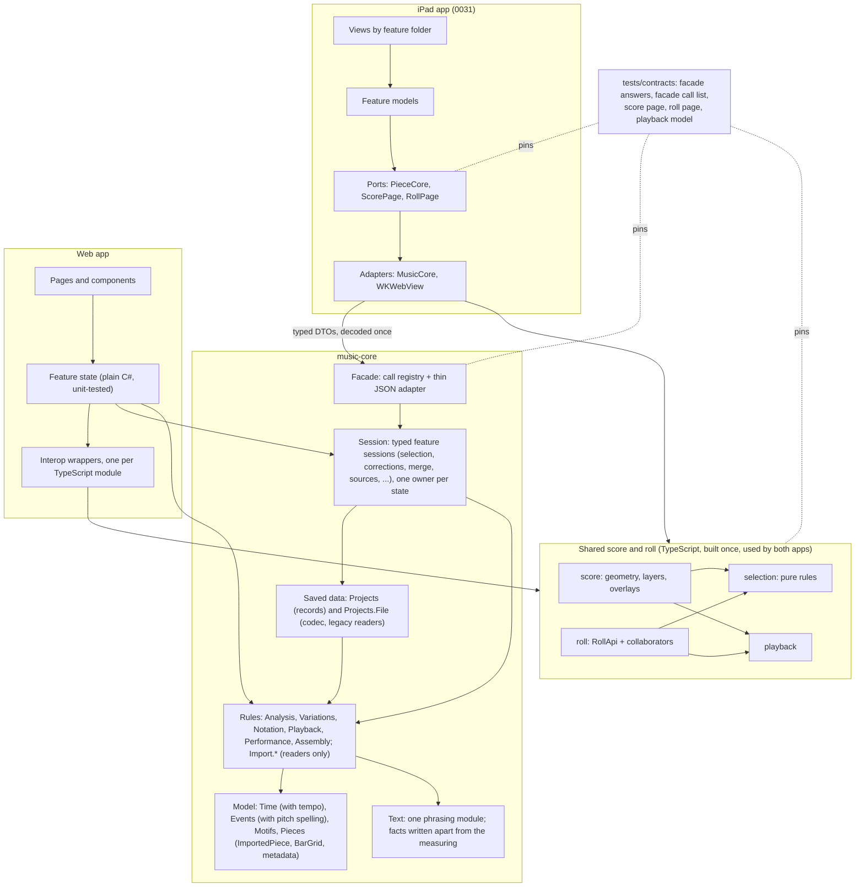

# Refactoring audit: structure and architecture of the repository

Status: current, a proposal for the refactoring task (not yet reviewed by Andrei). Written 2026-11-16 on `develop` at
`0d2bc52` (after #627, #628, #630 and #631). Read-only: no source file was changed to write it. It replaces nothing and
builds on [decision record 0031](architecture/adr/0031-ipad-score-modules.md), the [iPad UI review](code-map/ui-review-2026-11.md),
the code maps in [`code-map/`](code-map/) and the quality ratchet ([`governance/quality/README.md`](../governance/quality/README.md)).

Goal: a surgical plan that brings the three subsystems (the C# music-core, the Swift iPad app, the web app) to SOLID,
strict module boundaries and high locality of context, so that an agent can change one module without loading the project.

How it was measured: line counts and outlines of every tracked source file; the namespace and import graphs built from
the sources; `tools/quality/baseline.json`; a Release build of `MotiffLab.slnx` and every suite that runs on Linux, with
coverlet coverage; the history of the `iPad` and `Browser tests` workflows. Limits are listed in [section 7](#7-what-this-audit-did-not-do).

## 1. Executive summary

### Structural health

| Subsystem | Score | Why |
| --- | --- | --- |
| **music-core** (C#, 296 files, 60.1k lines) | **7 / 10** | Pure and deterministic, no I/O, no UI; its only package is PdfPig; the `dependencies` check keeps web, cloud and AI out; 2,130 tests, 92 % of lines and 84 % of branches covered. Against it: 7 pairs of namespaces depend on each other; two hand-written JSON codecs of 3.6k and 2.2k lines; analysis and bilingual text live in the same classes; the application session of the iPad (`OpenPiece`) is welded to JSON text. |
| **iPad app** (Swift, 127 files, 38.5k lines, plus 1.9k lines of hand-written JavaScript) | **4 / 10** | One flat folder and one module; `ScoreController` (2,396 lines) is read by 35 files; music-core's answers are untyped everywhere (674 `as?` casts and 342 `[String: Any]` in 53 files); 25 files hold SwiftUI views next to network, file or music-core calls; a dozen files are Swift ports of web code. For it: 0031 is accepted and its first two steps are merged, 451 unit tests run green on macOS, the old-mode branches went in v0.6.5, literal copy-paste is near zero. |
| **Web app** (Blazor 38.6k lines of C# and Razor, TypeScript 23.9k, CSS 12.9k) | **3 / 10** | `PlaybackLab` is one class in 51 files: 14,625 lines, 247 fields, about 800 methods, coupled to 538 types, with no unit test; `app.css` is one file of 12,750 lines; `piano-roll.ts` is one class of 4,077 lines with no direct test; 535 JavaScript calls by string name from 113 files; 19 experiment switches still branch the code; the browser suite has failed on every version tag from v0.6.1 to v0.6.5. For it: the pure TypeScript modules are well tested (593 node tests), `tsc` is strict, one `any` in the whole layer. |

Not scored, both small and healthy: the API (16 files, 1.8k lines, 79 tests) and the scan server (Python, 1.8k lines with
its tests).

### The five most dangerous nodes

1. **The facade contract between music-core and the iPad app.** About 150 calls dispatched by string name in five
   `switch` blocks; 1,399 hand-written `json.Write…` calls on the C# side; on the Swift side 117 `facadeObject` reads in
   40 files that fall back to a default when a field is missing or renamed. Nothing names the contract as data, and Swift
   is compiled only on macOS by label or tag, so `build-test` cannot see a break. Every refactoring of the core's facade
   or of a Swift feature crosses this boundary.
2. **The iPad score screen:** `ScoreController.swift` (2,396), `ScoreScreen.swift` (1,960) and `src/ipad/App/Web/score.js`
   (1,631, outside every quality check). 45 published values, 176 functions, 14 unrelated sections sharing one state.
   Decision record 0031 (accepted) describes the cure; steps 1a and 2 are merged (#630, #631), ten remain.
3. **`PlaybackLab` on the web:** the web's whole work session, UI state and feature logic in one Blazor component with no
   unit tests; its only net is the browser suite, which is red on `develop`.
4. **The shared score and roll layer lives inside the web project and is driven by two parallel page controllers.**
   `Scripts/roll/piano-roll.ts` (4,077 lines, 123 fields, 181 methods) and `Scripts/score/score-view.ts` (1,882) have no
   node test of their own; `src/ipad/App/Web/score.js` re-implements what `score-view.ts` does (for example `placeBookmarks`
   is the same code line for line), invisible to the duplicate check because `src/ipad/App/Web/**` is excluded from it.
5. **The saved-data core:** `Project` (35 state properties, 105 public members across its partial files) and the
   `ProjectFile` codec (3,605 lines, readers for versions 1 to 16), in a namespace that depends on `Import`, `Analysis`,
   `Variations`, `Performance` and `Assembly` and is depended on by them. It is well tested (95 % of lines), which makes it
   safe to split, but it is where a mistake costs a player's work.

### What is healthy and must be kept

- music-core has no dependency on the apps, the cloud or AI, and a check enforces it.
- One source of truth for the project file: the C# reader and writer, golden files for versions 12, 15 and 16, the
  tolerant reader, and the API checking only the envelope ([`project-file.md`](project-file.md), 0026).
- Shared case files already pin three cross-platform rules: the playback model, scrubbing and the analysis answers
  (`tests/ipad/MotiffLabTests/Golden/*.json`, read by node, xUnit and XCTest). This is the pattern to extend.
- Protected acceptance scenarios (`tests/backend/Acceptance/MotiffLab.Acceptance.Tests`) go only through the facade and may not be edited by the agent that
  broke them.
- The ratchet is blocking since 2026-11-16: baselined code may not grow.

## 2. Topology and dependency maps

### 2.1 Projects and folders as they are

| Path | What it is | Size | Built and tested by |
| --- | --- | --- | --- |
| `src/backend/MotiffLab.MusicCore` | The domain: 19 namespaces (table in 2.4) | 296 files, 60,070 lines | `build-test`; `tests/backend/Unit/MotiffLab.MusicCore.Tests` (178 files, 2,130 tests), `tests/backend/Acceptance/MotiffLab.Acceptance.Tests` (24) |
| `src/ipad/Core` | NativeAOT wrapper: `Exports.cs`, five C functions `ml_version`, `ml_open`, `ml_call`, `ml_close`, `ml_free` over `MusicCoreFacade` | 242 lines | compiled by `build-test`; published as an xcframework by the `iPad` workflow |
| `src/backend/MotiffLab.Api` | ASP.NET Core API: projects in Cosmos DB, profile, plan, the assistant relay | 16 files, 1,799 lines | `build-test`; `tests/backend/Integration/MotiffLab.Api.Tests` (79); deployed by `API` |
| `src/MotiffLab.Web` | Blazor WebAssembly: 9 pages, 110 Razor files, 122 C# files in 24 feature folders; one stylesheet | 38,587 lines of C# and Razor; 12,865 of CSS | `build-test` compiles it; **no unit-test project**; `tests/e2e` (58 Playwright spec files) by label, tag or nightly on `main` |
| `src/MotiffLab.Web/Scripts` | TypeScript in 11 folders (`score` 26 files, `roll` 12, `playback` 7, `layout`, `storage`, `import`, …), compiled to `wwwroot/js` | 84 files, 23,907 lines | `tsc` in the build; `tests/web` (59 files, 593 node tests) |
| `src/ipad/App/MotiffLab` | The iPad app: one XcodeGen target, 127 Swift files in one folder | 38,530 lines | `iPad` workflow on macOS (label `ipad-tests`, tags, by hand): `MotiffLabTests` (52 files, 451 tests), `MotiffLabScreens` (6 UI tests) |
| `src/ipad/App/Web` | The pages inside the app's two web views: `score.js`, `roll.js`, their HTML and CSS | 2,188 lines | nothing compiles or lints them; the `dependencies` check follows their imports |
| `src/backend/omr` | The scan server (Python: homr, Basic Pitch) | 1,810 lines with tests | `pytest` in `build-test` when it changes; `Scan server` workflow |
| `design/kit` | Tokens, component CSS, mockups | — | `tests/web/design.test.mjs` keeps the web's copy of `tokens.css` identical |
| `tools/quality`, `governance` | The ratchet, the guards | — | `node --test` in `build-test` |

The iPad app bundles the web project's build output: `project.yml` copies `wwwroot/js/{score,roll,layout,storage,playback}`,
`wwwroot/i18n` and `wwwroot/audio/piano` into the app. The shared score and roll code is therefore owned by the web
project and has no home of its own.

### 2.2 How the parts talk, and where the truth lives

| Boundary | Mechanism | Typed? | Source of truth | What checks it |
| --- | --- | --- | --- | --- |
| Web C# → music-core | Direct calls on public C# types of 27 namespaces (only `MusicCoreFacade.NewProjectId` and `.Imported` from the facade) | Yes, by the compiler | The C# types | Compiler |
| iPad Swift → music-core | `ml_call(piece, name, json)` → `MusicCoreFacade.Call` → `OpenPiece.Call` / `OpenDocument.Call` / `…Request` | **No.** Names are strings; requests are `[String: Any]` encoded by `facadeRequest`; answers are read with `as?` | Only the C# code. The contract's text is a 115-line XML comment in `MusicCoreFacade.cs` and 0020; `motifflab_core.h` still says contract 3 and `MusicCore.swift` contract 5 (it is 12) | xUnit facade tests (C# side only); XCTest `FacadeTests` on macOS; the analysis golden on both |
| Swift ↔ `score.js` / `roll.js` | The score page through one port since #631 (0031 step 2): `ScorePage` sends a `PageCommand` (the 41 functions of `window.motiff`) and decodes a `PageEvent` (22 message kinds). The roll: 23 `callAsyncJavaScript` calls by function name into `window.roll` in `RollController`, one more in `ScoreScreenViews` | Names only, for the score page; arguments and payloads are still `Any` and dictionaries. Nothing for the roll | `tests/contracts/score-page.json` for the score page's names; hand-kept for payloads and for the roll | `tests/web/score-page-contract.test.mjs` in `build-test` and `ScorePageContractTests` on macOS, names only; nothing for the roll |
| Web C# ↔ TypeScript | `IJSRuntime` by string: 535 call sites, 177 distinct names, in 113 files; 59 `[JSInvokable]` callbacks named by string in 95 `invokeMethodAsync` sites | No | Hand-kept; payload interfaces are declared by hand in TypeScript | Playwright only |
| Both apps ↔ project file | `.motiff.json` version 16, read and written only by `ProjectFile` | Yes | `ProjectFile.cs` + `project-file.md` | Golden files, 95 % coverage |
| Both apps ↔ API | REST with a bearer token; the assistant's turn format | C# shares `Assistant.Conversation` types between the API and the web; Swift re-declares them (`AssistantChat.swift`, `JSONValue`) | The core's types for C#; hand-kept in Swift | API tests; XCTest |
| Both apps ↔ scan server | HTTP `/recognise`, `/transcribe` | Hand-written on three sides (Python, `ScanService.cs`, `Scan.swift`) | None | pytest; e2e; XCTest |
| Design tokens | `design/kit/tokens.css`, copied for the web, parsed by `Design.swift` | Yes | The kit | node test, XCTest |
| Interface text | `wwwroot/i18n/*.json` (both apps), `src/ipad/App/Words/*.json` (iPad only), sentences built inside music-core by `Words` | — | Three places, by design | `tests/web/i18n.test.mjs` |

So there is one source of truth for the saved data and for the domain types on the web, and **none for the three wire
contracts the iPad depends on** (facade, page, roll): each is duplicated by hand on its two sides.

### 2.3 As-is

Two things in this picture carry most of the cost. First, there are **two application layers**: the facade's `OpenPiece`
(selection, what was understood, the variation chain, corrections, merging, sources) and `PlaybackLab`, which keeps the
same kind of state and invalidation rules for the web in a UI component. Second, there are **two page controllers** over
the same score layers, and **two playback engines**.

### 2.4 As-is inside music-core

| Namespace | Files | Lines | Public / internal types | Uses (other namespaces) |
| --- | --- | --- | --- | --- |
| `Time` | 8 | 715 | 13 / 0 | — |
| `Events` | 9 | 674 | 19 / 0 | Time |
| `Motifs` | 5 | 717 | 12 / 0 | Time, Events |
| `Settings`, `Accounts` | 5 | 560 | 13 / 0 | — |
| `Analysis` | 38 | 10,486 | 126 / 3 | Time, Events, Motifs, **Import, Notation, Playback, Projects** |
| `Variations` | 24 | 4,766 | 66 / 0 | Time, Events, Motifs, Analysis |
| `Notation` | 10 | 2,512 | 16 / 3 | Time, Events, **Playback, Import, Analysis** |
| `Playback` | 7 | 685 | 16 / 0 | Time, Events, **Import, Notation** |
| `Import` (Midi, MusicXml, Scan, Transcription, Vector) | 56 | 11,100 | 102 / 42 | Time, Events, **Projects, Analysis**, Motifs |
| `Performance` | 8 | 1,449 | 25 / 0 | Time, Events, **Projects**, Import, Playback, Export |
| `Assembly` | 10 | 2,168 | 26 / 0 | Time, Events, Analysis, **Projects**, Playback, Performance, Import, Notation |
| `Projects` | 46 | 10,713 | 102 / 5 | **Import (82 uses)**, Variations (62), Analysis, Performance, Assembly, Export, Motifs, Settings, Playback |
| `Experiments`, `Invitations`, `Analytics`, `Export` | 7 | 1,223 | 18 / 0 | Variations, Motifs, Analysis, Playback |
| `Assistant` | 30 | 4,354 | 51 / 7 | Projects, Variations, Analysis, Events, Time, Notation, Motifs, Assembly |
| `Facade` | 32 | 7,858 | 2 / 30 | everything |

The dotted pairs are the seven mutual dependencies. Each is caused by a handful of value types that sit in the namespace
of the feature that first needed them: `ImportedPiece` and `BarGrid` in `Import`, the pitch spelling in `Notation`, the
tempo model in `Playback`, the saved records in `Projects`.

### 2.5 To-be

Rules of the target:

1. Dependencies point one way: views → models (feature state) → ports → adapters; in the core, facade → session → saved
   data → rules → model. No pair of namespaces or TypeScript folders depends on each other. The `dependencies` check
   states the allowed edges, so a new cycle fails `build-test`.
2. Every wire contract exists once as data under `tests/contracts/` and is read by the tests of both of its sides.
3. One owner per state (CLAUDE.md, «Writing code» 3): a feature's state lives in its session or model, never in a view,
   a page or a composition root.
4. A feature is a folder that holds its model, its port use and its views; an agent changing it reads that folder, the
   port's contract and the code map.
5. The application session is written once in the core; the JSON facade is an adapter over it. The web may adopt a typed
   session when a web task touches that feature (no parity is implied, 0025).

## 3. Registry of monoliths

128 tracked code files are longer than 350 lines: 31 in music-core, 35 in the iPad app, 39 in the web app, 18 tests,
4 tools and workflows, and one third-party file (`wwwroot/lib/verovio/verovio.mjs`, not ours). 35 are over the quality
threshold of 600 lines; 23 are 800 lines or more. «Deps» is the number of `using` / `import` lines, with injected
services after the plus sign.

### 3.1 music-core

| File | Lines | Deps | Responsibilities mixed | Split into |
| --- | --- | --- | --- | --- |
| `src/backend/MotiffLab.MusicCore/Projects/ProjectFile.cs` | 1,744 | 11 | 8: the envelope and version switch; readers of versions 1–15; ink and marks; bookmarks, resume points, Check; performances and merges; phrases, scan, transcription, bars; the variation chain and every operation's parameters; JSON primitives and the tolerant reader's unknown entities (92 methods) | Keep `ProjectFile.Read` / `.Write`. Move the rest to `Projects/File/`: `JsonRead` (primitives, also used by `Facade/Request`), `Legacy/` (everything `ReadEarlier` needs), `MarksCodec`, `PerformanceCodec`, `VariationCodec`, `UnknownEntities`. Golden files pin it |
| `src/backend/MotiffLab.MusicCore/Notation/NotationGenerator.cs` | 1,597 | 8 | 6: planning bars and parts; rhythm of heard notes (`Snap`, `AsHeard`); tuplets; staves, clefs and voices; beams and rests; writing MEI with tempos and directions (20 types, 69 methods; `PlanPart` complexity 28) | `NotationPlan`, `HeardRhythm`, `StaffLayout`, `MeiWriter`; `NotationGenerator` keeps `FromMidi` / `FromMusicXml` / `Generate` |
| `src/backend/MotiffLab.MusicCore/Facade/Answer.cs` | 1,366 | 16 | 12 or more: the JSON of every feature (piece, project, phrases, selection, facts, circle, harmony, DNA, variation, checks, notation, roll, playback, catalogue); coupled to 216 types; `Dna` is 153 lines | `Answer.<Feature>.cs` by feature and `JsonWrite` for the primitives; later each writer sits beside the typed result of its session |
| `src/backend/MotiffLab.MusicCore/Import/MusicXml/MusicXmlImporter.cs` | 1,275 | 6 | 6: loading and sniffing XML and MXL; the part list; the per-part reader (notes, ties, slurs, tuplets, graces, barlines, repeats, directions, key, time); merging parts; aligning bars; issues (`Build` is 256 lines, complexity 43) | `MusicXmlDocument` (load), `PartReader` in its own files by element group, `MusicXmlAssembler` (`Build` cut into ties, slurs, barlines, texts) |
| `src/backend/MotiffLab.MusicCore/Import/Transcription/BarGrid.cs` | 1,055 | 4 | 5: the grid as a model (signature and beat lookup); beat tracking; bass tracking; search and refine; applying the grid to notes | `BarGrid` (model, moved to `Pieces`), `BeatTracker`, `GridSearch`, `GridApply`; `BarGrid.Sections.cs` (382) becomes `LiveSections` |
| `src/backend/MotiffLab.MusicCore/Projects/Project.cs` | 978 | 10 | 7: the aggregate's 35 properties; creation from a file, a document, a recognition; originals; bookmarks and categories; resume points; performances; assembly; plus summary and saved-record types (105 public members with its partials) | First a file per sub-aggregate (`Project.Bookmarks`, `.ResumePoints`, `.Performances`, records in their own files); then, as a separate decision, group the state as the file's three layers (originals, notes, workspace; 0030) |
| `src/backend/MotiffLab.MusicCore/Variations/OperationTemplates.cs` | 818 | 4 | 2 at scale: the explanation text of about 15 operations, in two languages, with its own formatters (`Revoiced` complexity 38, `Densified` 34) | One template file per operation family; formatters to the phrasing module |
| `src/backend/MotiffLab.MusicCore/Analysis/MotifAnalyzer.cs` (+ `.Character.cs` 374, `.Rhythm.cs`, `.Texture.cs`) | 739 | 3 | 4: measuring the melody; reading the key; facts as sentences; English and Russian grammar helpers (`Analyze` 129 lines) | `MotifMeasures` (numbers) and `MotifFacts` (sentences) per lens; helpers to the phrasing module |
| `src/backend/MotiffLab.MusicCore/Facade/OpenPiece.cs` (+ 8 partial files, about 2,500 lines) | 734 | 17 | 8: the session's state; import, open, transcribe; dispatch; phrases and levels; selection; understanding, Try, variation; notation; playback and roll; save. Every method takes a `Request` and returns JSON text | Typed feature sessions (`SelectionSession`, `CorrectionsSession`, `MergeSession`, `SourcesSession`, `PerformanceSession`, …), each the owner of its state; `OpenPiece` composes them; JSON only in the adapter |
| `src/backend/MotiffLab.MusicCore/Analysis/Harmony.cs` | 674 | 2 | 3: chord types; finding chords (windows, scoring); harmony facts as text | `ChordModel`, `ChordFinder`, `HarmonyFacts` |
| `src/backend/MotiffLab.MusicCore/Analysis/PieceDna.cs` | 593 | 4 | 3: 11 record types; seven lanes; the key read from notes | `DnaModel`, `DnaLanes`, key reading shared with `KeyFinder` |
| `src/backend/MotiffLab.MusicCore/Facade/MusicCoreFacade.cs` | 532 | 6 | 4: the registry of open pieces; four ways to open; the dispatch of piece 0; a 115-line history of the contract in a comment | The history to `docs/`; a call registry as data (name, handler, «showing», «without a piece») in place of the `switch` blocks and name lists |
| `src/backend/MotiffLab.MusicCore/Analysis/SentenceMap.cs` | 526 | 2 | 3: the model and its edits; suggesting sentences (`Group` complexity 21); facts as text | `SentenceMap`, `SentenceFinder`, `SentenceFacts` |
| `src/backend/MotiffLab.MusicCore/Projects/PieceParts.cs` | 524 | 5 | 3: the parts model; splitting a PDF, notes or a recording; cuts and titles | `PiecePart` types; a splitter per origin |
| `src/backend/MotiffLab.MusicCore/Analysis/PhraseBoundaries.cs` | 508 | 2 | 3: evidence types; the finder (slurs, rests, repeats); the player's boundaries | One file per kind of evidence |
| `src/backend/MotiffLab.MusicCore/Variations/VariationFacts.cs` | 503 | 4 | 2: the Keep checks; the explanation text (`Explain` 112 lines, complexity 34) | `KeepChecks`, `VariationExplanation` |
| `src/backend/MotiffLab.MusicCore/Experiments/ExperimentCatalogue.cs` | 475 | 6 | 3: types; four experiments; the context and its text | Types apart; one file per experiment |
| `src/backend/MotiffLab.MusicCore/Import/Midi/MidiImporter.cs` | 472 | 3 | 2: the import; the track reader with the pedal | `TrackReader` in its own file |
| `src/backend/MotiffLab.MusicCore/Projects/SourceOperations.cs` | 466 | 2 | 2: originals (add, remove, revive); Notes (add, delete, recognise, make working) | `OriginalOperations`, `NotesOperations` |
| `src/backend/MotiffLab.MusicCore/Import/PieceImporter.cs` | 445 | 6 | 3: sniffing the format; importing; the model `ImportedPiece` every namespace uses | `ImportedPiece`, `ImportedTrack` to `Pieces` (this breaks three cycles); `FormatSniffer` |
| `src/backend/MotiffLab.MusicCore/Analysis/StructureAnalyzer.cs` | 432 | 4 | 2: recurrences and spans; facts as text | Measures and facts apart |
| `src/backend/MotiffLab.MusicCore/Projects/ProjectFile.Layers.Read.cs` | 401 | 3 | 1: the reader of version 16 | Leave; it moves into `Projects/File/` |
| `src/backend/MotiffLab.MusicCore/Analysis/ShortMap.cs`, `PhraseMap.cs` | 399, 396 | 2, 3 | Each: a level's model, its suggestion and its edits. With `SentenceMap` they are three parallel implementations of `Make…`, `JoinWithNext`, `SplitAt`, `Snap`, `EditsFor` | One edit algebra for the three levels |
| `src/backend/MotiffLab.MusicCore/Analysis/MusicalIdeas.cs` | 395 | 2 | 2: finding ideas; text | Measures and facts apart |
| `src/backend/MotiffLab.MusicCore/Assembly/Assembled.cs` | 391 | 5 | 2: replaying the journal; `Carry` (105 lines, complexity 26) | One method per step kind; raise branch coverage first (Assembly: 61 %) |
| `src/backend/MotiffLab.MusicCore/Performance/PerformanceComparison.cs` | 381 | 2 | 2: matching (`Compare` 123 lines); classifying | `NoteMatcher`, `DifferenceClassifier` |
| `src/backend/MotiffLab.MusicCore/Import/Scan/ScanRepair.cs` | 371 | 5 | 2: parsing the scan's MusicXML; mending and re-timing | Leave until touched |
| `src/backend/MotiffLab.MusicCore/Facade/Answer.Project.cs` | 361 | 7 | Part of `Answer` (marks, bookmarks, resume, Check, settings) | With `Answer.cs` |

### 3.2 iPad app

| File | Lines | Deps | Responsibilities mixed | Split into |
| --- | --- | --- | --- | --- |
| `src/ipad/App/MotiffLab/ScoreController.swift` | 2,396 | PDFKit, SwiftUI, UTType, WebKit | 14 sections over one state: the page's plumbing, phrases and selection, bookmarks, margin notes and highlights and layers, Check, corrections, the roll's note editor, versions, sources, merging, focus, resume and beats, strokes, selection history; 45 `@Published`, 176 functions, 37 music-core calls, 38 page calls (through `ScorePage` since #631) | 0031 section 3: `PenModel`, `SelectionModel`, `MarksModel`, `CheckModel`, `SourcesModel`, `MergeModel`, `FocusModel` over the ports `ScorePage` and `PieceCore`; the controller stays as the composition root |
| `src/ipad/App/MotiffLab/ScoreScreen.swift` | 1,960 | SwiftUI, WebKit | 6: the layout of the layers (`layers`, 143 lines); wiring of every controller's callbacks (`wire`); sources and views; the roll drawer and its playheads; resume; 12 view types (bar, pill, selection menu, focus bar, panels) with 70 pieces of view state | 0031 section 4: `ScoreScreen+Roll`, `+Sources`, `+Expand`, `+Playback`; each view type in its own file |
| `src/ipad/App/Web/score.js` | 1,631 | 16 imports | 9: page layout and paging; bookmarks; margin notes; Check flags; version markers and tints; playheads and cards; the pen and rubbing; selection plumbing; reporting to Swift. 82 functions around one `state` object, 41 exported to `window.motiff` | 0031 step 11: TypeScript modules behind `page-contract.ts`. Add: the overlays it shares with `score-view.ts` move to one set of modules both controllers call |
| `src/ipad/App/MotiffLab/Dna.swift` | 1,243 | SwiftUI | 4: decoding the `dna` answer (`DnaMap`); the lanes' drawing; the harmony rows and the circle; cards; playing a section (`DnaPlaying`). `DnaScreen` is 890 lines | `DnaModel` (typed decode), `DnaLanes`, `DnaHarmony`, `DnaCards`, `DnaPlaying` |
| `src/ipad/App/MotiffLab/Pdf.swift` | 901 | PDFKit, SwiftUI | 5: `PdfController` (15 published values, bookmarks, save, music-core calls); the PDFKit view; the screen; Contents; More with sources | `Pdf/PdfController`, `PdfPagesView`, `PdfScreen`, `PdfContents`, `PdfMore` |
| `src/ipad/App/MotiffLab/PlaybackEngine.swift` | 852 | Foundation | 4: messages; musical time; voices and clicks; reports. A port of `playback-processor.ts` | `PlaybackEngine+Time`, `+Voices`, `+Reports`; keep it one type, it is cohesive |
| `src/ipad/App/MotiffLab/Insights.swift` | 821 | SwiftUI | 3: facts decoded from JSON; `InsightsController` (13 published values, 6 music-core calls); 7 views | `InsightsModel`, `InsightsController`, `InsightsViews` |
| `src/ipad/App/MotiffLab/Bookmarks.swift` | 722 | SwiftUI | 4: bookmark types and their decode; `ContentsController`; the card; the drawer with 9 views | `BookmarkModel`, `ContentsController`, `BookmarkCard`, `ContentsDrawer` |
| `src/ipad/App/MotiffLab/Versions.swift` | 708 | SwiftUI, UTType | 3: four decoded shelves (`VersionShelf`, `MergeInfo`, `SourcesInfo`, …); the version bar; the merge views (18 types) | `VersionModel`, `MergeModel` types, `VersionViews`, `MergeViews` |
| `src/ipad/App/MotiffLab/LibraryView.swift` | 598 | SwiftUI, UTType | 4: the library screen (31 pieces of view state); file operations; opening and switching views of a piece; online copies | `LibraryModel` (open, switch, delete as one owner: UI review «three guards for one switch»), `LibraryView` |
| `src/ipad/App/MotiffLab/SourcesSheet.swift` | 596 | SwiftUI, UTType | 2: the sheet; rows, menus and dialogs | Rows and dialogs in their own files |
| `src/ipad/App/MotiffLab/Player.swift` | 566 | AVFoundation, QuartzCore, SwiftUI | 4: the audio graph; the playback model's state (14 published); loading scores from music-core; polling reports | `PlayerAudio` (engine node), `PlayerModel`, `PlaybackScore` decode |
| `src/ipad/App/MotiffLab/SettingsView.swift` | 560 | PhotosUI, SwiftUI | 3: `DeviceSettings` (a store); the settings sheet; the account panel and profile editor | `DeviceSettings` to its own file; `AccountPanel` to the account feature |
| `src/ipad/App/MotiffLab/Check.swift` | 558 | SwiftUI | 3: Check types and decode; corrections; the drawer | `CheckModel`, `CheckDrawer` |
| `src/ipad/App/MotiffLab/RollController.swift` | 550 | SwiftUI, WebKit | 3: the web view and its messages; the editor; input rules | 0031 step 12: a typed `RollPage` port |
| `src/ipad/App/MotiffLab/LibraryTools.swift` | 550 | SwiftUI | 11 view types of the library's list | By view group |
| `src/ipad/App/MotiffLab/Account.swift` | 521 | Foundation, UIKit | 4: MSAL sign-in; the plan and Pro features; the profile; HTTP requests | `AccountSession`, `PlanModel`, `ProfileModel`, `ApiClient` |
| `src/ipad/App/MotiffLab/Design.swift` | 520 | CoreText, SwiftUI, UIKit | 3: parsing `tokens.css`; fonts; 10 styles and components | `DesignTokens`, `DSType`, `DSStyles` |
| `src/ipad/App/MotiffLab/PencilPalette.swift` | 506 | SwiftUI, UIKit | 3: Pencil gestures; the palette's geometry; the palette view | `PencilGestures`, `PaletteLayout`, `PencilPalette` |
| `src/ipad/App/MotiffLab/FolderFoundSheet.swift` | 488 | SwiftUI | 1: views of one sheet (10 types) | By view |
| `src/ipad/App/MotiffLab/PiecePartsSheet.swift` | 474 | PDFKit, SwiftUI | 2: `PieceSplitter` (5 music-core calls); the sheet | Controller and views apart |
| `src/ipad/App/MotiffLab/Metronome.swift` | 447 | AVFoundation, SwiftUI | 4: the click clock on the audio thread; tempo rules (a port of `metronome.ts`); the controller; the pill's views | `MetronomeClock`, `MetronomeTempo`, `Metronome`, `MetronomeViews` |
| `src/ipad/App/MotiffLab/Reference.swift` | 427 | AVFoundation, SwiftUI | 3: answers decoded; the controller; its own piano | Model, controller, sound |
| `src/ipad/App/MotiffLab/PdfInk.swift` | 406 | PDFKit, UIKit | 2: stroke geometry (a port of `pencil-marks.ts`); the controller's ink extension | `DocumentStroke` to the ink feature |
| `src/ipad/App/MotiffLab/LibraryShelf.swift` | 401 | Foundation | 1, but a duplicate: search, filter and order rules that `src/MotiffLab.Web/Projects/LibraryShelf.cs` also implements | Leave; the rules are a candidate for music-core (section 4.4) |
| `src/ipad/App/MotiffLab/Tempo.swift` | 399 | SwiftUI | 3: `TempoSetting`; `TempoReading` (the text rules of the web's `TempoReading.cs`); views | Model and views apart |
| `src/ipad/App/MotiffLab/RollTools.swift`, `RecognitionViews.swift`, `PiecePropertiesSheet.swift`, `SourcesSwitch.swift`, `ReferenceChordsScales.swift` | 386, 385, 359, 356, 351 | SwiftUI | Views with small stores beside them (`RollZoom`, `RecordingListening`, `ReferenceSounding`) | Stores out of the view files when the feature is next touched |
| `src/ipad/App/MotiffLab/Scan.swift` | 383 | PDFKit, SwiftUI | 3: the scan server client (HTTP); the engine choice; two panels | `ScanClient`, `ScanPanel` |
| `src/ipad/App/MotiffLab/InkInput.swift` | 367 | UIKit | 2: the gesture recogniser; the live ink view | Leave |
| `src/ipad/App/MotiffLab/PieceParts.swift` | 364 | Foundation | 1: value types and requests of the parts | Leave |
| `src/ipad/App/MotiffLab/SourcesController.swift` | 352 | PDFKit, SwiftUI | 2: the sheet's operations; the hand-over between screens | Joins `SourcesModel` (0031 step 7) |

### 3.3 Web app

| File | Lines | Deps | Responsibilities mixed | Split into |
| --- | --- | --- | --- | --- |
| `src/MotiffLab.Web/wwwroot/css/app.css` | 12,750 | — | Every style of the app in one global sheet: 307 comment-headed blocks, 2,862 token uses, no `@import`, no component-scoped sheet | One sheet per area (`base`, `score`, `roll`, `library`, `sheets`, `insights`, `assistant`, `import`, `reference`), loaded in a fixed order; the score's marks shared with `src/ipad/App/Web/score.css` as one file |
| `src/MotiffLab.Web/Pages/PlaybackLab.razor` (+ 50 partial files, 14,625 lines in all) | 4,153 | 30 + 11 | The whole work session: loading and saving the piece; selection; analysis; playback; variations; marks; bookmarks; Check and repairs; sources; assembly; performances and recordings; the assistant; focus; resume; settings popovers; 866 lines of markup. 247 fields, about 800 methods, coupled to 538 types, 49 JavaScript calls | Feature state in plain C# classes, one owner each (`PieceSession`, `SelectionState`, `MarksState`, `BookmarksState`, `SourcesState`, `AssemblyState`, `PerformanceState`, `AssistantState`), unit-tested; then the markup into child components that take their state |
| `src/MotiffLab.Web/Scripts/roll/piano-roll.ts` | 4,077 | 18 | 7 in one class: the viewport and zoom; painting (`drawRoll` 248 lines, complexity 91); the keyboard and gutter; the note editor; selection gestures (three generations: strips, modes, places); playheads; the legend. 123 fields, 181 methods; the literal 480 appears 38 times | 0031 section 4: `RollApi` interface plus collaborators (viewport, painter, editor, legend, input router) |
| `src/MotiffLab.Web/Scripts/score/score-view.ts` | 1,882 | 17 | 6: Verovio loading and layout; paging and lazy fill; overlays (bookmarks, notes, Check, versions, assembly); playhead and follow; selection plumbing; PDF export. 67 fields, 76 methods | `ScoreEngraving`, `ScorePaging`, shared overlay modules, `ScoreFollow`; `ScoreView` composes |
| `src/MotiffLab.Web/Pages/PlaybackLab.Assembly.cs` | 1,205 | 13 | The assembly feature's state and 62 methods inside the page class | `AssemblyState` + its component |
| `src/MotiffLab.Web/Scripts/playback/playback-processor.ts` | 1,085 | 0 | 4: messages; time; voices and clicks; the recording's sound; scrubbing. Cohesive; mirrored by `PlaybackEngine.swift` | Same cut as the Swift port, so the two stay comparable |
| `src/MotiffLab.Web/Pages/Import.razor` | 1,043 | 10 + 10 | 4: three routes (file, scan, recording); the recording editor with its waveform; scan progress; opening the result | A component per route; the recording editor apart |
| `src/MotiffLab.Web/Dna/PieceDnaMap.razor` | 898 | 5 + 2 | 4: lanes; harmony rows; the circle; hearing | As `Dna.swift`: model, lanes, harmony, cards |
| `src/MotiffLab.Web/Score/ScoreView.razor` | 790 | 6 + 4 | The interop wrapper of `score-view.ts` (49 methods, 88 public members) plus the pencil's state | Leave as the one wrapper; the pencil's state apart |
| `src/MotiffLab.Web/Scripts/score/score-geometry.ts` | 710 | 2 | 2: reading a page's SVG into frames (`readPage` 124 lines); queries | `page-reader.ts`, `ScoreGeometry` |
| `src/MotiffLab.Web/Roll/PianoRoll.razor` | 698 | 11 + 4 | The interop wrapper of `piano-roll.ts`; overlays; labels | Leave as the one wrapper |
| `src/MotiffLab.Web/Pages/PlaybackLab.Layout.cs` | 668 | 12 | Popovers, pill menus, levels, drawers, the pen, PDF export, stepping: «everything about the chrome» | Into the components that own those controls |
| `src/MotiffLab.Web/Scripts/score/svg-to-pdf.ts` | 666 | 0 | 3: parsing SVG; path and shape operators (complexity 63); text | `svg-parse`, `pdf-paths`, `pdf-text` |
| `src/MotiffLab.Web/Scripts/score/selection-layer.ts`, `selection-place-layer.ts`, `pencil-layer.ts` | 596, 559, 592 | 7, 7, 2 | Each one layer class with drawing, input and reporting together | Drawing apart from input when next touched (the code map already asks for it) |
| `src/MotiffLab.Web/Pages/PdfReader.razor`, `Home.razor.cs` | 560, 558 | 11 + 8, 13 | Pages that hold their features' state (PDF: bookmarks, pen, metronome, sources; home: library, sheets, resume, sync) | State classes as for `PlaybackLab` |
| `src/MotiffLab.Web/Scripts/score/pencil-marks.ts`, `playback/playback.ts`, `metronome/metronome.ts` | 542, 536, 433 | 0, 7, 2 | Cohesive modules, each ported by hand to Swift (`InkGeometry.swift` / `PdfInk.swift`, `Player.swift`, `Metronome.swift`) | Leave; pin the ports with shared case files |
| `src/MotiffLab.Web/Sources/SourcesSheet.razor`, `Insights/InsightsStream.razor` | 512, 438 | 4 + 2, 6 + 1 | A sheet with its rows, menus and dialogs; the stream with its rows | Row components |
| `src/MotiffLab.Web/Import/ScanService.cs` | 501 | 11 | 3: the scan client; the recording editor's interop; transcription | `ScanClient`, `RecordingEditor`, `TranscriptionClient` |
| `src/MotiffLab.Web/Account/OnlineProjects.cs`, `CloudAccount.cs` | 495, 360 | 8, 8 | The API client, the sync records and the plan, each also hand-ported to Swift | Leave; the HTTP shapes to one place |
| `src/MotiffLab.Web/Scripts/import/recording.ts`, `mp4.ts`, `folder.ts` | 469, 393, 393 | 2, 1, 2 | Import helpers; `recording.ts` also lends `decodeMono` and `peaksOf` to `playback` | The audio helpers to `audio/` |
| `src/MotiffLab.Web/Pages/PlaybackLab.Performance.cs`, `.Variants.cs`, `.SourcesSheet.cs`, `.Recording.cs`, `.Marks.cs`, `.Bookmarks.cs` | 463, 454, 431, 400, 380, 367 | 7–14 | Partial files of the page class: no boundary, shared fields | Their feature state classes |
| `src/MotiffLab.Web/Library/RecognitionQueue.cs`, `Projects/ProjectStore.cs` | 425, 364 | 7, 8 | A queue with its storage and its runs; a store with its row types | Leave until touched |
| `src/MotiffLab.Web/Scripts/roll/roll-model.ts`, `roll-view.ts` | 376, 362 | 0, 1 | Cohesive, pure, tested | Leave |

### 3.4 Tests and tools over 350 lines

`tests/backend/Unit/MotiffLab.MusicCore.Tests/Facade/MusicCoreFacadeTests.cs` (1,328) and `tests/ipad/MotiffLabTests/FacadeTests.swift`
(701) test the same contract from its two sides without sharing a case; they become readers of the facade fixtures
(section 5.3). The others are long because they are lists of cases and need no split: `NotationGeneratorTests.cs` (632),
`PlaybackTests.swift` (598), `PencilTests.swift` (573), `ProjectFileGoldenTests.cs` (475), `playback-processor.test.mjs`
(468), `performance.spec.mjs` (429), two `make_fixtures.py` (427, 386), `MusicXmlImporterTests.cs` (424),
`ExplanationAuditTests.cs` (421, with one method of complexity 56), `ProjectFileTests.cs` (408), `BarGridTests.cs` (403),
`StylusTests.swift` (364), `AssemblyTests.cs` (363), `ObservationTests.cs` (359), `PiecePartsTests.cs` (352).
Tools: `tools/quality/quality.mjs` (544), `infra/azure/setup.ps1` (482), `.github/workflows/ci.yml` (383),
`tools/perf/measure.mjs` (382); out of scope here.

## 4. Diagnosis: contracts, leaks and duplicates

### 4.1 Direction of dependencies

| # | Finding | Evidence | Consequence |
| --- | --- | --- | --- |
| L1 | Seven pairs of core namespaces depend on each other (section 2.4) | The graph of `using` lines and type uses | A change in `Import` can force a read of `Projects`, `Analysis` and `Notation`; no namespace can be understood alone |
| L2 | The application session is fused with the wire format | Every `OpenPiece` method is `string Method(Request)`; `Answer` writers are called inside the use cases | The session cannot be reused by the web or tested without JSON; the web keeps a second session in `PlaybackLab` |
| L3 | The persistence codec sits in the domain's namespace and knows every feature | `ProjectFile*.cs` in `Projects`, with 11 namespaces imported and CA1506 at 193 types | Acceptable for a mapper, but it should be a sub-namespace nothing else imports from |
| L4 | Analysis classes build bilingual sentences | `Words` is used in 26 files of `Analysis`, 23 of `Variations`; `MotifAnalyzer` holds `RussianInterval`, `WithArticle`, `Plural` | Measuring and wording change for different reasons; a wording fix reopens an analyser of 700 lines |
| L5 | SwiftUI views call music-core, the network, files and `UserDefaults` directly | 34 files call `MusicCore.*`; 25 files declare views next to such calls (`ScoreScreen.swift` 4, `Insights.swift` 6, `PiecePartsSheet.swift` 5, `SettingsView.swift` 4, …); `UserDefaults` in 19 files | A view cannot be previewed or tested without the framework; state has no single owner |
| L6 | Razor components call JavaScript directly | `IJSRuntime` invoked in 113 files | A renamed TypeScript export fails only in the browser |
| L7 | TypeScript folders depend on each other | `score` ↔ `playback` (the hold timing constants live in `score/selection-gesture.ts`, the playhead drag in `playback`); `roll` → `score` for the selection rules; `playback` → `import/recording.ts` | The pure selection rules have no folder of their own |
| L8 | The shared TypeScript belongs to the web project | `project.yml` bundles `src/MotiffLab.Web/wwwroot/js/*`; an iPad task must build the web project | iPad tracks «do not read web pages», yet their page's code is there |
| L9 | The API is rebuilt and redeployed on any music-core change | `api.yml` paths include `src/backend/MotiffLab.MusicCore/**`; the API uses only `Assistant.Conversation`, `Accounts` and the project envelope | Every core refactoring step deploys the API (to the `develop` servers) |

### 4.2 Encapsulation

- music-core: 578 public types against 90 internal. Everything is public because the web consumes the types directly;
  only `Facade` is closed (2 public, 30 internal). After the session is typed (L2), the rule engines behind it can become
  internal one namespace at a time, with `InternalsVisibleTo` for the tests.
- iPad: one module, so every declaration without `private` is visible to all 127 files; `ScoreController` has about 360
  members of which about 130 are private. Raw `[String: Any]` crosses feature boundaries (117 reads of facade answers in
  40 files, 59 request builders in 27). Only 33 types are `Codable`.
- Web: payloads to TypeScript are C# records serialised by reflection and matched by hand-written TypeScript interfaces;
  the flat arrays of the roll and the playback score are packed twice, once for the web (`Web/Playback/PlaybackPayload.cs`)
  and once for the facade (`Facade/Answer.cs`, `Playback/PianoRollData.cs`).
- Error handling in Swift is silent by habit: 248 `try?`, two log statements in the whole app. A decode that fails
  shows as an empty screen, not an error.

### 4.3 Interfaces

The code base has almost no interfaces to be too wide: three in C# (`IVariationOperation`, `IProjectStore`,
`IAssistantModel`), one protocol in Swift (`PenHolder`). The violation of interface segregation is the opposite one:
**wide concrete surfaces that every client depends on whole.**

| Surface | Width | Clients | Segregate into |
| --- | --- | --- | --- |
| `ScoreController` | about 200 members used outside it (0031) | 35 files; 50 `@ObservedObject` uses in 16 | The seven feature models; views observe only theirs |
| `window.motiff` | 41 functions, 22 message kinds | `ScoreController`, `ScoreScreenViews`, `PracticeView` | `PageCommand` / `PageEvent` exist since #631 as one flat list; each feature model gets its own part of it |
| `PianoRoll` | 181 methods, called by the web and by `roll.js` | 2 hosts | `RollApi` split into view, selection, editing and playhead interfaces |
| `ScoreView.razor` | 88 public members | `PlaybackLab`, focus, compare | Per-overlay parameters and one command interface |
| `PlaybackLab` | 247 fields visible to all 51 partial files | itself | Feature state classes |
| `Answer` (static) | 34 writers, 216 types | every facade file | By feature |
| `Project` | 105 public members | core, web, facade | Operations per sub-aggregate; later the three layers |
| `MusicCoreFacade.Call` | about 150 names, three lists of «which calls are allowed when» | the iPad | The call registry |

### 4.4 Duplicates

The duplicate check reports 0.24 % of copied lines, which is true for literal copies in the files it reads. It does not
read `src/ipad/App/Web/**`, and it cannot see the same rule written in two languages. Those are the real duplicates:

| # | Concept | Copies | Kept in step by |
| --- | --- | --- | --- |
| D1 | The work session over a piece (selection, what was understood, variation chain, corrections, sources) | `Facade/OpenPiece*.cs` (iPad) and `Pages/PlaybackLab*.cs` (web) | Nothing; they have already diverged (the web assembles versions by 0024, the iPad merges by `performance.merge`) |
| D2 | The score page's controller over the shared layers | `Scripts/score/score-view.ts` and `src/ipad/App/Web/score.js`: 12 functions share a name, `placeBookmarks` is identical | Nothing |
| D3 | The playback engine | `playback-processor.ts` and `PlaybackEngine.swift` | `scrub.json`, and the engine's own tests on each side |
| D4 | The playback model and playhead drag | `playback-model.ts`, `playhead-drag.ts` and `PlaybackPosition.swift`, `PlayheadDrag.swift` | `playback-model.json` (good) |
| D5 | The metronome's rules | `metronome.ts` and `Metronome.swift` | Nothing |
| D6 | Ink geometry (anchoring, erasing, rubbing) | `pencil-marks.ts` and `InkGeometry.swift`, `PdfInk.swift` | Nothing |
| D7 | Library search, filter and order | `Web/Projects/LibraryShelf.cs` and `LibraryShelf.swift` | Nothing; pure rules that belong in music-core |
| D8 | The tempo's reading and its text («♩ = 92», «♩ ≈ 96») | `Web/Playback/TempoReading.cs` and `Tempo.swift` | Nothing |
| D9 | Sync, online copies, account and plan clients | `Web/Account/*.cs` and `CloudSync.swift`, `OnlineProjects.swift`, `Account.swift` | The sync decisions are in the core (`ProjectSync`); the HTTP shapes are hand-kept |
| D10 | The scan server client | `ScanService.cs` and `Scan.swift` | Nothing |
| D11 | The assistant's turn format | `Assistant.Conversation` (core, shared by the API and the web) and `AssistantChat.swift` | Nothing |
| D12 | Flat payload packing | `Web/Playback/PlaybackPayload.cs`, `Playback/PianoRollData.cs`, `Facade/Answer.cs` | Nothing |
| D13 | Three phrase levels' edit operations | `ShortMap.cs`, `PhraseMap.cs`, `SentenceMap.cs` | Tests of each |
| D14 | Small wording helpers | `Bars(first, last, Words)` in 5 files; `Listed`, `Count`, `WithArticle`, `Plural` twice each | Nothing (under the 10-line threshold) |
| D15 | Reading «now» from a request | `Now(Request)` in 6 facade files | Nothing |
| D16 | The JSON primitives of the two codecs | `ProjectFile.cs`, `Facade/Answer.cs`, `Facade/OpenDocument.cs` (baselined duplicates) | Nothing |
| D17 | Pitch names | `roll-model.ts` `pitchName` and the core's `Pitch` and `NoteNaming` | A comment |
| D18 | The score marks' CSS | `app.css` and `src/ipad/App/Web/score.css` (172 lines) | Nothing |

D3 to D6 are deliberate ports (0019): they cannot be removed, only pinned. D1, D2, D7, D8, D12 to D16 can be removed.

### 4.5 Dead code and context rot

- **Experiment switches.** The catalogue in `Settings/SettingsCatalogue.cs` still lists 23 `experimental.*` switches. The
  iPad reads none since v0.6.5; the web still branches on 19 of them (43 references). Each keeps two paths alive on the
  web. Keeping or removing each is Andrei's decision (governance, decision 2).
- **Stale contract texts:** the 115-line history in `MusicCoreFacade.cs`; `src/ipad/Core/include/motifflab_core.h` («contract
  3, project file 12»); `MusicCore.swift` («contract 5, project file 14»). Agents read these as truth.
- **Selection has three generations in the shared code:** the strips' hold gesture of 0.6.1, the modes of 0.5, the places
  of 0.6.2 (`roll-strip-gesture.ts`, `roll-modes.ts`, `roll-place*.ts`, `selection-gesture.ts`, `selection-places.ts`).
  The iPad uses places only; the web keeps the older two. `piano-roll.ts` carries all three.
- **Types used only by tests** in music-core (candidates, to confirm with the reference finder of the 2026-11-09 review
  before deleting): `SecondFileSource`, `SurprisePick`, `SelectionStep`, `MotifSourceReference`, `GridFit`,
  `SwingMeasure`, `MeterStretch`, `InkThinning`, `Cadence`. `Invitations` is two files of 27 lines that only hold
  `Passage` and `InvitationContext` for `Experiments`.
- **No unused Razor component and no unreachable file was found** at file level; the old iPad mode branches
  (`onePosition`, `PlaceSelection.on`) are gone. Member-level dead code was not measured (section 7).
- **Missing maps.** `governance/roles/common.md` requires a code map per area; `docs/code-map/` has `ipad`, `score` and
  `roll` but no `core.md` and no `web.md`, the two largest areas.

## 5. Tests: the safety net

### 5.1 What exists and whether it runs

Run for this audit on a clean clone of `0d2bc52` (Linux, .NET 10, Node 22):

| Suite | Where | Result today | Runs in CI |
| --- | --- | --- | --- |
| music-core unit tests | `tests/backend/Unit/MotiffLab.MusicCore.Tests` (xUnit) | **2,130 passed**, 0 failed, 22 s | `build-test`, every pull request |
| Protected acceptance scenarios | `tests/backend/Acceptance/MotiffLab.Acceptance.Tests` (xUnit, through the facade) | **23 passed, 1 skipped** (a known defect) | `build-test` |
| API tests | `tests/backend/Integration/MotiffLab.Api.Tests` | **79 passed** | `build-test` |
| TypeScript node tests | `tests/web/*.test.mjs` | **593 passed** | `build-test` |
| Guards and ratchet | `governance/tests`, `tools/quality` | **27 passed** | `build-test` |
| Scan server | `src/backend/omr/tests` (pytest) | not run here | `build-test` when it changes |
| iPad unit tests | `tests/ipad/MotiffLabTests` (XCTest, 451 tests) | cannot run on Linux; last runs green (v0.6.5 tag and #631 on 2026-11-16) | `iPad` workflow: label `ipad-tests`, tags, by hand |
| iPad UI tests | `tests/ipad/MotiffLabScreens` (6) | as above; the switch test only when asked | as above |
| Web browser tests | `tests/e2e` (Playwright, 58 spec files, 5 browser projects) | **failing on `develop`**: the runs for the tags v0.6.1, v0.6.2, v0.6.3, v0.6.4 and v0.6.5 all failed. On v0.6.5 Chromium: 183 passed, 5 failed (`pdf-scan.spec` «Add a version on a PDF», three of `performance.spec` on sources and recordings, `playhead.spec` «Back to playback»); Firefox, WebKit and the Android tablet failed, the iPad tablet project was cancelled at its time limit | label `browser-tests`, tags, nightly on `main` only |

Coverage of music-core (coverlet, the unit tests alone): 92 % of lines, 84 % of branches. By namespace, lines / branches:
`Time` 100 / 96, `Events` 99 / 95, `Motifs` 99 / 94, `Playback` 99 / 91, `Notation` 98 / 94, `Analysis` 97 / 90,
`Import` 95 / 86, `Projects` 95 / 85, `Performance` 95 / 84, `Variations` 94 / 85, `Assistant` 94 / 80, `Facade` 94 / 79,
**`Assembly` 82 / 61**. Weakest files: `AssemblyMatch.cs` 66 %, `OpenPiece.Merge.cs` 67 %, `Import/Vector/Tuplets.cs` 68 %.
The API's own code is 68–100 % covered; `CosmosProjectStore` is not exercised (the tests use a store in memory).

### 5.2 What is not covered

| Gap | Size | Why a refactoring would regress it |
| --- | --- | --- |
| **All C# of the web app** | 38.6k lines, no test project | `PlaybackLab`'s rules (what a new selection clears, what saving keeps, how sources switch) exist only as behaviour in a browser, and the browser suite is red |
| **`piano-roll.ts`** | 4,077 lines | No node test imports it; only its pure helpers (`roll-model`, `roll-view`, `roll-place`, …) are tested. Its painting and its pointer handling are unpinned, and both apps run it |
| **`score-view.ts`, `playback.ts`, `pdf-view.ts`, `folder.ts`, `selection-handles.ts`** | 1,882 + 536 + 341 + 393 + 222 lines | No node test |
| **`src/ipad/App/Web/score.js`, `roll.js`** | 1,942 lines | No test, no lint, no type check; exercised only by the UI walk on macOS |
| **`ScoreController`** | 2,396 lines | Built in four test files, mostly for its value types; `ScoreScreen`, `DnaScreen`, `InsightsController`, `ContentsController`, `PieceSplitter`, `ReferenceController` appear in no unit test. The order of calls to the page and to music-core is unpinned |
| **The facade contract as the iPad reads it** | about 150 calls | C# tests assert what the core writes; nothing on Linux asserts what Swift reads. A renamed field compiles and reads as a default |
| **Swift ports of web rules** (D5–D8) | metronome, ink geometry, library rules, tempo text | No shared cases; the two sides can drift |
| **`Assembly` and merging in the facade** | branches 61 %, `OpenPiece.Merge.cs` 67 % | The hardest musical logic with the thinnest net |

### 5.3 Characterization tests to write before the cuts

A characterization test records what the code does now; its expected values come from the present behaviour, so it is
not a protected scenario and not a statement that the behaviour is right.

| ID | Pins | How | Needed before |
| --- | --- | --- | --- |
| C1 | Every facade answer the iPad reads | xUnit writes the answer of each showing call for three fixture pieces (a MusicXML piece, a heard recording, a PDF piece), in English and Russian, to `tests/contracts/facade/*.json` (as `AnalysisParityTests` does for `phrases` and `dna`); it fails on any byte change | Any change under `Facade/` (W1.5 onwards) |
| C2 | The facade's call list | The registry of call names as a file; a node test scans `src/ipad/App/MotiffLab/*.swift` for the names it sends and fails on one that is not in the list. It runs on Linux in `build-test` | W1.6, and every Swift step |
| C3 | What Swift decodes | XCTest decodes the C1 files into the typed DTOs; a field the DTO needs and the file lacks fails on macOS | W2.2 onwards |
| C4 | The order of calls of the score screen | With the ports of 0031 in place, a recording fake of `ScorePage` and `PieceCore`; XCTest replays scripted scenarios (open, select, add a note, resolve a Check flag, start a merge, enter focus) and compares the transcript of commands and calls with a kept file | W2.4 to W2.10 |
| C5 | The iPad page | A Playwright project (WebKit) opens `src/ipad/App/Web/score.html` over the built modules with a stub `webkit.messageHandlers`, sends `window.motiff` commands and compares the messages posted and the overlays drawn | W2.11 |
| C6 | The roll's painting and input | A node test builds `PianoRoll` over a recording canvas context: a fixed payload and frame give a kept list of draw calls; scripted pointer sequences give a kept list of callbacks | W2.12 |
| C7 | The web's session rules | As each state class leaves `PlaybackLab`, xUnit tests in a new `tests/MotiffLab.Web.Tests` record its transitions | W3.2 onwards |
| C8 | A green browser baseline | Fix the 5 failing specs (or the code they caught) so the suite is green on `develop` | Any change to `Scripts/score`, `Scripts/roll`, and all of wave 3 |
| C9 | Assembly and merge | Unit tests for the uncovered branches of `Assembled.Carry`, `AssemblyMatch.Of`, `OpenPiece.Merge` | W1.9 |
| C10 | The ports | Shared case files for the metronome, ink geometry and tempo text, read by node (or xUnit) and XCTest, as `playback-model.json` is | Before either side of a port is cut |
| C11 | Interop names | A node test (like `razor-bindings.test.mjs`) checks that every function name invoked from C# is exported by the compiled module it is called on | W3.3 |

## 6. Roadmap

Rules for every step:

- One step is one pull request to `develop` that one session can finish: it changes no behaviour, no saved data and no
  wire format; `dotnet build` and every suite of `build-test` stay green; `node tools/quality/quality.mjs` passes and the
  baseline entries of what moved are removed, never raised.
- A step that touches Swift runs the `iPad` workflow (label `ipad-tests`) before it merges; a step that touches
  `Scripts/score`, `Scripts/roll` or the web runs the browser suite (label `browser-tests`).
- A step moves code or adds a seam, never both with a behaviour fix. A defect found on the way is written down and fixed
  in its own pull request.
- The code map of the area is updated in the same pull request.
- Platform focus (governance): steps of waves 0 to 2 touch web pages only where a move in the core forces a `using`
  change there; that is mechanical and compiles or fails.

### Wave 0: the net (tests and maps only)

| Step | What | Done when |
| --- | --- | --- |
| W0.1 | Code maps `docs/code-map/core.md` and `web.md` from sections 2 and 3 of this audit | Both under 3 KB, linked from `docs/README.md` |
| W0.2 | C8: the browser suite green on `develop` | A run with label `browser-tests` passes in the five projects |
| W0.3 | C1 and C2: facade answer fixtures and the call list with its Swift scan | New tests green in `build-test` |
| W0.4 | C9: Assembly and merge branches | `Assembly` branch coverage at or above the core's average |
| W0.5 | C10: shared cases for the metronome, ink geometry and tempo text | The same file read by both sides |

### Wave 1: music-core and the contracts

| Step | What | Guard |
| --- | --- | --- |
| W1.1 | New namespace `Pieces`: move `ImportedPiece`, `ImportedTrack`, `TrackHands`, `PieceMetadata`, `PieceDetails`, `OriginalKind` and the `BarGrid` model there. Removes `Import ↔ Projects` and `Analysis ↔ Import` | Compiler; all tests |
| W1.2 | Pitch spelling (`NoteNaming`, `SpelledPitch`, `PitchSpeller`, `KeyChange`) to `Events`; the tempo model (`PlaybackTempo`, `TempoBeat`, `TempoSource`) to `Time`. Removes `Analysis ↔ Notation` and `Notation ↔ Playback` | Compiler; all tests |
| W1.3 | Saved records that rule engines need (`SavedPerformance`, `PerformanceSource`, `Cut`, `CheckFlag` and its enums, `PieceLayer`, `Bookmark`) below `Projects`. Removes the last three cycles. Then state the allowed edges in the `dependencies` check (that pull request is Andrei's to merge) | Compiler; the check |
| W1.4 | `ProjectFile` into `Projects/File/` as in 3.1, one pull request per part (primitives, legacy, marks, performances, variations) | Golden files; `ProjectFile*Tests` |
| W1.5 | `Answer.cs` by feature; `JsonWrite` primitives shared with the codec (removes D16) | C1 |
| W1.6 | The call registry: names, handlers and flags as data; the `switch` blocks and the three name lists go; the contract's history moves to `docs/facade-contract.md`, generated from the registry; the stale comments in the header and in `MusicCore.swift` are corrected | C1, C2 |
| W1.7 | Typed sessions out of `OpenPiece`, one a pull request, in this order: selection and understanding; corrections and the edits layer; merge; sources; performances; marks and bookmarks. Each returns a typed result; the JSON adapter writes it | C1; facade tests; acceptance |
| W1.8 | One phrasing module; `MotifAnalyzer`, `StructureAnalyzer`, `Harmony`, `SentenceMap`, `MusicalIdeas`, `VariationFacts` each cut into measures and facts (removes D14) | Analysis golden in both languages; `ExplanationAuditTests` |
| W1.9 | The algorithm files, one each: `MusicXmlImporter`, `NotationGenerator`, `BarGrid`, `OperationTemplates`, `Assembled`, `PerformanceComparison` | Their tests (94–98 % of lines today); C9 |
| W1.10 | `Project`: operations per sub-aggregate in their own files; `SourceOperations` in two; the phrase levels' one edit algebra (D13) | `Projects` and `Analysis` tests |
| W1.11 | Leftovers: `Invitations` into `Experiments`; the types only tests use, after the reference finder confirms | Compiler |

### Wave 2: the iPad app (decision record 0031, with three additions)

| Step | What | Guard |
| --- | --- | --- |
| W2.0 | Done: 0031 step 2, `ScorePage` with its contract file (#631) | `iPad` workflow, green |
| W2.1 | Feature folders: move the 127 files into `Score/`, `Roll/`, `Playback/`, `Library/`, `Import/`, `Sources/`, `Pdf/`, `Assistant/`, `Reference/`, `Account/`, `Design/`, `Core/` (addition 1). File moves only; baseline entries re-keyed by the tool | `iPad` workflow; no diff inside files |
| W2.2 | `PieceCore` (0031 step 1b) with the facade's error decoded once, and typed DTOs: one `Decodable` type per answer, introduced with the feature that reads it (addition 2). The `[String: Any]` readers of a feature go in that feature's step | C3 |
| W2.3 | C4: the transcript tests of the score screen over fake ports | Green before W2.4 |
| W2.4 – W2.10 | 0031 steps 3–9, one model a step: Pen, Selection, Marks, Check, Sources, Merge, Focus | C4; `MotiffLabTests`; the device check at the next version |
| W2.11 | 0031 step 10: `ScoreScreen` wiring by concern; its 12 view types into files | UI walk |
| W2.12 | Feature files cut into model, controller and views: `Dna`, `Pdf`, `Insights`, `Bookmarks`, `Versions`, `Player`, `Account`, `Metronome`, `Reference`, `SettingsView` (addition 3), one a pull request | Their tests; UI walk |
| W2.13 | 0031 step 11: `score.js` to TypeScript; the overlays it shares with `score-view.ts` extracted once (removes D2); `src/ipad/App/Web` enters the lint and duplicate checks | C5; browser suite |
| W2.14 | 0031 step 12: the roll's port, then `PianoRoll`'s collaborators one a step | C6; browser suite |

### Wave 3: the web app and the shared layer

| Step | What | Guard |
| --- | --- | --- |
| W3.1 | `tests/MotiffLab.Web.Tests` in the solution; first tests for the plain classes that exist (`LibraryShelf`, `TempoReading`, `ViewStates`, `PlaybackPayload`) | `build-test` |
| W3.2 | `PlaybackLab` state classes, one feature a pull request, smallest first: resume, bookmarks, marks, Check and repairs, selection and analysis, sources, performances and recordings, variants, assistant, assembly | C7; browser suite |
| W3.3 | `PlaybackLab.razor` markup into region components (top bar, pill, selection menu, popovers, sheets, drawers) that take their state | Browser suite |
| W3.4 | Interop only through wrapper classes, one per TypeScript module; C11 | C11; browser suite |
| W3.5 | `Scripts/selection/` for the pure rules; `audio/` for the decode helpers; the allowed folder edges in the `dependencies` check (L7) | node tests |
| W3.6 | `score-view.ts` into engraving, paging, follow and the shared overlays; `svg-to-pdf.ts` in three | node tests; browser suite |
| W3.7 | `app.css` into area sheets; the score marks shared with the iPad page (D18) | `stylesheets.test.mjs`; the screenshot walk |
| W3.8 | `Import.razor`, `PdfReader.razor`, `Home.razor.cs`, `PieceDnaMap.razor` as in 3.3 | Browser suite |
| W3.9 | Rules both apps re-implement move to music-core behind added facade calls: library search and order (D7), the tempo's text (D8), payload packing (D12). This adds calls to the contract, so it is planned as work, not as a silent step | C1; both suites |
| W3.10 | The web's experiment switches, once each is decided | Browser suite |

### Decisions for Andrei before or during the work

1. **One application session or two.** Recommended: the typed sessions of W1.7 become the one application layer of the
   core; the iPad uses them through the facade at once, the web adopts one only when a web task touches that feature.
   The alternative, keeping `PlaybackLab`'s own session for good, leaves D1 in place.
2. **The 19 switches the web still branches on:** keep or remove each (decision 2 of the governance).
3. **The browser suite:** W0.2 is web work during an iPad-focused period. Recommended: do it, because waves 2 and 3
   change modules both apps run and a red suite cannot tell a regression from the present failures.

### What is deliberately not in the plan

Behaviour changes the reviews already list (the fair queue for music-core calls, closing a piece left by Back, one web
view per piece, the piano decoded once): they are fixes, to be scheduled as fixes. A change of the wire format to
generated serialisers: the hand-written writers give byte-stable output that C1 can pin; generated ones would not.
Splitting the iPad app into Swift packages: feature folders give the locality now; packages can follow once the ports
exist.

## 7. What this audit did not do

- Swift was not compiled or run here (no macOS); the Swift numbers are from the sources and from the workflow history.
- Dead code was measured at file and type level only. Unused members in Swift and TypeScript need the reference finders
  of the review of 2026-11-09 (Roslyn, the TypeScript language service).
- Cyclomatic complexity is quoted from `tools/quality/baseline.json` (measured values, reset on 2026-11-16), not
  re-measured.
- The browser suite's failures were read from the run of tag v0.6.5 (Chromium log); the other four tag runs were seen
  only as failed.
- Runtime behaviour, performance and the UI itself were out of scope; see the [iPad UI review](code-map/ui-review-2026-11.md).
